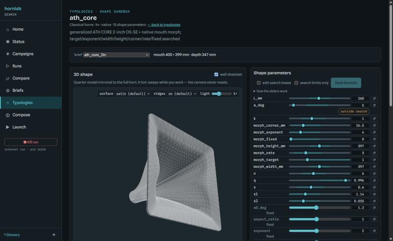
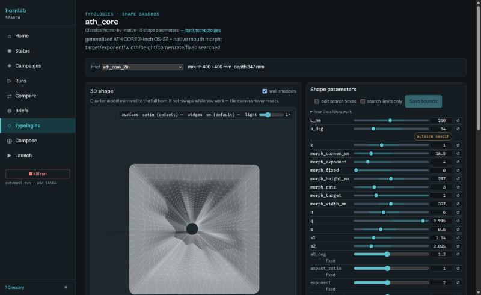
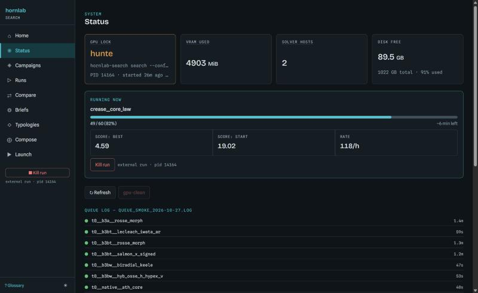
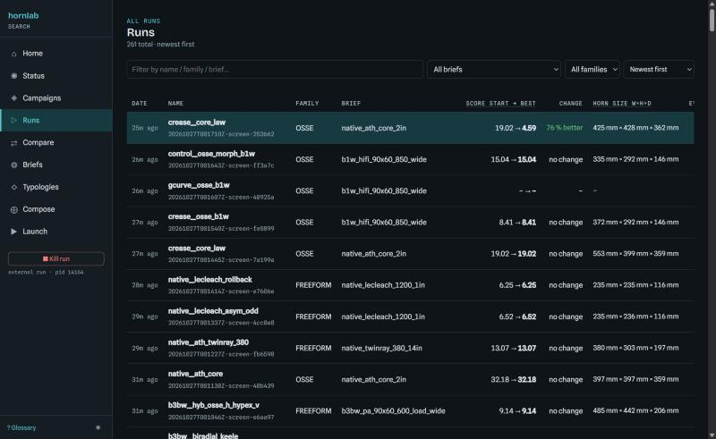
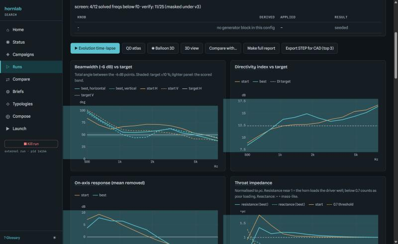

# hornlab-search

**Describe the horn you want. Let the computer find it.**

hornlab-search designs horn loudspeakers by goal instead of by guesswork. You say what you need,
for example *"90° × 60° coverage from 850 Hz up, a 1.4-inch driver, and it has to fit in
360 × 300 mm"*, and it builds candidate horns, simulates each one with real boundary-element
acoustics on your GPU, scores how close it gets, and evolves better shapes overnight.



## Why it's fun

- **Every serious horn family in one place:** OSSE and R-OSSE waveguides, Le Cléac'h, Salmon
  rollback and X-shape horns, biradial, tractrix and exponential classics, hybrids, freeform shapes,
  and Ath-style CORE / TwinRay designs.
- **The creased, sculpted look, on purpose.** The folded walls of Ath's CORE horns come from a
  coverage angle that changes with direction. Here that's a set of searchable knobs, so the
  optimizer can explore folds, lobes and Morph-squared mouths, not just smooth trumpets.
- **A real shape sandbox.** Pick any typology, drag a slider, and watch the side view, mouth outline
  and 3D horn update live. Switch to "search limits only" to see exactly what a run can reach.
- **Honest physics.** Every candidate gets a full 3D acoustic solve: beamwidth, directivity, on-axis
  response and throat loading. The solver is checked against an exact analytic case and a second,
  independent solver.
- **Runs overnight, shows up in the morning.** Queue a night of searches; every run lands in the
  GUI with leaderboards, curves, an evolution time-lapse and STEP export for CAD or 3D printing.



## What it looks like

| Live overnight run | Every run, ranked |
|---|---|
|  |  |



## How it works, briefly

1. **A brief** fixes the driver, the size you can build, the target coverage and the frequency band.
2. **A typology** is a horn family with knobs (angles, lengths, flare laws, mouth shape).
3. **The search** (CMA-ES) tries designs, meshes each one, solves it on the GPU and scores it.
4. **The GUI** shows the results as they come in.

It is a search layer over the HornLab packages (geometry/meshing and the GPU and CPU boundary-element
solvers); it never re-implements a solver or mesher. License: **AGPL-3.0-or-later**.

## Install

```powershell
.\.venv\Scripts\python.exe -m pip install -e ".[dev,crosscheck]"
```

Requires Python `>=3.11,<3.14`, a recent NVIDIA driver (the CUDA runtime is provisioned
automatically), and Julia 1.12 via juliaup. See `TOOLCHAIN.md` for the pinned dependency SHAs and
measured machine numbers.

## Status (2026-10-26, pre-beta)

- **Solver verified** on the GPU (2026-10-22): GPU tests 18/18; analytic pulsating sphere within
  0.020 dB; GPU (`beat_cuda`) vs CPU (`bempp_cpu`) cross-check within 0.039 dB.
- **Typologies** (41 in `examples/catalog.yaml`): native OSSE, R-OSSE, ICW and FREEFORM families,
  plus generator families (conical, exponential, hyperbolic-exponential, tractrix, biradial,
  Le Cléac'h, Salmon, hybrids, monotone perturbations). Every one is a YAML config with a seed and
  search bounds. Our FREEFORM implementations match the mesher's own evaluator within 0.2 mm.
  Le Cléac'h was re-enabled on 2026-10-25 after its research dossier landed
  (`docs/research/typologies/`); the R9 rule still stands — nothing ships under a published name
  without a verifiable reference.
- **Per-direction walls and guiding curves**: native OSSE can search the ATH CORE construction
  (`a(p)`, `n(p)`, `s(p)` as superformula expressions — the `az_*` knobs) and an OS-SE guiding
  curve (`gcurve_*`, superellipse or superformula). Those are the mechanisms behind the creased
  CORE / TwinRay walls. Search boxes are physical ranges, not the constraint: the brief envelope
  and mesh validity are (`tools/widen_campaign_boxes.py`).
- **Briefs** (`examples/briefs/`) fix the driver exit, size envelope, target and weights so
  typologies are compared on one objective; the 2026-10-26 campaign set adds the objective-v3
  K-law f0 (plus a separate f0_v for wide horns). Screens are coarse rankings — a "family A beats
  family B" claim needs the two-seed `compare` tier.
- **Dataset**: 6,055 solved or failed records (OSSE, R-OSSE, ICW, FREEFORM), `dataset verify` OK.
  The surrogate (fast-prediction) model is not active: its gates failed on too little data.
  Caveat: objective-v3 runs currently write `search.ndjson` + `best.json` but **not** dataset
  records (`dataset/record.py` accepts v1/v2 only) — fix owed.
- **Overnight runs**: `tools/run_campaign_night.py` reads a runtime night YAML
  (`runs/nights/<night>.yaml`, not committed) and runs its jobs strictly sequentially — one GPU
  job at a time, per-job hygiene, timeouts and a `summary.jsonl`. The runs and their leaderboards
  appear in the GUI automatically.
- **Beta readiness pass** in progress (`docs/HANDOFF_BETA.md`); results go to
  `docs/evidence/BETA_READINESS.md`.

Known limits: free-standing horn, no baffle, room or enclosure; rigid lossless walls, no air
absorption; rigid uniform-velocity spherical-cap source (no phase plug or compression chamber);
the objective reads the **H and V planes only**, so diagonal (45°/135°) behaviour — exactly what a
creased wall changes — is not scored; coverage is graded to 8 kHz at 12,000-dof caps with the fused
CUDA path (measured ceiling on the 8 GB card: 8 kHz safe to a ~474 mm mouth, 10 kHz to ~353 mm,
≥550 mm at 8 kHz is memory-saturated); 12 log-spaced screen frequencies cannot see narrow
resonances.

## Commands

```powershell
.\.venv\Scripts\hornlab-search.exe doctor     # environment self-check (exit 0 = healthy)
.\.venv\Scripts\hornlab-search.exe families --brief examples\briefs\axi_90x90_1in.yaml
.\.venv\Scripts\hornlab-search.exe campaign --brief <brief> --families <names|group|all> --tier dry-run|screen|compare
.\.venv\Scripts\hornlab-search.exe gpu-clean  # clear this project's Julia / BEAT hosts, print VRAM
```

| Command | Does |
|---|---|
| `doctor`, `version` | environment self-check; version |
| `families` | list typologies and whether each fits a brief |
| `campaign` | run several typologies under one brief and write a leaderboard |
| `run`, `search`, `verify` | evaluate a seed; CMA-ES search; re-solve the top designs at verify fidelity |
| `report`, `compare` | HTML report of a run; how far two solved runs disagree |
| `export-step` | closed STEP solids (mm) for CAD or 3D printing |
| `selftest` | analytic sphere and GPU-vs-CPU cross-check |
| `dataset`, `surrogate` | dataset verify / stats; phase-2 surrogate (inactive) |
| `gpu-clean` | clear stale solver hosts |
| `gui` | local web GUI at http://127.0.0.1:8765: status, campaigns, runs, compare, briefs, launch, evolution time-lapse, 3D view, and a **typology sandbox** (drag any knob and watch the H/V section and the 3D horn update live; save new search bounds) with parameter tooltips generated from the catalog |

Only one GPU job runs at a time: a second GPU command fails fast with `GPU busy: ...`.
Overnight batches go through `tools/run_campaign_night.py --night runs\nights\<night>.yaml` (same
rule — jobs run sequentially, with per-job hygiene, timeouts and a `summary.jsonl`).
New users start at `docs/BETA_QUICKSTART.md`.

## The one artifact to back up

`dataset/` is gitignored but precious: it is the only artifact here that costs GPU-hours to
regenerate, and it is the entire prerequisite for phase 2. **Back up `dataset/`.**

## Docs

- `docs/plan/` — the frozen plan and contracts. Start at `docs/plan/00_ORCHESTRATOR.md`.
- `docs/CONTINUITY.md` — current wave, last checkpoint, next step, measured numbers.
- `docs/ISSUES.md` — mirror of the open GitHub issues.
- `docs/reference/PARAMETERS.md` and `docs/reference/TYPOLOGIES.md` — **generated** from the code and
  the YAMLs (every knob's meaning, hard limits, per-typology seed and search range). Regenerate with
  `tools/gen_param_catalog.py --write`; `--check` fails on drift.
- `docs/evidence/` — measured runs, one dated document per pass; `docs/evidence/README.md` indexes them.
- `docs/BETA_QUICKSTART.md` — first loop for beta testers; `docs/TYPOLOGY_PLAN.md` — typologies and briefs.
