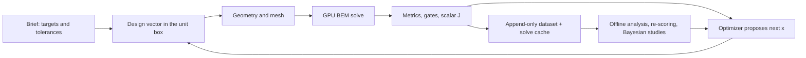

# Collaborator handoff, 2026-11-14: what was built, with the optimization side first

**Who this is for:** a collaborator with an applied-mathematics background, not a loudspeaker
background, who is pulling `main` and the Hugging Face data today. The acoustics is kept to what
you need to read the optimization problem. Everything here points at a file you can open.

**State of the repo at handoff:** every code change of the last three weeks is merged into `main`
(PRs #47-#58). Branches that never merged are listed in section 8 with the reason. The data is on
Hugging Face (section 7), refreshed 2026-11-14 with 31,287 rows (26,317 ok). Superseded plans and handoffs moved to `docs/archive/2026-11-14/`.

---

## 1. The problem in one paragraph

We design horn loudspeakers (the flared waveguide in front of a compression driver) by search. A
**brief** states what the horn must do: a coverage angle (for example 80 degrees horizontal by 60
vertical), a frequency band, a throat size and a few tolerances. A **design** is a vector of
roughly 10-20 continuous geometry parameters (length, flare angles, morph rates, profile
exponents). For each candidate we build a surface mesh, solve the acoustic wave equation with a
**boundary-element method (BEM)** on the GPU, and get the sound field at many angles and
frequencies. From that field we compute a handful of metrics and combine them into one scalar
**J** (lower is better). An optimizer proposes the next design. One evaluation costs about
**40-60 s on the GPU** at screening fidelity (6-8k unknowns, 18 frequencies;
`docs/evidence/SPEED_ADOPTION_2026-11-14.md`) and about **10 minutes on the CPU lane**. A
typical run is 200-1,300 evaluations.

So, mathematically: **expensive, deterministic but discretization-noisy, black-box minimization
over a box in about 13-20 dimensions, with hidden infeasible regions and a budget of a few hundred
evaluations.** That is the setting every algorithm below lives in.



## 2. The objective J, as a mathematician would want it

J is a weighted sum of tolerance-normalised penalty terms plus hard penalties:

```
J(x) = sum_k  w_k * term_k(x) / tol_k  +  penalty(x)
```

- **Terms** (`hornlab_search/objective/`): coverage error (beamwidth vs target, per plane), ripple
  (detrended frequency-to-frequency wobble), directivity-index level and slope, on-axis flatness,
  throat loading (how well the horn loads the driver near its cutoff), diagonal-plane behaviour.
  Each version (v4, v6, v7, v8 proposal) is a separate file; the brief selects the version.
- **Normalisation:** since v4, every term is divided by an owner-set tolerance, so `term/tol = 1`
  means "exactly at the acceptable limit". This made terms comparable and J roughly unitless.
- **Infeasibility:** designs the mesher refuses, or meshes too large for the GPU, become failed
  rows. Historically a failure was written as J = 1000. The Bayesian code refuses to train on these
  as if they were real function values (see section 5).
- **Important consequence:** the solve cache is keyed on geometry and solver settings, **not on the
  objective**. Any stored solve can be re-scored offline under a different objective in
  milliseconds. You can experiment with objective design without a GPU
  (`hornlab_search/objective/replay.py`, `tools/analysis/offline_scores.py`).
- **Measured caution:** re-scoring 22,928 stored rows under two objective versions gave
  Kendall tau of only 0.08-0.32 between their rankings, and top-20 overlap of 0-5 designs
  (`docs/evidence/RESCORE_V6_V7_2026-11-12.md`). What "best" means depends heavily on the
  weights and tolerances. That makes objective choice a first-order modelling decision, not a detail.

## 3. The optimizers that exist today

| Algorithm | Where | Status | Notes |
|---|---|---|---|
| **CMA-ES** | `search/cma.py` (pycma) | Production default | Unit box `[0,1]^k`, bounds clipped in `DesignSpace.denormalize`. Budget counts only non-cached evaluations. Resume is deterministic: same seed, same candidates, cached replays are free. |
| **IPOP/BIPOP restarts** | `search/cma.py` | Shipped | Mirrors pycma's restart schedules. |
| **CMA-ME quality-diversity "atlas"** | `search/cma_me.py` (pyribs 0.12) | Shipped, opt-in | Grid archive over two descriptors; fills a map of good-but-different designs instead of one optimum (Fontaine 2020). |
| **NSGA-II** | `search/nsga.py` | Implemented, parked | Needs ~10^4 evaluations, so only realistic with a surrogate evaluator. |
| **Warm start** | `search/warmstart.py` | Shipped 2026-11-12 | CMA mean from the best prior design; `sigma0` from the spread of the top-k. Refuses cross-objective/cross-brief data unless explicitly allowed. |
| **Linked knobs** | `search/links.py` | Shipped 2026-11-12 | Removes a dimension by making it affine in a parent knob. |
| **Budget heuristic** | `search/budget_heuristic.py` | Shipped | Hansen-grounded budget suggestions (`lambda = 4 + 3 ln N`, about `100 N` evaluations per run). |
| **Neural surrogate (MLP ensemble) + ISMO** | `surrogate/` | Inactive | Its rank-correlation acceptance gate failed on available data; the code refuses to be used until it passes. |
| **Bayesian optimization (BoTorch)** | `bo/`, `studies/` | **New, integrated, pilot-verified** | Section 4. |

## 4. What the BoTorch work added (the main new thing)

Short version: **a careful, reproducible Bayesian-optimization study system that sits beside CMA-ES.
It does not replace it.** It is protocol `bo-study-v1.1`. The design emphasis was "never fabricate
a number": every failure is a tagged result, not a guessed value.

### 4.1 The model and acquisition (locked spec, `hornlab_search/bo/`)

- **Surrogate:** `SingleTaskGP` on `Y = -J`, `ConstantMean`, `ScaleKernel(Matern nu=2.5, ARD)`,
  `Standardize` outcome transform. Lengthscale bounds `[0.005, 4]` (init 0.25), outputscale
  `[1e-3, 1e3]`, fixed observation noise `1e-6 * var(J)`, one exact-MLL fit (100 iterations max),
  float64 on CPU (`bo/model.py`).
- **Acquisition:** `qLogNoisyExpectedImprovement`, observed training X as baseline, 128-sample
  scrambled-Sobol QMC sampler, scored with q = 1 (`bo/acquisition.py`).
- **Candidate set:** no continuous inner optimization. A frozen **finite pool of 4096
  scrambled-Sobol points** is generated once and only cheap checks (geometry builds, envelope,
  throat) are applied. The acquisition is maximized over the legal remainder (`bo/data.py`,
  `bo/propose.py`). This keeps the proposal reproducible and avoids proposing unbuildable shapes.
- **Exploration:** every 4th proposal is a maximin (space-filling) pick from the same pool. The
  counter survives resume.
- **Encoding:** an audited "active projection" drops parameters that are provably no-ops for the
  task (for example `morph_exponent` when `morph_target = 1`); the example task is d = 13
  (`bo/encoding.py`). This came out of a parameter-activity study
  (`docs/evidence/bo_study_2026-11-12/s4/parameter_study.md`).
- **Training data:** only one task, one objective version, one backend, one fidelity. Rows are
  deduplicated by geometry; failed rows are never regressed as J = 1000 (`bo/data.py`,
  `bo/cohort.py`).
- **Other policies (APIs exist, not yet in production runs):** `pareto` (coverage vs ripple
  frontier; `bo/pareto.py`), `cma_seed` (hand a seed pack to CMA), `exploration` (pure
  space-filling), and opt-in constraint/cost/trust-region components (`bo/extensions.py`).
  Dispatcher: `bo/policy.py`.

### 4.2 The study workflow (`hornlab_search/studies/`)

A **study** is a question plus a frozen data snapshot. It goes: snapshot, analyze, propose,
**package** (an immutable, hash-addressed run plan with a fixed budget), run, verify, decide.
Budget per package: 18 screening solves + 6 verification/audit solves = 24 solves, at most 120
attempts. The runner refits the GP after each screen. At the end, 4 finalists plus 2 random
audits are re-solved at higher fidelity to check that the screening result holds up. A crash or
ambiguous attempt keeps its budget reservation; nothing is solved twice silently. The GUI exposes
all of this under **Analysis -> Studies**. Runbook: `docs/BAYESIAN_STUDIES_RUNBOOK.md`.

### 4.3 What has been measured (`docs/evidence/BAYESIAN_STUDY_INTEGRATION_2026-11-14.md`)

- Task: an 80x60 degree horn, objective v7. 64 training observations chosen from 185 compatible
  rows; pool kept 1692 of 4096 points after cheap checks.
- Live pilot: 18 screens + 6 verify/audit solves, all 24 completed. Re-scoring every stored result
  with the canonical scorer gave the same score (max difference 0). Best screen J = 3.105.
- **What this is not:** it is an integration test, not evidence that BO beats CMA-ES. No matched
  comparison has been run yet. That comparison is the obvious next study (section 6).

### 4.4 Environment

BoTorch/GPyTorch/Torch are optional and imported lazily. Normal installs never import them, and
calls return a tagged `capability_missing`. The working interpreter on the owner machine is an
isolated venv (`../oc-wt/bo-study/bayes-venv`), rebuilt with `pip install -e ".[bayes,dev]"`.
The GP runs on CPU; only the BEM solve uses the GPU.

## 5. Other analysis and data work you will see

- **Experiment catalog and cohorts** (`docs/evidence/bo_study_2026-11-12/s0/`): which stored rows
  are comparable (same objective, brief, solver pins, fidelity). Most of the 25k rows are not
  mutually comparable, and the tooling says so instead of pooling them.
- **Seed variance and A/B rules** (`.../s3/`): a pre-declared paired-difference rule with bootstrap
  confidence intervals. Five pairs is labelled a pilot, not significance.
- **Sensitivity** (`.../s4/`, `docs/research/compute_study_2026-11-12/`): Spearman knob
  sensitivities per run, plus a run inventory (414 runs, about 29k evaluations) and a compute
  allocation plan. These are descriptive. The compute study's scripts are included but expect the
  owner machine's `runs/` tree.
- **Quality-diversity comparison and hypothesis cards** (`tools/analysis/qd_compare.py`,
  `hypothesis_cards.py`, `geometry_descriptors.py`): equal-cost comparisons between search arms, and
  structured "combine parent A and parent B" design hypotheses with ablations.
- **Surrogate validation** (advisory): held-out split, Brier score for feasibility, out-of-domain
  flags. Shown in the GUI Analysis page.
- **Solver speed:** a fork change to the GPU solver cut whole-candidate time by 25-28% with
  results identical to about 1e-5 dB (`docs/evidence/SPEED_ADOPTION_2026-11-14.md`). Mesh-size
  caps were raised from 12k to 24k unknowns on the live configs after measuring memory.

## 6. Where BO could go next (open problems that fit your background)

Ordered roughly by value per effort. None of these is started.

1. **Matched BO-vs-CMA benchmark.** Same task, same budget, several paired seeds, fixed-budget and
   fixed-target reporting (ECDF/ERT, IOHprofiler style), failures counted. This is the experiment
   that decides whether BO earns a place in the default loop. The seed-variance tooling (s3) and
   the CMA-ME comparison rules already exist.
2. **BO as CMA's initializer.** Use the GP to choose CMA's starting mean and step size (the
   `cma_seed` policy exists, with no score math yet). It is cheap to test and keeps CMA's robustness.
3. **Feasibility as a separate classifier.** About 16% of stored rows are failures (4,800 failed vs
   25,294 ok at the last data snapshot). A GP classifier or constrained acquisition
   (`bo/extensions.py` has the signed-margin pieces) could stop spending solves on unbuildable or
   oversize meshes.
4. **Multi-objective.** Coverage and ripple trade off. `bo/pareto.py` has the frozen reference
   point and policy; qLogNEHVI over raw coverage/ripple is specified but not run in production.
5. **Multi-fidelity and cost.** Screen vs verify fidelity are **discrete** (different mesh policy and
   frequency grid), not a smooth fidelity scalar. Cost varies with mesh size. A cost-aware or
   discrete multi-fidelity acquisition is a natural fit. The plan says to model these explicitly.
6. **Transfer across briefs and objectives.** Today the GP is single-task. Because solves can be
   re-scored under any objective offline, there is a lot of cheap cross-task data. Multi-task GPs or
   learned priors across briefs are open.
7. **Trust-region BO (TuRBO)** on a bounded subspace, benchmarked against warm-started CMA.
8. **Robustness of finalists.** Small manufacturing perturbations around a finalist, comparing a
   quantile or worst case to nominal. This is specified as a later study; it needs real solves.

Constraint to remember: **one GPU, one solve at a time** (plus one CPU-lane search). Batch
acquisition (q > 1) only helps if you queue the batch; there is no parallel solve.

## 7. Getting the data

- **GitHub:** `main` of `llevaachingada/Hornfab` has the code, docs and small evidence files.
- **Hugging Face dataset:** <https://huggingface.co/datasets/chingadalleva/hornlab-search-data>.
  It holds sharded tars of the dataset rows (`dataset-*.tar`), the solve cache (`solve-*.tar`) and
  the readable run outputs (`text-*.tar`). Download and verify per
  `docs/COLLABORATOR_PULL_RUNBOOK_2026-11-02.md` (`tools/hf_sync.py pull-all`). Upload records:
  `docs/evidence/HF_UPLOAD_2026-11-13.md` and `docs/evidence/HF_UPLOAD_2026-11-14.md`.
- Without a CUDA GPU you can still re-score, analyze, fit the GP and propose. Only new solves need
  the GPU box.

## 8. Branches not merged into main (deliberately)

| Branch | Why it is not in main |
|---|---|
| `solver-speed-orch2` | C1 rear-density mesh audit and 16 study configs; superseded by the adopted speed program, kept for reference. |
| `docs/data-ga-plan-2026-11-12-v2` | Earlier draft of the governing data/GA plans; final versions are in `docs/research/`. |
| `beta-fixes` | One research-note commit (Solana section 11 amendment) from 2026-10-30; not needed on main. |
| `archive/dev-fused-cuda-pin` | Pins the solver to a local `file://` fork URL. Never mergeable, by design. |
| `archive/swarm-F-2026-10-31`, `archive/swarm-H-2026-10-31` | Rescued untested work-in-progress from parallel agents. Kept so nothing is lost. |
| `archive/backup-consolidation-L1`, `archive/backup-consolidation-T` | Backups taken before the 2026-11-12 data consolidation. |

## 9. Reading order

1. This file.
2. `docs/research/COUNCIL_REVIEW_AND_IMPL_PLAN_2026-11-12.md`, sections 1, 4.5 and 5: the plan
   behind the analysis and BO work, with the literature table.
3. `docs/research/BAYESIAN_STUDY_ORCHESTRATOR_SPEC_2026-11-12.md`: the locked BO spec.
4. `docs/BAYESIAN_STUDIES_RUNBOOK.md` and `docs/evidence/BAYESIAN_STUDY_INTEGRATION_2026-11-14.md`.
5. `docs/CODE_MAP.md` rows for `bo/`, `studies/`, `search/`, `objective/`.
6. `docs/CONTINUITY.md` (newest entries first) for the day-by-day record.
