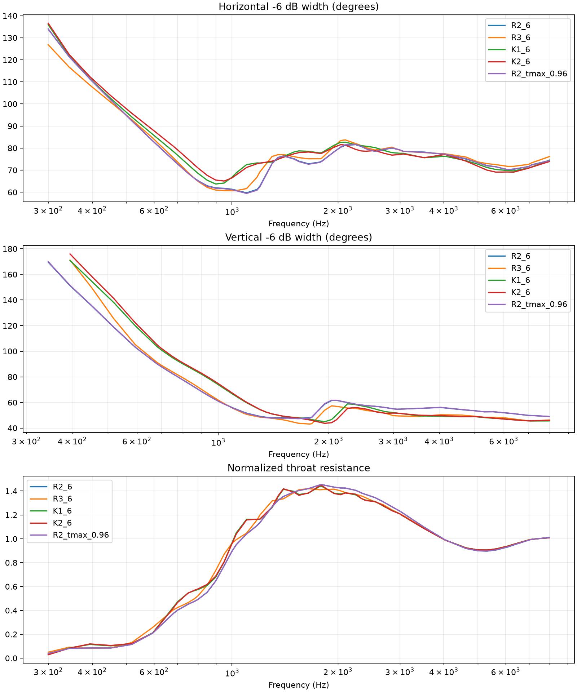

# Sculpted home-900 V11 BEM readout

Home 900 Hz V11, fixed 51-frequency observation grid, 36 mm source, freestanding quarter model

## Acceptance and scoring identity

The [normal Runs entry](http://127.0.0.1:8765/#/run/20261121T132642Z-verify-e78fc6) registers R2’s actual CUDA measurement without spending another solve. Its exact replay gives J 3.106326646919, full-balloon status and finite raw CD terms of 0.407262 `cd_lw`, 0.423419 `cd_di_std`, 0.353640 `cd_nacc` and 0.803429 `offaxis_smooth`. The saved response contains complex H, V and balloon pressure and complex throat impedance. The [packaging parity record](packaging_parity.json) shows identical J and terms under the primary and advisory briefs. It records the staged result separately. [R0 offline replay](r0_offline_replay.json) evaluates the historical response under V11 on its own grid. It is outside the matched ranking.

The [dedicated queue](../../queue/sculpted_xo900_acoustic_discovery_2026-11-21.yaml) finished 7/7 at 08:30 EST. It registered six measured controls and ran one new GPU solve. The matched comparison reuses the original augmented verify observation tier of 51 frequencies and 6 epw baseline meshes. A broader discovery cohort would use one common screen tier and refine only qualifying comparisons.

## Matched measured controls

| Case | epw | J | H RMS error | V RMS error | CD method |
|---|---:|---:|---:|---:|---|
| R2_6 | 6 | 3.1063 | 5.21 | 5.86 | full balloon |
| R3_6 | 6 | 2.6940 | 4.47 | 4.10 | full balloon |
| K1_6 | 6 | 3.1530 | 5.13 | 4.11 | full balloon |
| K2_6 | 6 | 3.0966 | 5.50 | 3.53 | full balloon |
| R2_7 | 7 | 3.0986 | 5.20 | 5.86 | full balloon |
| R3_7 | 7 | 2.6922 | 4.48 | 4.09 | full balloon |
| K1_8 | 8 | 3.1385 | 5.12 | 4.10 | full balloon |
| K2_8 | 8 | 3.0826 | 5.49 | 3.51 | full balloon |
| FAV | 6 | 3.3668 | 8.05 | 11.22 | full balloon |
| k-home | 6 | 2.9968 | 13.13 | 8.62 | full balloon |
| ext-OSSE | 6 | 2.9247 | 11.55 | 4.15 | full balloon |
| R2 native truncation | 6 | 3.1289 | 5.25 | 5.94 | full balloon |

R2/R3 and K1/K2 comparisons use the same frequency and observation grid. K2 changes both finishing and the projected mouth, so the pair assesses the complete finish.

6 to 7 or 8 epw changes mesh and source discretization. This single refinement comparison does not establish a general numerical floor.

The JSON includes all weighted score terms, actual solved bins, preferred-pattern errors, 30/45-degree H/V cuts, lobe checks, complex-impedance components and source identity. Complex far-field pressure is reported where stored. Mouth pressure was not captured.

B3 v7 and Crowe 700 Hz v11 experiments have different identities and are excluded.

## Native rollback and roundover decision

The [R2 truncation probe](http://127.0.0.1:8765/#/run/20261121T132819Z-verify-e3efb5) ran fresh in 126.7 GPU seconds. Moving native `tmax` to 0.96 raised J by 0.02256 at 6 epw. Source connectivity matched and the maximum source-node drift was 0.00000114 mm. The test changes the termination along with the native radius refit and body, so its single-tier delta provides no reason to advance this control. [Measured pairs and pattern values](measurements.md) · [Native R-OSSE construction](https://at-horns.eu/release/R-OSSE%20Waveguide%20rev7.pdf).

The installed `hornlab_mesher.builders.point_grid_freestanding._freestanding_mouth_closure_points` stacks corresponding inner and outer endpoints for a ruled closure. The GRID route supplies the two sheets and exposes no separate curved closure. A specified-radius physical roundover still needs a versioned transition surface with tangent continuity and shell clearance, followed by a matched BEM measurement. The native probe is a different construction.

Retain R3’s stronger body sweep as the lead for further fixed-candidate checks. K2’s complete finish and the K axial-only probe warrant continued study of the geometry and directivity tradeoffs. Keep Crowe C1/C2 held at the source and shell gates. No CMA campaign is admitted.
