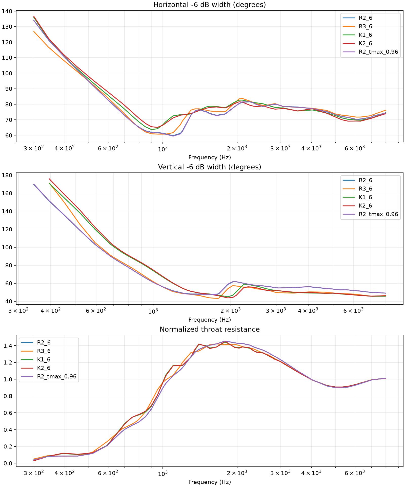

# Sculpted home-900 V11 BEM readout

Home 900 Hz V11, fixed 51-frequency observation grid, 36 mm source, freestanding quarter model

| Case | epw | J | H RMS error | V RMS error | CD method |
|---|---:|---:|---:|---:|---|
| R2_6 | 6 | 3.1063 | 5.21 | 5.86 | full balloon |
| R3_6 | 6 | 2.6940 | 4.47 | 4.10 | full balloon |
| K1_6 | 6 | 3.1530 | 5.13 | 4.11 | full balloon |
| K2_6 | 6 | 3.0966 | 5.50 | 3.53 | full balloon |
| R2_7 | 7 | 3.0986 | 5.20 | 5.86 | full balloon |
| R3_7 | 7 | 2.6922 | 4.48 | 4.09 | full balloon |
| K1_8 | 8 | 3.1385 | 5.12 | 4.10 | full balloon |
| K2_8 | 8 | 3.0826 | 5.49 | 3.51 | full balloon |
| FAV | 6 | 3.3668 | 8.05 | 11.22 | full balloon |
| k-home | 6 | 2.9968 | 13.13 | 8.62 | full balloon |
| ext-OSSE | 6 | 2.9247 | 11.55 | 4.15 | full balloon |
| R2_tmax_0.96 | 6 | 3.1289 | 5.25 | 5.94 | full balloon |

R2/R3 and K1/K2 comparisons use the same frequency and observation grid. K2 changes both finishing and the projected mouth, so the pair assesses the complete finish.

6 to 7 or 8 epw changes mesh and source discretization. This single refinement comparison does not establish a general numerical floor.

The JSON includes all weighted score terms, actual solved bins, preferred-pattern errors, 30/45-degree H/V cuts, lobe checks, complex-impedance components and source identity. Complex far-field pressure is reported where stored. Mouth pressure was not captured.

B3 v7 and Crowe 700 Hz v11 experiments have different identities and are excluded.

