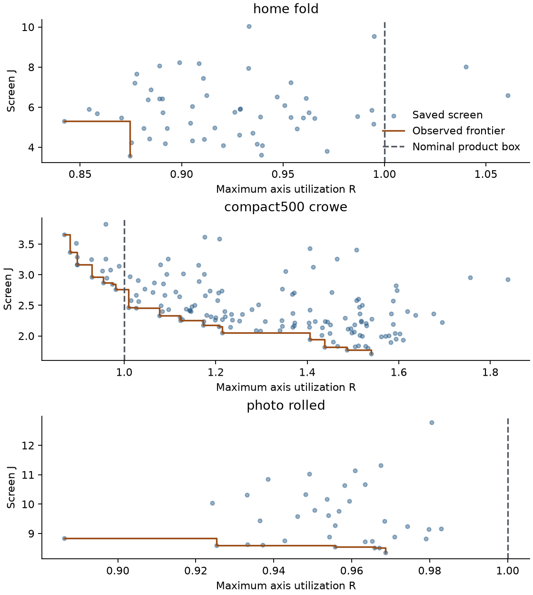

# Offline size and score baseline

Reproduce from the repository root with `.venv\Scripts\python.exe docs/evidence/size_aware_2026-11-24/baseline.py --plot`. The input run paths and SHA-256 hashes, exclusion counts, identities, individual observations, region minima and frontiers are in [baseline.json](baseline.json). Input runs are local artifacts.

Each comparison stays within a single run and identity. A digest of the saved run config identifies the Home Fold snapshot because its rows lack the recorded brief hash. The records preserve score, source, mounting and mesh-grid fields. All three cohorts use saved screening simulations.

Dimensions use the unrounded, mirrored quarter-domain `bbox_m`. Width and height are twice the maximum absolute transverse coordinate. Depth is the axial extent. Box litres are width × height × depth. The saved `build_box_m` adds estimated material clearances separately. The frontiers summarize J against volume or maximum axis utilization. The bins describe the sampled designs.

| Saved screen cohort | Eligible / excluded | R ≤ 1.00 | R ≤ 1.05 | R ≤ 1.15 | R ≤ 1.25 | Full saved region |
|---|---:|---:|---:|---:|---:|---:|
| Home Fold | 55 / 3 invalid geometry | 53 / 3.56950 | 54 / 3.56950 | 55 / 3.56950 | 55 / 3.56950 | 55 / 3.56950 |
| Compact500 Crowe | 152 / 0 | 17 / 2.75785 | 25 / 2.45857 | 47 / 2.25051 | 72 / 2.04828 | 152 / 1.70512 |
| Home photo rolled | 36 / 0 | 36 / 8.35481 | 36 / 8.35481 | 36 / 8.35481 | 36 / 8.35481 | 36 / 8.35481 |

Each size cell gives the accumulated observation count and best screen J. The historical search cohorts contain zero verify observations. New paired Crowe verification is below, and the rolled verification is in [DIRECTIVITY_VERIFY.md](DIRECTIVITY_VERIFY.md).

The Compact500 product-region lead was `fbaa37e52eb9`, approximately 490 × 444 × 274 mm. The broad discovery lead `138f09ce5472` was about 770 × 548 × 393 mm. The 1.25 region recovers part of the observed screening gain. The three regions above 1.05 mix changing geometry and unequal observation counts, which prevents a causal or diminishing-returns estimate. Home Fold's smallest-J observation has R ≈ 0.875 and the sampled larger designs do not beat it. This analysis is descriptive and makes no GP training-admission claims.

## Compact500 Crowe matched verification

The CPU preflight found 4,037 / 5,654 / 7,777 used nodes for the three saved candidates. All passed the existing DOF, topology and source checks. The [three-job queue](../../queue/size_aware_crowe_verify_2026-11-24.yaml) used fixed saved recipes, fresh caches and the original open brief for each. The stored settings match on BEAT CUDA dependency pins, source, target, weights, resolution and the 29-frequency verify grid with balloon DI. The bracket names describe the size of selected existing designs.

| Region | W × H × D (mm) | R | Screen J | Verify J | DOF | Solve / wall time |
|---|---:|---:|---:|---:|---:|---:|
| Product | 490.4 × 444.1 × 274.0 | 0.981 | 2.75785 | 2.69414 | 4,037 | 31.8 / 55.3 s |
| ε ≤ 1.25 | 607.3 × 475.9 × 342.6 | 1.215 | 2.04828 | 1.97593 | 5,654 | 54.8 / 77.6 s |
| Discovery | 770.0 × 547.8 × 393.5 | 1.540 | 1.70512 | 1.60832 | 7,777 | 93.4 / 117.2 s |

All three completed. GPU memory started and returned to 1,206 MiB for each job. The runner observed 1,493, 1,653 and 1,877 MiB peak GPU memory, respectively. Total recorded job wall time was 250.1 s. Reproduce the matched identity checks and timing with `.venv\Scripts\python.exe docs/evidence/size_aware_2026-11-24/crowe_verify.py`. [Machine record](crowe_verify.json)

The 607 mm candidate retained about two thirds of the observed verify J improvement between the 490 mm and 770 mm designs, at about two thirds of the latter's verification wall time. All three originate from one campaign and differ in more than size. This is a finalist comparison. Multi-seed optimizer performance, spatial mesh convergence and manufacturing fit of these parts require separate evidence.
