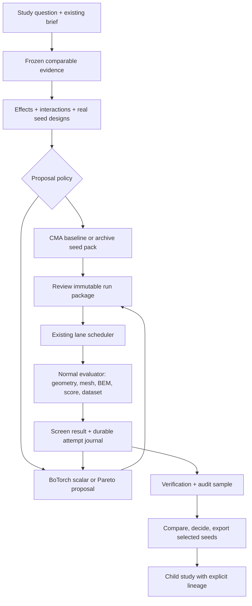

# Bayesian design studies: locked implementation and GUI specification

**Status: designed, not implemented. Owner-directed expansion, 2026-11-12.** This is the execution specification for the BoTorch and persistent GUI-workflow track of [the reviewed plan](COUNCIL_REVIEW_AND_IMPL_PLAN_2026-11-12.md). The [prompt pack](DATA_GA_IMPLEMENTATION_PROMPTS_2026-11-12.md) contains an orchestrator block and bounded parallel-worker blocks. This document resolves the core integration and mathematical choices; implementation workers must not substitute their own algorithms, signs, targets or workflow.

**Product outcome:** one persistent **Design Study**, from a question about a horn through comparable evidence, parameter explanations, candidate proposals, scheduled solves, verification, a recorded decision and the next study. BoTorch becomes a planned proposal engine inside this workflow. CMA remains the experimental baseline; existing analysis, surrogate, run, dataset and verify code remains in use.

**Protocol ID: `bo-study-v1.1`.** [The horn-optimization hardening decision](HORN_OPTIMIZATION_HARDENING_2026-11-12.md) governs delivery: **M0 reusable data/rescoring + parameter audit → M1 existing-GUI explanation → M2 BoTorch proposals → M3 integrated workflow**. BoTorch and its full GUI/propose/run/verify feedback loop remain in the implementation scope. Build its pure adapter/fixtures in parallel once input/scoring contracts freeze; foundational gates sequence integration rather than remove it. No production cache/default/job changes in M0–M2, and no need for a new registry merely to produce the first report.

The constants below are engineering starting points to test, not universal scientific optima. Only the parent integrator may amend this protocol, with a versioned decision record and updated tests. Missing data or an API mismatch is an explicit gap for the parent; it is not permission for a worker to choose a different mathematical method.

## 1. The complete owner workflow

| Step | Owner sees/does | System captures | Next permitted action |
|---|---|---|---|
| Define | “Improve loading”, “reduce coverage error”, or “explore different shapes”; select an existing brief/config | Task, source/driver/mounting assumptions, score version, target, bounds, selected protocol | Save a draft study; no solve |
| Choose evidence | Comparable archived runs, counts, exclusions, available screen/verify data | Frozen cohort/snapshot; exact input identities and missingness | Analyze the chosen evidence |
| Understand | Per-metric knob effects, supported interactions, score decomposition, actual design examples | Analysis artifact linked to snapshot and method | Choose real seed exemplars; propose an experiment |
| Propose | “CMA seed pack”, “Bayesian next design”, or “coverage/ripple trade-offs”; explanation and uncertainty | Model/proposal/pool/seed IDs, predicted metrics, novelty/support, untested status | Inspect geometry/curves; prepare a run package |
| Review package | Domain, initial candidate, adaptive policy, budget, lane, verification allowance and stop rules | Immutable package hash and user launch event | Queue through the existing job/lane system |
| Run | Next predicted design → actual screen result, cost, refusal/failure reason; serial progress | Candidate/attempt journal, normal run/dataset/cache artifacts, model updates | Continue only inside the approved package limits |
| Verify | Finalists plus audit samples, paired curves, changed ranks, missing gates | Explicit parent/solve/fidelity links and provenance | Compare only supported/verified results |
| Decide | Paired improvement/cost, trade-offs, robust alternatives and unresolved evidence | Accept/reject/inconclusive decision with rationale; selected designs | Save a seed pack or fork a child study; no hidden default changes |

The “new idea” path uses the same study: select two compatible parent designs, record an acoustic hypothesis, choose an existing legal construction or a researched generator extension, compare parents/combination/ablations, then verify. A new idea card is not a solved horn.



The feedback arrow is allowed only while the reviewed adaptive run package remains valid and has budget. No GUI click on a chart starts a solve.

## 2. Fixed architecture and ownership seams

For M0–M2 use read-only analysis artifacts, the existing report/GUI paths and an optional pure advisory BO adapter. Do not create a database/job framework as a prerequisite. At M3, use new modules under **proposed** `hornlab_search/studies/` and `hornlab_search/bo/`; do not extend frozen `types.py` or replace `surrogate/`. These modules are additive application orchestration and proposal adapters, not solvers. Keep BoTorch optional and lazily imported. The normal GUI and CMA workflow must work when it is absent.

| Layer | Proposed files / owned responsibility | Must consume |
|---|---|---|
| Study domain | `studies/schema.py`, `store.py`, `service.py` | S0 comparability and artifact IDs |
| Data/encoding | `bo/data.py`, `encoding.py`, `metrics.py` | Existing `DesignSpace`/`GeneratedSpace`, records/provenance, target/scorer helpers |
| Bayesian engine | `bo/model.py`, `acquisition.py`, `propose.py` | Immutable numeric training set and candidate pool |
| Adaptive execution | `studies/runner.py`, `reconcile.py` | Normal evaluator, lane locks/env, dataset/cache and existing worker lifecycle |
| CLI | `studies/cli.py`; integrator-only registration in `cli.py` | Study service; validated argv, no shell strings |
| GUI adapter | `gui/data_studies.py`; integrator-only `server.py`/`jobs.py` wiring | Study service and existing job/run/verify APIs |
| GUI views | `static/studies.js` plus minimal shared app/chart hooks | Typed study view models; existing run/design/verify components |

The study registry is **not another acoustic dataset**. It stores identities, revisions, workflow events, proposed candidates, artifact references and decisions. Actual responses still live in normal runs/cache/dataset. Reports and the GUI read the same service layer and artifacts; neither recomputes score mathematics in JavaScript.

### Durability, revision and failure semantics

**M3 integration:** use stdlib SQLite for the planned durable workflow registry at `<study_root>/studies.sqlite3` and hash-addressed immutable artifacts. M0–M2 use immutable manifests/existing run links first. Persistence is implemented after its input/artifact contract is proven; it remains in the full plan and does not require a positive BO benchmark to write/test. The eventual study root defaults to `<root>/studies`, runtime/gitignored. Tests use temp roots; this planning pass creates no registry.

Registry tables: `studies`, `revisions`, `artifacts`, `jobs`, `proposals`, `attempts`, `decisions`, `events`. Store canonical JSON specs and references, not full response arrays. Use per-request connections, transactions, foreign keys, local-disk WAL and a bounded busy timeout. Schema migrations have explicit numbered versions and tests; no silent destructive reset. Publish artifact bytes atomically and verify their hash before committing a registry reference. Orphan/incomplete files remain unreferenced and are reported; no automatic deletion.

Separate **`spec_revision`** (the authorization/configuration revision exposed as `revision` in the user-facing API) from monotonic **`event_seq`** and per-run **`observation_seq`**. User edits to bound task/cohort/policy inputs carry `expected_revision` and update spec_revision conditionally. Progress, attempt journals, within-policy refits and result/verification attachments append events under the approved run/package identity without changing spec_revision. Polling is read-only. Otherwise the first progress update would invalidate the runner's own package.

Every mutating request has a scoped `idempotency_key`. Inside the transaction, check for a matching prior key/payload **before** rejecting an old expected revision: a retry after a lost successful response returns that original result. Reused key/different payload fails. New stale user edits get HTTP **409**. An approved package binds exact spec revision, **initial** snapshot/model/proposal, resolved config, numerical protocol, code/dependency pins, lane and budget. Its adaptive policy explicitly permits hash-linked child snapshots/models augmented only by this run's compatible measured observations. Manual source/cohort/domain/policy changes invalidate the package; the runner records any in-flight outcome but stops future dispatch. Display-only selections do not invalidate it.

Store stage status separately: `not_started`, `queued`, `running`, `complete`, `failed`, `interrupted`, `unknown`, `stale`. Derived readiness comes from artifact dependencies; a single overall “complete” flag cannot represent a partially verified study. A failed model fit can coexist with a usable evidence report. Keep partial results useful and visibly partial.

**Crash rule:** SQLite and external solver files are not one transaction. Persist an attempt intent before dispatch, reconcile process/lock/run/cache state afterward, and never claim exactly-once BEM execution. An uncertain in-flight attempt becomes `unknown`; it cannot automatically relaunch or spend another solve budget. Reconciliation or an explicit resumed package resolves it.

Before each backend invocation reserve one potential BEM-call unit durably; an unknown attempt retains that conservative reservation until evidence resolves whether the call occurred. A retry reserves another unit. Screen, verify and audit calls use the **same** attempt/reservation/journal/reconciliation mechanism and exact solve identity; verification is not an unjournaled afterthought. Recheck cache/already-verified identity after acquiring the lane and before dispatch. A crash after response persistence but before journal commit must recover the existing result or remain unknown, never silently solve again.

## 3. Locked numerical contract

### 3.0 Explainability baseline, before automatic search reduction

S4 first implements the parameter/activity and geometry bridge in the hardening decision, then uses `ExtraTreesRegressor(n_estimators=256, min_samples_leaf=5, max_features=1.0, n_jobs=1, random_state=analysis_seed)` for available physical outputs and frozen J. The 100 unique observations/five independent groups screen is an eligibility policy, not validation proof. Connected run/resume/duplicate-geometry groups stay together; if too few groups remain, return descriptive results. Use five-group-fold validation and report fold errors against the training-mean baseline; recommendations additionally require useful held-out performance and stable, supported effects. Do not split rows to force a pass. These gates are not prerequisites for a deliberately provisional BO research pilot.

Permutation importance uses held-out R² score loss with ten repeats and correlated-feature group permutations; never label it ΔJ. Keep raw, normalized and weighted objective terms separate and version-aware. For effect curves, use ten empirical quantile bins, merge adjacent bins until at least ten unique observations support a bin, and show actual observations plus model summaries. No causal label or automatic pinning.

For an initial interaction diagnostic, compute `D_ij=f(x+h*e_i+h*e_j)-f(x+h*e_i)-f(x+h*e_j)+f(x)` at prespecified normalized steps **0.025, 0.05 and 0.10**. ExtraTrees is discontinuous: these are finite model changes, not derivatives. All four endpoints must be legal, respect activity predicates and have geometry/support records. Keep nearest-training distance and the 95th percentile cutoff as diagnostics, not proof of joint support; inspect projected 2D support and independent-group coverage too. Deduplicate anchors, report excluded/boundary anchors, and use 20 anchors only as an eligibility screen. Compare median absolute change/sign/pair ordering across steps and fold/group fits; suppress unstable or unsupported rankings. Add additive-tree, correlated-manifold, conditional/no-op and known-coupling fixtures. This is local model nonadditivity, not fANOVA, a causal acoustic interaction or a p-value; unsupported pairs say `not_estimable`.

Do not remove a dimension or impose a hard link automatically. The next step for a promising pair is a prepared 2×2 intervention around legal actual designs, under the same physical task and validation policy. ALE/fANOVA may be added later under their own versioned estimator spec; they are not interchangeable names for this first diagnostic.

### 3.1 First real task and eligible data

Before fitting any advisor, freeze the three identity layers: immutable physical solve/raw response; target-dependent regenerated metrics; version/brief/weights/tolerances/gates/code-specific score table. R0 must replay original scores and demonstrate compatible changed-score/target variants with zero backend calls and immutable source artifacts. GP training selects one explicit score variant and metric identity, not a mixture of stored J labels. Missing terms/gates or unsupported physics are unavailable, never filled as pass. Legacy neural-surrogate score/version capability must also be audited before using it as a fair comparator.

First candidate task: existing **`examples/typologies/campaign_2026-10-26_v4/native__ath_core_v4.yaml`**, resolved through the normal loader and its brief. Before selecting it, M0 must demonstrate an adequate compatible cohort and knob/geometry/metrics/J completeness, or return insufficient evidence for parent task selection. Keep the production parameter list/bounds/physical assumptions/v4 score and solve settings unchanged. A versioned **advisory-only active projection** may exclude statically proven, geometry-tested no-op controls and reconstruct them at their recorded value; do not remove merely quiet or conditionally active knobs. For this candidate, `morph_exponent` is ignored at fixed `morph_target=1`. Compare that projected advisory treatment explicitly with the unchanged CMA baseline. Do not substitute the narrow config or stale inline targets. Parent freezes the resolved task and mapping at M0.

This is a native OSSE task selected to avoid requiring unimplemented generator-surrogate support. Encoding must support future generated tasks only when full knob provenance and hash round-trip are proven. Do not pool its records with another brief or another physical/scoring configuration solely because both say OSSE/v4.

For the initial GP:

* One task/brief/scoring identity and **one fidelity/spec** per model. Screen, verify and final do not mix. Backend parity must be established before deliberately pooling backends; initially use one backend.
* Use only actual successfully solved observations with complete required inputs and known physical/scoring eligibility. A solver failure, invalid geometry, gate refusal or missing metric is not a physical observation J=1000. Retain its category and cost separately. Large legitimate J alone is not an invalidity predicate.
* Deduplicate physical solve identity, preserving a link to all scored/cached observations. Repeated rows/cache hits do not shrink noise estimates or inflate independent evidence. Historical repeated identical designs are not independent stochastic BEM replicates.
* All preprocessing and training subset selection for validation use the training partition only. Archive replay tests are **off-policy prediction tests**, not proof of a closed-loop optimization speedup.

The full key order is the existing alphabetical `space.keys()`; `d` is the retained length after the explicit audited advisory projection, never an implicit reordering. Use its bound/log transforms and reconstruct the full vector before `space.denormalize`. Fixed/no-op reference keys stay fixed. Reject missing keys, clipping of historical out-of-domain observations or a hash-mismatched round-trip. Compare approximate final-surface equality separately because different param hashes can describe the same surface. The protocol supports continuous retained parameters, `1 <= d <= 20`; unsupported discrete spaces return a capability error, not an invented relaxation.

Frozen arrays: `X: (n,d)`, scalar `Y: (n,1)`, physical objectives `Y_phys: (n,2)` when available, constraint values `G: (n,c)`, exact observation IDs and eligibility masks. Use `torch.float64` on **CPU**, at most two Torch threads per worker. No `.cuda()` and no CUDA initialization in a proposal job. JSON uses finite values or explicit null/masks; no NaN/Infinity JSON.

### 3.2 Bounded, deterministic training selection

Minimum GP observations: `n_min = max(16, 2*(d+1))` usable unique geometries. Below it return `needs_initial_data`, with a reproducible space-filling preparation manifest; do not pretend a trained model exists.

Maximum initial fit: **256** points. If more eligible data exist, take 64 lowest-J points plus 192 deterministic maximin-diversity points; ties use the recorded design ID. Preserve physical-equivalence diagnostics separately from source hashes. Publish retained/excluded IDs. This is a resource policy, not a coverage guarantee: M2 compares held-out results/proposals against alternate stratified subsets and all eligible data where tractable, with prespecified noise-floor multipliers 0.1/1/10 and two independent pool seeds; workers report sensitivity rather than choosing a new optimum. The production recipe stays fixed unless parent revises it. For later adaptive runs reserve the latest min(64,n_new) eligible study observations plus 64 best scalar/Pareto observations, deduplicate, then maximin-fill capacity; log every addition/eviction. Constraints must additionally represent measured boundary data before activation.

### 3.3 Scalar BO: exact model and sign

Minimize the existing frozen objective J by modeling **`Y = -J`**. Do not negate twice, log-transform J, rescale it with v8 tolerances, or optimize a different objective during this baseline comparison.

Use `SingleTaskGP`, `ConstantMean`, `ScaleKernel(MaternKernel(nu=2.5, ard_num_dims=d))`, and `Standardize(m=1)`. Lock kernel lengthscale constraints to `[0.005,4]` in unit coordinates, initial lengthscales `0.25`; outputscale constraints `[1e-3,1e3]`, initial outputscale `1`; mean starts at zero; no custom priors. These are declared baseline choices, not undocumented library defaults.

For each output, let `s2` be sample variance on the training partition. If `s2 <= 1e-12`, return `flat_training_response` and prepare exploration instead of fitting an arbitrary confident model. Set fixed `train_Yvar = 1e-6*s2` in the **original output-squared units**. `Standardize` transforms both values and this variance. This is a numerical regularization floor for near-deterministic simulations, **not measured solver noise** or a claim about manufacturing uncertainty.

Fit exact marginal log likelihood with the pinned BoTorch/GPyTorch SciPy fitter, one fit attempt, max 100 optimizer iterations. Save warnings, convergence status and all hyperparameters. Cholesky jitter starts at `1e-8` for double precision; one reset/retry may use `1e-6`. No unbounded retries, silent model-family swap or arbitrary likelihood-noise learning. If fitting/posterior/acquisition is nonfinite or fails, return `model_unavailable`; preserve data and prepare the fixed exploration fallback as a labeled non-BO suggestion. No automatic solve follows a fit failure.

Choose **`qLogNoisyExpectedImprovement` (qLogNEI)**, with the observed eligible `X_baseline`, `SobolQMCNormalSampler(sample_shape=[128], seed=acq_seed)`, and `prune_baseline=False`. Log acquisition is an acquisition ranking, not predicted J or probability of success. Posterior predictions are untransformed back into original `-J` units; show predicted J as minus the posterior mean and reverse interval endpoints correctly. Display marginal `mu +/- 1.96*sigma` from the latent posterior (`observation_noise=False`), labeled a **model credible interval**, not a calibrated physical tolerance or frequentist confidence interval. Never silently clamp nonphysical predicted errors; flag them and report model diagnostics.

Reference API sketch, not executed code:

```python
gp = SingleTaskGP(X, -J, train_Yvar=Yvar, covar_module=locked_kernel,
                  mean_module=locked_mean, outcome_transform=Standardize(m=1))
mll = ExactMarginalLogLikelihood(gp.likelihood, gp)
# Fit with the locked iteration/retry policy and persist its diagnostics.
acq = qLogNoisyExpectedImprovement(
    model=gp, X_baseline=X,
    sampler=SobolQMCNormalSampler(torch.Size([128]), seed=acq_seed),
    prune_baseline=False,
)
# Pool tensor shape is (number_of_candidates, q=1, d).
values = acq(pool_chunk.unsqueeze(-2))
```

Workers must check exact constructor/fitter APIs against the pinned version in an isolated smoke test. The mathematical choices above remain fixed if argument spelling differs.

### 3.4 Candidate generation: library acquisition, existing geometry

v1 deliberately uses a **finite candidate pool**, avoiding differentiation through generators, rounding, clipping, meshing or hard feasibility code. This is approximate acquisition optimization, not a continuous global optimum.

1. Generate **4096** scrambled Sobol unit-box points with a recorded seed through the audited encoding. Run available cheap materialization/schema/envelope checks without BEM; materialize once and cache within the job. Publish unique-pool size, rejection/near-duplicate rates, geometry novelty and independent-seed sensitivity. This finite high-dimensional pool may miss useful regions. Candidates are **cheap-check-passed, mesh/acoustic eligibility unknown**, not fully feasible horns. Do not invent extra rules or perform 4096 mesh builds.
2. Deduplicate by actual materialized geometry plus intended solve identity; remove already evaluated, currently reserved and truly pending identities. Also remove unit-coordinate near-duplicates with infinity-norm distance `<=1e-6`. Geometry identity wins over vector differences after rounding/transforms.
3. Evaluate q=1 acquisition in chunks of **64**; choose the largest finite value, ties by geometry ID. `X_pending` contains only really dispatched, unresolved evaluations, not archived failures or hypothetical display cards. The serial v1 engine normally has no other in-flight candidate.
4. Every fourth **new proposal index** uses maximin exploration from the same legal pool instead of acquisition. All other indices use qLogNEI. Proposal index, pool, tie rule and reason are persisted; resume cannot reset the exploration cadence.
5. If the pool has no novel legal candidate, try at most two further recorded Sobol seeds. Then return `pool_exhausted`. No endless resampling, silent bound widening or fabricated candidate.

Proposal record: study revision, protocol/model/training/pool IDs, vector/key order, materialized geometry hash and params, generator knobs if relevant, intended solve hash, predicted scalar/physical means and intervals, acquisition value and units/meaning, support/feasibility status, selection reason, creation timestamp. Predictions are never appended as measured dataset rows.

### 3.5 Multi-objective BO: implement as the next engine, with fixed metrics

**M3, after advisory contracts and offline correctness gates:** implement `pareto_pool_v1` using two raw acoustic errors, coverage and ripple. Reuse `scalar_v8.v8_raw_terms` as a raw measurement helper, but explicitly construct params from the resolved brief's supported **`cov_narrow_ratio`, `cov_below_f0`, `diag_reference`**, declared API-required tolerances, frozen target and weights. Bare `V8Params.for_class("A")` loses the brief's narrow ratio **2** to default 1. Test matched under/over errors with that ratio inside the squared-error aggregate. Hash the metric policy; unsupported conventions refuse. Validate arrays/masks and reject sentinel fills. This does not register v8/change scalar J or require a positive real BO benchmark before implementation.

The precise underlying coverage aggregation, per-plane f0, narrow-side convention and ripple definition are inherited from that versioned helper and recorded in `physical_metric_spec_hash`. **Ripple must use its response-based detrended branch.** The underlying `_v2_ripple_values` may silently return finite legacy ripple when cuts are absent or detrending throws; explicitly assert its `_used_resp` diagnostic is true, with finite nonempty scored support. If not, exclude this metric observation or expose a distinctly named legacy metric spec; never pool both under one ripple label. Workers must not substitute beamwidth means, average J components, another RMS convention or an invented loading metric. Test synthetic responses, malformed cuts/detrending fallback and helper parity. Both objectives are minimized, so model `[-cov_deg,-rip_db]` with independent per-output GPs using the same frozen kernel/noise policy and `ModelListGP`; explicitly report that cross-output correlation is not modeled.

The raw helper does not return `_used_resp`: R0's canonical adapter must explicitly call/check the existing ripple helper or use a parent-approved diagnostic seam, then assert raw-helper parity. **Finite/nonempty is not enough:** weighted helpers can silently drop nonfinite bins or fall back from invalid weights. Freeze complete intended per-plane/ripple frequency masks and valid weight vectors; every compared design must supply those same declared bins. Differing per-plane f0 masks are allowed when declared, but unexpected missing H/V bins are not. An identical predeclared restricted mask is a distinct metric identity with partial status, not silent per-design deletion. Zero-weight exclusions are explicit; invalid/negative/nonfinite or zero-total intended weights refuse. Test one missing bin, unexpected unequal support, no scored mask, invalid weights and a declared shared restricted mask. Exact historical replay may preserve its old dropping convention but must label physical incompleteness separately.

Freeze the hypervolume reference from the training snapshot **before any proposal**: for each physical error `m`, define `limit_m = max(observed_m) + max(0.1*(max-min), eps_m)`, where `eps_cov=0.1 degree`, `eps_rip=0.01 dB`. Set `ref_point=[-limit_cov,-limit_rip]` in original post-objective units. Store the actual numbers; do not recompute them as results arrive or compare hypervolume across studies with different reference/metric specs. A new physical requirement should create a new study/revision, not silently move the reference. Also display physical trade-offs, since a statistical reference is not an acoustic acceptance threshold.

Use `qLogNoisyExpectedHypervolumeImprovement` (qLogNEHVI), 128 Sobol posterior samples, `prune_baseline=False`, and the same bounded q=1 candidate pool/cadence. `IdentityMCMultiOutputObjective(outcomes=[0,1])` selects the objective outputs. Initially no learned outcome constraints: only the chosen class-A task and exact existing feasibility checks. Success means discovering a useful feasible frontier at measured cost, not merely increasing an acquisition number.

Call this a **coverage/ripple trade-off frontier**, not the acoustic optimum. Accompany it with multilobe/crossing/no-crossing flags, balloon-versus-estimated DI and variation, on-axis response, measurable loading, size, source-assumption bands and fidelity. Outermost -6 dB beamwidth and 180° no-crossing conventions can hide undesirable patterns. Do not invent new hard cutoffs or treat missing context as pass. The candidate ATH brief has loading weight zero and a uniform-piston/source caveat above approximately 3957 Hz; its 300–8000 Hz results are not proof of real-driver efficiency, maximum SPL, distortion or higher-band source accuracy.

For the Pareto training subset, replace the 64 scalar-J elites with up to 64 measured nondominated physical-error points. If there are more, retain by descending crowding distance in the fixed-reference-normalized two-objective box, ties by geometry ID; if fewer, fill to 64 by scalar-J order from remaining eligible points. Then add up to 192 maximin-diversity points as above. Reference values are frozen from the full eligible training snapshot, not updated by this subset or by later outcomes. The GUI displays objective directions and the two physical errors even when a candidate has a worse scalar J.

### 3.6 Outcome constraints, cost and trust regions: bounded extensions

These are designed extensions behind explicit capability flags, not alternate default methods a worker may choose.

**Constrained extension:** first require complete, measured signed margins and at least one observed feasible design. Cheap generator/schema/envelope/throat checks remain exact; they are not Gaussian observations of a Boolean failure. For a loading-scored task, a dedicated adapter must reproduce existing canonical loading/f11 semantics, including explicit loaded-hi precedence and sample/crossing rules. Proposed dimensionless margins are `g_lfp=1.6*LFP20/F_X-1`, `g_hold=(0.5-min_ReZ)/0.5`, and `g_window=F_X/loaded_hi-1`. Each value is valid only when the canonical windows/crossings are measurable; otherwise it is unknown. Use canonical constants/helpers and assert that all `g<=0` agrees with existing gate verdicts on complete fixtures; if it does not, stop this extension for parent review. Do not approximate a missing crossing with a large finite g.

Model complete margins as additional GP outputs; acquisition constraint functions return the **untransformed signed margins**, with negative values feasible. `eta=1e-3` applies to these dimensionless margins and is acquisition smoothing, not acoustic tolerance. Select objective outputs 0/1 explicitly so constraint outputs never enter hypervolume. Unknown margins, no feasible seed, incomplete gate coverage or poor calibration yields `constraint_model_unavailable`. Do not disable a physical gate to generate recommendations. Split deterministic geometry refusal, measured acoustic infeasibility and infrastructure failure in every report.

**Cost extension:** train a separate GP for `z=log(max(actual_BEM_seconds,1e-3))` from uncached BEM attempts, including measured failed-call costs, never cached zero times or unmeasured cheap refusals. Require 30 compatible timing observations; otherwise label cost modeling unavailable and keep the non-cost-aware protocol. Rank by `log_acquisition - (mu_z + 0.5*var_z)`, a declared heuristic improvement divided by expected lognormal solve cost. Fit/analysis/verification overhead is still included in end-to-end experiment results. No claim this heuristic is optimal knowledge gain per second.

**Trust-region extension (`turbo_pool_v1`):** after scalar baseline validation, use the existing fitted GP and the same pool method within a local box. Center at the best measured eligible design. Initial normalized length `L=0.8`, min `0.5**7`, max `1.6`; lengthscale weights `w_j=ell_j/geometric_mean(ell)`; box is `clip(center +/- L*w/2, 0,1)`. A success is an improvement in J of more than `1e-3*max(abs(J_best_before),1e-8)`. Three successive successes double L up to max; `max(4,d)` consecutive eligible nonimprovements halve L; success/failure resets the other counter. Geometry refusals count as nonimprovement for this state; infrastructure failures pause the policy and do not update it. Shrinking below min ends the trust-region run; it does not secretly restart, widen a physical bound or create extra independent replicates. Persist center/L/counters/lengthscales/iteration. Call this the declared HornLab trust-region variant, not a byte-identical implementation of every TuRBO paper detail.

**Multi-fidelity:** first implement measured screen→verify allocation and separate per-fidelity models. Do not append a made-up continuous “fidelity=0.5” coordinate for discrete mesh/grid/backend changes. Continuous multi-fidelity KG or a discrete multi-task value-of-information policy needs its own parent-frozen math and validation before activation. The locked v1 runner below already provides useful multi-fidelity workflow without falsely claiming an MF-GP algorithm.

### 3.7 Shared outcome isolation for CMA, QD and BoTorch

The governing [refusal/error policy](HORN_OPTIMIZATION_HARDENING_2026-11-12.md) section 8 is part of this full plan. Existing `resample` can still tell its final penalty after ten replacements; valid-budget counting alone cannot prevent trajectory effects. Add F0's proposed opt-in `infeasible_penalty: resample_strict` for plain CMA and shared `error_policy: retry_same_then_stop`; existing defaults remain unchanged. Both new values require implemented config validation before use.

Use one pure typed classification adapter: physical geometry, actual brief envelope, resource/cap refusal, measured acoustic gate, transient solve infrastructure, metric/pipeline/unknown error, or complete score. Resource fit is not acoustic quality. Transient errors retry the same geometry/spec at most two total backend calls without asking/learning; unresolved cases stop resumably before a contaminated batch update. Unknown errors stop for diagnosis. All draws/costs/retries are recorded, including cached rejection effort. Strict deterministic replacement is capped at ten per slot and the resolved total draw cap; exhaustion stops without tell or covert box changes.

Complete measured canonical acoustic-gate penalties may be told to strict CMA as the explicit brief's real constrained objective. Missing-input gate penalties and fabricated error scores may not. BoTorch stores measured constraint margins separately and never trains an acoustic GP on infrastructure/resource J=1000. Outcomes remain in the reusable raw archive; data/training/report views separate them instead of deleting failure records.

F1 QD keeps exact scheduler order/count and vector/hash mapping, protects both search/result archives, and isolates infrastructure before tell. MAE is not a substitute for this. Deterministic QD refusals still follow the declared legacy emitter policy until a supported, parent-designed constrained adapter proves its own update/resume behavior. No row-filter/descriptor/NaN hack; unsupported API paths report a capability gap. A good single archive does not prove universal protection.

Checkpoint full optimizer and external RNG state, partial batch/slot vectors, observations, unknown dispatches and counters under pinned protocol/spec/code; reconcile before resume and preserve cumulative caps. Cache hits need no backend reservation; a miss reserves immediately before dispatch, and uncertain calls retain reservations. Prefetch shutdown cannot dispatch more work or tell a partial/contaminated batch. Strict+LQ/restarts must refuse until specifically tested. Actual wide bounds remain unchanged; resampling still conditions sampling and changes RNG history, so assess boundary/acceptance/cost effects with a wide-box baseline.

## 4. Fixed execution and verification policy

Proposed CLI command family (not present today):

```powershell
# All use the pinned project Python from a current-source worktree.
& $PY -m hornlab_search.cli study validate --spec study.json
& $PY -m hornlab_search.cli study create --spec study.json
& $PY -m hornlab_search.cli study snapshot --study <id>
& $PY -m hornlab_search.cli study analyze --study <id>
& $PY -m hornlab_search.cli study propose --study <id>
& $PY -m hornlab_search.cli study package --study <id> --out scratch\package.json
& $PY -m hornlab_search.cli study run --package scratch\package.json --dry-run
# Actual study run is a separately scheduled action; not executed by this review.
```

No worker may document these as existing until CLI tests pass. Every path in a study is resolved/contained through the service; the GUI accepts IDs and validated fields, not arbitrary shell commands or file paths.

The CLI also provides explicit `reconcile`, `decide` and `export` actions using study IDs and validated payload files. All actions accept an explicit contained study root for tests/integration. `run --dry-run` validates/displays the package without spawning a solve process, cleaning hosts, writing to the acoustic dataset/cache or acquiring solve ownership. Ordinary study artifact writes stay in the selected study root.

Baseline prepared package: **18 new screen BEM calls, up to 6 verification candidates, 120 total candidate attempts, one active solve**. Verification consumes its own declared new-call cap of 6; total new BEM-call cap 24 includes worker failures/retries. Cache hits retain elapsed cost but do not consume a new-call count. Cheap deterministic refusals consume attempts, not BEM calls. A wall deadline is required before real scheduling, chosen from comparable measured logs and owner availability, not invented by the worker. A dry-run package can have `deadline_required=true`.

The runner proposes one design, reserves/journals its identity, preflights, evaluates through the normal pipeline, records the outcome, updates the study, then refits before the next proposal. It cannot run several CUDA solves concurrently. Every fourth proposal is the fixed exploration arm. A package is an adaptive policy authorization with a bounded domain/budget, not a claim its future candidates are already known. Show that clearly in the GUI.

Stop on budget, deadline, explicit cancellation, pool exhaustion, invalid/stale package or three consecutive infrastructure/solver-host failures, preserving partial results. Numerical model failure pauses BO and produces a labeled exploration recommendation; it does not automatically continue with another optimizer. A resumed package reconciles all prior attempts and counts before any new dispatch.

Verification selection is fixed: up to **four** distinct screen finalists, ranked by actual frozen J for scalar mode; for Pareto mode choose up to four feasible nondominated designs by descending crowding distance in the fixed reference-normalized objective box, ties by geometry ID. Add **two** uniformly selected remaining eligible screened designs using the reserved audit RNG seed. Exclude duplicates/already verified exact specs. If fewer exist, verify fewer and report shortfall; do not duplicate or substitute predicted designs. All compared optimizer arms receive the same screen/verify budget policy, including failure costs. These small budgets are pilots, not power guarantees.

Use the existing evaluator and persistence, but **own the appropriate lane for the full serial runner**. The current CLI `_solve_lock` is a null context for CPU because the night runner owns the CPU lock; therefore a new study runner must explicitly hold `runs/.cpu.lane.lock` for CPU or the existing GPU lock for CUDA, set lane-specific worker/env/cache/dataset roots, and avoid nested lock deadlocks. Never infer lane from JobManager's generic GPU flag. No worker may clean hosts from another/unknown lane.

Cancellation is job-kind and lane-aware: CPU analysis/proposal work never invokes GPU cleanup; solve cancellation only affects its owned process/host trees and follows existing guarded cleanup rules. Do not copy current blanket GPU cancellation behavior into the study job path.

## 5. GUI design: concrete routes, panels and behavior

### Navigation and integration points

Keep **Analysis** in the existing navigation. Its root gains two tabs: **Studies** and **Reports**; existing report URLs and `/api/analysis` behavior stay compatible. Add specific routes before generic report routes:

* `#/analysis/study/<id>/overview`
* `#/analysis/study/<id>/data`
* `#/analysis/study/<id>/explain`
* `#/analysis/study/<id>/propose`
* `#/analysis/study/<id>/execute`
* `#/analysis/study/<id>/decide`

Use existing run and verify views as the place for detailed acoustics, not a duplicate inspector. Study links retain study/candidate context in query parameters or a return link. At review time `gui-int` already has active verification routes, selected-design verification and dirty shared files; integrate its reviewed API instead of rebuilding them or assuming they are on main.

Source seams inspected: `gui/static/app.js:75` route table, `:98` route dispatcher, `:2240` analysis view; `gui/server.py:32`–`:53` analysis API; `gui/jobs.py` job dispatch/cancellation. Extend disposal/polling cleanup so leaving a study page does not leak timers/3D scenes or update a newer revision with a stale response.

### Study workspace wireframe

```text
Analysis / Studies / <study name>                         Revision 4 · Draft/Partial
Brief · score v4 · backend · screen/verify specs · input snapshot time

Overview | Data | Explain | Propose | Run & Verify | Decide

[Main evidence or design comparison panel]      [Selected horn / candidate]
                                                Geometry preview + source ID
                                                Predicted / screen / verified badges
                                                Actual H/V/loading curves link
                                                Why selected + support/uncertainty

[Next action, enabled only when its inputs are current]
[Budget / lane / job status] [Excluded/unknown data] [Export study record]
```

**Overview:** study question, target and fixed assumptions; progress/readiness; available evidence; current best measured and best verified shown separately; a readable next action. No cross-version J winner.

**Data:** cohort table by brief/generator/fidelity/backend/score identity; counts of records versus unique solves versus independent experiments; missing generator knobs/arrays/gates; explicit exclusions; snapshot date/hash. A “use compatible data” default cannot hide excluded rows. Changing cohort creates a revision and invalidates dependent artifacts.

**Explain:** selector for coverage, ripple, loading etc.; raw/normalized/weighted score decomposition separate from parameter effects; supported effect charts; pairwise local interaction view with sampled anchors; actual design examples. The panel says observed/predicted/controlled evidence, physical units, band, held-out error and support. A failed validation shows why a recommendation is unavailable rather than an impressive importance chart.

**Propose:** choose the predeclared policy: CMA seed pack, scalar Bayesian or coverage/ripple trade-offs. Show a capability card when BoTorch/data/constraints are unavailable. Candidate table includes actual source or unsolved geometry, predicted J/physical intervals, selection reason (improvement/exploration), nearest known examples and feasibility status. Selecting a point updates the shared design inspector and curve links. Predicted curves never appear as measured screen curves. Hypervolume charts show the fixed reference and physical axes; acquisition values are labeled technical diagnostics, not “horn quality.”

**Run & Verify:** reviewable package with pinned task/protocol, adaptive-versus-fixed behavior, first candidate, exact attempt/solve/verification budget, required deadline, lane, and stop/recovery rules. One **Queue study run** action calls the existing job/lane integration. When busy, show actual queued/rejected status; do not fake a successful queue. Progress separates proposed, started, solved, cached, geometrically refused, acoustically infeasible, infrastructure failed, verified and unknown. The verify selection policy and audit samples are visible. Open existing run/verify panels for detailed curves and rank changes.

**Decide:** paired cost/quality outcomes, success/censoring, verified finalists/Pareto trade-offs, prediction residuals and unresolved gates; record accept/reject/inconclusive and rationale. “Save selected seed pack” writes an explicit artifact; “Continue as child study” retains lineage and opens a new draft. Neither flips project defaults, changes bounds globally or writes guessed new typology code.

**Empty/stale/error states:** no compatible data, insufficient unique observations, missing optional dependency, poor model fit, unknown source assumptions, absent verification, stale revision, interrupted job and ambiguous external attempt all have distinct messages/actions. Never use a green check merely because a JSON file exists. Long CPU work runs asynchronously with status; list pages never load every response NPZ.

### API contract

New endpoints, without changing old analysis/report API semantics:

| Endpoint | Role |
|---|---|
| `GET /api/studies` | Small summaries/readiness; no array loads |
| `POST /api/studies` | Create draft from existing config/task and explicit question |
| `GET /api/studies/<id>` | Revision and summary view model |
| `POST /api/studies/<id>/revise` | Validated task/cohort/policy change with optimistic revision |
| `POST /api/studies/<id>/analyze` | Durable CPU job request |
| `POST /api/studies/<id>/propose` | Durable CPU model/proposal job request |
| `POST /api/studies/<id>/package` | Create immutable reviewed package; no solve |
| `POST /api/studies/<id>/launch` | Launch only a current package through lane/job manager |
| `POST /api/studies/<id>/cancel` | Idempotently cancel the specified owned study job/package through the lane-aware adapter |
| `GET /api/studies/<id>/artifacts/<artifact_id>` | Validated typed view model / contained artifact reference |
| `POST /api/studies/<id>/decision` | Record decision and selected designs |

All POSTs use existing origin/hostname/JSON protections, allow-listed fields and idempotency keys. Spec edits/launches validate expected spec revision; execution/cancel mutations validate their explicit owned package/job/event identity. Standard errors: 400 invalid input, 404 unknown ID, 409 revision/launch conflict, 422 unavailable prerequisite, 503 missing optional engine/service. Existing server catch-all error envelopes may need an explicit typed-error translation so failures are not HTTP 200 “success.” Tests must assert real status codes and lost-response idempotent retries. Never concatenate user input into shell text.

The current JobManager is **not a durable workflow engine**: it keeps jobs largely in memory, marks running jobs ended on GUI restart and does not implement general fresh-job queuing while the GPU is busy. Add a registry-backed study job adapter/reconciliation layer; do not claim “reuse JobManager” solves crash recovery. Analyze/propose jobs are bounded CPU jobs; adaptive execution uses explicit lane identity. Stable study/attempt/job IDs correlate UI, CLI logs and acoustic artifacts.

## 6. Interfaces and artifact shapes workers must share

Proposed Python service seam (parent freezes interfaces at M0, and M3 persistence types live outside global frozen contracts):

```python
validate_spec(spec) -> ValidatedStudySpec
freeze_snapshot(spec, source_roots, out_dir) -> SnapshotManifest
build_training_set(snapshot, metric_spec, split_spec) -> TrainingSet
fit_model(training_set, model_policy, seed) -> ModelFitResult
propose_one(model_result, candidate_pool, proposal_policy, history) -> ProposalResult
prepare_run_package(study_revision, proposal, execution_policy) -> RunPackage
run_package(package, evaluator_adapter, lane_adapter, journal) -> RunResult
reconcile_study(study_id, process_and_artifact_probe) -> ReconciliationResult
build_study_view(study_id, phase) -> dict
```

`ModelFitResult` and `ProposalResult` are tagged success/unavailable results with reason codes; callers must not substitute zero predictions. They include protocol/library versions, artifact hashes, timing and warnings. Real evaluator adapters return normal Evaluation-derived provenance, never replace the core solver. `RunPackage` uses canonical JSON and an explicit `execution_mode="adaptive_serial"` for Bayesian runs.

Required artifacts per applicable stage: `study_spec.json`, `snapshot.json`, `cohort.json`, `training.npz`, `training_ids.json`, `analysis.json`, `model_manifest.json` + model state, `pool_manifest.json`, `proposal.json`, `package.json`, attempt journals, `results.json`, `verification.json`, `decision.json`. Content hashes plus schema/protocol versions bind them. Large arrays stay binary with pickle disabled for numeric data. Load model state only from this application's own hash-verified artifact registry, not arbitrary uploaded pickles.

Reproducibility means pinned code/libraries/device/settings and recorded random streams, with tested numeric tolerances. It does not promise bit-identical GP fitting across platforms or library versions. RNG streams are separated for cohort selection, train fitting, candidate Sobol, acquisition MC and audit verification; persist the actual integer seeds and states/counters.

## 7. Orchestrator execution order and acceptance tests

The primary orchestrator has at most **three workers** active beside itself. It owns schema/physics approval and the delivery gates. **Initial scope is M0–M2**, using existing reports/GUI and immutable advisory artifacts. New shared CLI/job/server orchestration, persistent storage and adaptive execution belong to M3 and are not prerequisites. Workers cannot merge, alter tolerances/metrics/defaults, start BEM or independently revise protocol.

Initial milestones are not the endpoint of the full authorized offline implementation. If an eligible real cohort exists, M1 shows its 3–5 actual examples; otherwise publish an honest insufficient-evidence report plus clearly synthetic fixture examples for plumbing. Never label synthetic results as archive evidence. Frozen fixture identities can support M3 implementation/correctness tests while real cohort claims and scheduled pilots remain blocked on data. Parent assigns a worker **both complete S0 and R0 prompts** (or schedules them separately within concurrency limits), not an ambiguous combined label that omits rescoring. R0 owns the canonical pure replay/metric policy adapter; B2 only encodes/consumes its outputs and cannot duplicate scorer math.

| Gate / wave | Parallel workers | Required handoff before next wave |
|---|---|---|
| **M0 — parent + bounded parallel audit** | S0/R0 preservation/re-scoring/census; B2 activity/geometry/metric adapters; S3 cost/replicate checks; schedule F0 outcome helper separately within concurrency limit | Immutable raw/metric/score identities, zero-backend replay, typed failure/resource/gate evidence, task/parameter ledger and geometry fixtures |
| **M1 — useful report** | S4 geometry/acoustic effects and score explanation; S6 fidelity/source context; small S10 existing-view renderer | 3–5 actual selectable examples trace knobs→shape→measured acoustics→J; honest support/validation; no new DB/jobs/cache behavior |
| **M2 — BoTorch proposals** | B3 pure CPU adapter (can start in parallel after M0 contract freeze); B8 tests; S9/S11 diagnostics | Optional dependency isolation, version-aware scores, active encoding, subset/noise/pool diagnostics, simple/CMA comparison and immutable proposal |
| **M2 gate — parent** | Review interface/correctness evidence and limitations | Continue planned M3 offline integration when contracts pass; no positive benchmark is required to implement it. Real pilot/adoption remains a separate gate |
| **M3A — persistent workflow** | B1 registry; B4 job/API bridge; B6 incremental GUI | After foundation contracts pass: revision/idempotency/partial-state fixtures and existing verify integration |
| **M3B — adaptive execution/engines** | B5 runner/recovery; B7 engines sequentially; F1 QD safety/interface validation; B8 adversarial tests | Full offline loop, outcome/trajectory/archive/RNG/lane/crash invariants; one reviewed engine at a time; no unapproved solves |
| **Scheduled real validation** | One serial lane owner | Approved budget/deadline, quiet/owned lane, unchanged baseline and explicit physical/source assumptions |

B7 follows M0/M2 contracts and implements Pareto, signed constraints/cost and trust-region variants as separate commits within the full plan, not a parallel bundle modifying one engine. B1/B4/B5 are sequenced M3 work rather than excluded scope or prerequisites to M1. True MF-GP activation needs a separately locked protocol. Workers preserve all planned capabilities and report unsupported inputs rather than replacement decisions.

Required tests include:

* Encoding round-trip, log bounds, key order, fixed knobs, unsupported integer spaces, generated provenance and duplicate geometry.
* Scalar direction: a lower true J corresponds to a larger BO target; displayed intervals and candidate selection signs are correct. Same-seed pool/model fixture is reproducible under pinned settings within explicit tolerance.
* Raw-metric extraction matches the canonical helper; objective standardization is reversed correctly; physical units unchanged; constraint outputs do not leak into hypervolume; fixed reference signs and persistence tested.
* Cheap refusals, measured infeasibility, solver failure and unknown data stay distinct; no fabricated J/metric/noise observation; unknown/unfit model cannot launch.
* Independent replicate/cost rules; cache hits and worker retries counted honestly; stage and actual elapsed costs labeled correctly.
* Revision invalidation, idempotent POSTs, stale launch 409, artifact atomic publication and interrupted reconciliation.
* One owned lane, CPU lock explicitly held, no nested GPU lock, CPU-analysis cancellation never calls GPU cleanup, unknown hosts untouched, duplicate browser launch cannot create duplicate solves.
* Kill simulated runner before/after intent, subprocess start, evaluator persistence, journal result and registry update; recover known outcomes or expose unknown, never silently rerun.
* GUI route precedence, deep links/return context, empty/missing/stale/partial states, timer disposal, predicted/screen/verified distinction, no NPZ flood on list views.
* A complete fake study through the real service/CLI/API seams with a deterministic coupled analytic evaluator; it must exercise propose, screen, verify, update and decision. This establishes workflow behavior, not acoustic benefit.

## 8. Dependency and primary-source grounding

At inspection the project venv has Torch **2.14.1**, but **BoTorch, GPyTorch and linear_operator are absent** (metadata read only). Plan an optional `bayes` extra with **`botorch==0.18.1`** and an isolated resolved dependency lock/smoke test before changing any shared environment. Record the actual compatible GPyTorch/linear_operator versions from package metadata/resolution; the parent freezes them at M0. Do not infer an install succeeded from a docs page, auto-upgrade the project’s Torch or install into the active solving environment.

BoTorch is deliberately used directly here: HornLab already owns domain transforms, records, scheduling and GUI. Ax is the maintainers' simpler recommendation for many generic BO setups, but adding a second study/experiment framework here would duplicate these responsibilities. This is an architectural choice, not a claim Ax is incapable.

Primary sources checked for this expansion:

* [BoTorch 0.18.1 package metadata](https://pypi.org/project/botorch/0.18.1/) for the proposed pin and installation context.
* [Official closed-loop qLogEI/qLogNEI tutorial](https://botorch.org/docs/tutorials/closed_loop_botorch_only) for the scalar acquisition/constraint integration pattern; our finite-pool and resource policy are HornLab choices.
* [Versioned acquisition API](https://botorch.readthedocs.io/en/v0.18.1/acquisition.html) and [discrete optimizer API](https://botorch.readthedocs.io/en/v0.18.1/optim.html) for tensor shapes, pending points, log acquisitions and discrete choices.
* [Official multi-objective overview](https://botorch.org/docs/v0.17.0/multi_objective) and [constraint conventions](https://botorch.org/docs/v0.17.0/constraints) for feasible Pareto acquisition and sign conventions. Use matching 0.18.1 APIs at implementation.
* [TuRBO reference tutorial](https://botorch.org/docs/v0.17.0/tutorials/turbo_1) for trust-region mechanics. The explicitly declared variant above is not a verbatim tutorial reproduction.
* [Multi-fidelity KG tutorial](https://botorch.org/docs/v0.17.0/tutorials/multi_fidelity_bo) for the separate MF research path; it is not evidence that our heterogeneous screen/verify settings satisfy that model.

Nothing here asserts a measured BoTorch speedup or superior horn result. The testable proposition is that uncertainty-aware proposals, an explicit trade-off frontier and a durable GUI feedback loop can improve **verified useful designs per total cost**. The study records the evidence needed to accept or reject that proposition.
