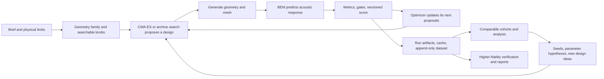

# HornLab: turn the archive into a better design and search system

**Status: implementation plan, not implemented. Reviewed 2026-11-12.** This supersedes the recommendations and execution order in `DATA_GA_RESEARCH_PLAN_2026-11-12.md`, its handoff, and the pasted single-reviewer review. Those remain historical inputs. Review method: primary-agent synthesis, two read-only source audits, bounded local artifact inspection, and external primary-source research. This was not an independent multi-seat council vote.

**Second hardening pass:** [Horn physics, reusable data and inclusive rollout decision](HORN_OPTIMIZATION_HARDENING_2026-11-12.md), following parent research, two independent Terra reviews and the owner-authorized preservation handoff. Protocol `bo-study-v1.1` keeps **BoTorch and its full GUI/solve/verify feedback integration in scope**. M0 proves preserved raw data/version-aware zero-solve rescoring and parameter semantics; M1 delivers the existing-GUI explanation. BoTorch adapter work can proceed in parallel after those contracts freeze, then M2/M3 complete proposals and integrated workflow. Gates sequence correctness/adoption, not removal of BoTorch. No production cache/default/job changes in M0–M2.

**Decision:** build reliable comparisons and an interpretable design archive, then connect them to a persistent **Design Study** in the existing GUI. Implement BoTorch as a first-class, opt-in proposal track alongside CMA, with fixed scalar and physical-trade-off recipes, serial solve/verification feedback and recorded decisions. Use the archive to choose diverse seeds and investigate parameter combinations. CMA-ES remains the experimental baseline.

**Execution authority for the expanded BoTorch/GUI track:** [Bayesian Design Study orchestrator specification](BAYESIAN_STUDY_ORCHESTRATOR_SPEC_2026-11-12.md). It freezes the key mathematics, data interfaces, workflow state, GUI routes/panels, lane/recovery behavior, parallel ownership and integration gates. The [prompt pack](DATA_GA_IMPLEMENTATION_PROMPTS_2026-11-12.md) now starts execution with B0 (orchestrator), which dispatches prerequisites and B1-B8 workers. This owner-directed expansion supersedes the earlier “BoTorch only as a later optional investigation” sequencing below; the source audit and S0-S11 foundations remain applicable.

The owner should ultimately be able to ask: “Which dimensions improve low-frequency loading without damaging upper-band coverage?”, “Does this combination work across several starting points?”, “Which different-looking horns give similar results?”, and “What should we solve next?” The system should answer with designs, acoustic curves, uncertainty, and a proposed experiment.

Complete, individually copyable implementation prompts are in [the slice prompt pack](DATA_GA_IMPLEMENTATION_PROMPTS_2026-11-12.md). Future paths and command surfaces described as **proposed** do not exist yet. Nothing here authorizes starting solves, changing the running queue, merging datasets, registering v8, or changing production defaults.

## 1. What the software does, in plain language



“Genetic algorithm” is a useful informal umbrella, but the main search is **CMA-ES**: it learns a distribution of promising continuous parameter combinations. CMA-ME/CMA-MAE maintain a collection of designs with different descriptors. There is also an NSGA-II implementation for trade-offs, and an existing neural-surrogate subsystem. These require different validation; they are not interchangeable modes of one GA.

A seed can mean two different things: the **starting horn geometry**, or the **random-number seed** that changes a search trajectory. A better starting horn and a more reliable random-seed experiment are separate improvements.

Today’s persisted information is valuable:

| Artifact | What it provides | What it cannot establish alone |
|---|---|---|
| `run.json`, `config.yaml`, `search.ndjson` | Search configuration, seed, bounds, candidate order, objectives, errors and timings | Independent experiments merely because many rows exist |
| Per-design response/metrics/geometry artifacts | Frequency and angle response, geometry, more detailed inspection | That the response is converged or comparable to another solve |
| Solve cache | Reuse of a design/mesh/solve result | Compatibility across dependency revisions without further provenance checks |
| Dataset JSONL + per-record NPZ | Parameters, target, mesh/solve metadata, metrics/terms, library SHAs, acoustic arrays; failures also retained | Complete provenance for every historical row; mesh geometry is not embedded in every record |
| Generator provenance on newer records | Generator name/spec/knobs/brief, in addition to materialized geometry | That every old record has reconstructable knobs |
| Sampled surface traces | Additional field reconstruction for the sampled geometries | A new boundary solution for an arbitrary new geometry |
| Analysis JSON/MD/PNG and GUI | Existing convergence, sensitivity, walls, links and comparison surfaces | Complete analysis coverage or reliable inference just because a chart renders |

Source anchors: `hornlab_search/search/evaluate.py:6`, `:586`, `:1619`, `:1678`; `dataset/record.py:245`, `:297`, `:376`; `dataset/store.py:1`, `:24`, `:379`; `solve/cache.py:53`; `search/nsga.py:1`; `surrogate/features.py:54`. Paths in this document are relative to the inspected DOCS worktree unless stated otherwise.

## 2. Verified snapshot and corrections to the supplied reviews

The code baseline is locally available **`origin/main=15644ca1e2fa62c1e6b71d76043370d632836ce1`**. The DOCS branch was **`5c1f10a`** after it advanced during inspection. This is a local remote-tracking snapshot, not a fresh GitHub API confirmation of PR state. No fetch, checkout, merge, commit or push was performed by this review.

The live solve checkout remains **`79edc8d`**. It is not an ancestor of that main snapshot. Do not run new analysis from its older implementation, or update it while the queue owns it. New code should branch from a refreshed, verified main after checking compatibility with work in progress.

### Completed work that must leave the backlog

* **v8 placeholder closure is done in the inspected main.** `scalar_v8.py:120` onward contains measured class A/B/C values and labels them descriptive calibration, not independent validation. Do not recreate PR #47 or make “replace all 1.0 values” the first task. v8 remains outside normal scorer dispatch (`search/evaluate.py:1095`; `objective/versions.py`).
* **The clean seed group is 25 runs, seeds 5101–5125**, reported as 151 rows per run, not 26 equal-budget runs. The saved analysis reports median best J **18.58868427480999**, max-minus-min **4.780348414761317**, bootstrap median CI **[18.41349804684173, 19.18579587078396]**. The user’s rounded figures are correct. The 777-row seed-1234 base is excluded. The saved table has 148–150 **new valid** evaluations per run: equal row budgets do not imply equal valid or solve costs.
* **Entry-point names are discoverable now.** `tools/analysis/{convergence,seed_variance,sensitivity,links,walls,ab_compare,lane_parity,term_balance,fidelity,report_day,v8_rescore}.py` exist in DOCS/main-derived code. An ongoing “discover guessed script names” task is unnecessary.
* **The GUI has an analysis view.** Its backend loads more outputs than the front end gives dedicated sections. `gui/data.py:3291` lists ten tools; `gui/static/app.js:2276` renders five dedicated analyses and discloses extras. Extend it; do not create a competing analysis application.

The seed JSON was read directly at `C:/Users/hunte/Hrns/oc-wt/AN/scratch/seedvar_freeform25eq/seed_variance.json`; SHA-256 **`a572149e15e210a664943e3832c9a2513537a1dc7f48fa766f2e1126e757b4f0`**. This is verification of the saved output, not an independent rerun of all seeds or a completed power study.

### Important scientific corrections

| Existing claim or implication | Correction |
|---|---|
| Five seeds is enough to decide | Five independent matched runs per arm is a reasonable **pilot**. Adequacy depends on paired variability and the improvement worth detecting. The old median-versus-range rule is not a calibrated significance test. |
| The 25-seed range gives paired variance for every new experiment | It describes this historical configuration. A range is not a standard deviation; paired-difference variance must come from the actual paired experiment. |
| Restarts are additional independent pseudo-seeds | Restarts share adaptive state, selection and total budget. They are components of one replicate, not extra independent evidence. |
| v8 versus v4/v6/v7 rank agreement validates `LQModel` | It measures disagreement between objective definitions. Validate LQ **predictions against true evaluations of the same objective**, out of sample and chronologically. |
| High correlation or R² makes a parameter link safe | It can reflect optimizer adaptation, bounds, selection or shared proxies. Confirm on held-out runs and a prospective linked-versus-unlinked ablation. |
| Near-zero permutation importance means pin the parameter | Correlated variables can hide each other; a poorly predictive model cannot justify removal. Check interactions and region-specific effects first. |
| Valid-only budget recovers 1.75× real evaluations at the same wall time | Changing what counts does not remove compute cost. It may increase work. Compare wall time, attempted designs, actual BEM calls and verified result quality. |
| Top-decile coordinate medians are the current warm-start implementation | `warmstart.py:112` chooses the best stored valid row as the mean; spread changes scalar sigma. Coordinate-wise medians can create an unseen, infeasible combination. |
| Low overlap between v8 and an older top-20 means either is better | It means the preferred designs changed. Neither ranking is an independent acoustic ground truth. Judge task-specific physical metrics and blinded, verified comparisons. |
| Class-B’s 87% v8 refusal is the geometry failure rate | It is a **rescoring eligibility/gate result**, not the rate of generator/mesh/worker failures. Diagnose each separately. |
| Large archive means a large uniform experiment | CMA trajectories are adaptive and clustered. Many similar or duplicated rows add little independent coverage. |
| Changing the screen grid requires deleting the cache | Frequencies enter `SolveSpec.hash()`. New solve specs should miss naturally. Verify this; preserve old entries and label their fidelity. Library revision compatibility is a separate gap. |

The documented v8 full rescore contains 23,833 scored rows. Class B has 4,063 rows, 3,545 refusals and 518 rankable. Its v4/v7 top-20 overlaps with v8 are both zero despite substantial global rank correlation. These are **ranking-sensitivity results**, not optimizer or surrogate wins. The rescore explicitly omits the mesh-derived throat gate (`tools/analysis/v8_rescore.py:1`–`:18`); do not present it as full live-v8 equivalence.

The rescore artifact SHA-256 is **`24b6d684da063b124401bbd58f0d11b8971afafb2935eb775982068f4254ba71`**. Tolerances were calibrated on the same archive, with top-decile selection under v4. Freezing that hash gives reproducibility, not independence or evidence that the tolerances match the owner’s acoustic priorities.

### Live data and worktrees

A bounded read around **21:25 UTC / 16:25 EST** found **57 record shards / 28,466 dataset records**, and **1 record shard / 237 CPU records**. These are changing-file snapshots, not an atomic census. `index.jsonl` duplicates metadata indexing and must not be counted as another record shard. The 23,833 rescore rows and the dataset total have different eligibility/time scopes; reconcile exclusions rather than forcing totals to match. A sampled old record lacks `objective_version`, run ID and brief provenance; preserve these as unknown unless recoverable from evidence.

Read-only ancestry and tracked-status classification against `15644ca`:

| Worktree | Head | Ancestry / observed tracked state |
|---|---|---|
| live | `79edc8d` | Unmerged; active-queue checkout, preserve |
| A / B / C / D / E / F | `7092df7` / `88ddb8d` / `55482f5` / `b8dc237` / `6bf52a2` / `b458fa2` | All ancestors; no tracked changes observed |
| AN | `1837f02` | Ancestor; modified analysis spec; preserve partial artifacts |
| G / G2 | `9bbf249` / `f62859f` | Ancestors; scratch preservation still required |
| L1 / R / T / V | `e1d4e59` / `fedbc4a` / `a886538` / `f210d3c` | Ancestors; T has modified verify-plan and INDEX |
| DOCS | `5c1f10a` | Unmerged documentation branch; output location for this review |
| gui-a / gui-b / gui-c | `ceb962d` / `18ab502` / `22c7ece` | Not ancestors; preserve as unmerged work |
| gui-int | `22ac0d2` | Not ancestor; multiple modified GUI and test files: active integration work |
| gui-wp01 / gui-wp2 | `b2dc507` / `fe6edd9` | Not ancestors; preserve |
| L4 / plan | `e7ce42c` / `90b9a49` | Not ancestors; preserve |

There are **23 registered worktrees including live**, not a permanent count of 21. “Ancestor” does not prove safe deletion: the check excluded untracked files, and scratch may be precious. GUI integration and T are actively dirty. Coordinate S10 with their owner before selecting files or duplicating the verification work.

Queue summaries still showed only g0/g1c completed in the continuation snapshot; this review did not prove current process ownership or completion of g2–g9. Recheck the lane locks, runner and logs at experiment time. The CPU c2b summary records exit 1; the handoff attributes it to BEAT connection resets. No recovery or solve was attempted here. A.7’s 5/5, maximum 0.0356 dB parity remains **historical reconstructed evidence**, not a freshly repeated independent-solver check. `beat_cpu` versus `beat_cuda` also share BEAT; the separate bempp cross-check serves a different role.

## 3. Source-level issues to fix before evaluating new search policies

These are implementation findings, not statistical speculation. They need focused regression tests before changing defaults.

1. **CMA-ME warm-start archive identity.** `search/cma_me.py:143`–`:151` can replace `x0` with the warm mean, but `:374`–`:381` evaluates `space.seed` and archives its score/descriptors/hash under `x0`. When they differ, the archived solution and evaluation disagree. Minimal repair: archive the normalized geometry actually evaluated, while keeping the emitter’s warm mean separate. Preserve candidate order and budget; do not add a hidden solve. Cover native and generated-space transforms. This is confirmed by static control flow; a full runtime reproduction was not run here.
2. **ME/MAE failure admission.** Plain CMA-ME uses an archive threshold of negative infinity, so a failed candidate can occupy an empty fallback cell when no valid seed descriptor protects it. MAE configuration also accepts a positive `j_threshold`, while archive thresholds are `-j_threshold` and failures have J=1000. A threshold of 1001 can admit a failed candidate (`cma_me.py:158`–`:181`, `:357`–`:370`; `config.py:836`). A small isolated in-memory `GridArchive` check admitted objective -1000 at threshold -1001, and rejected it at -999/-1000. This component check is not an end-to-end search test. Reject non-finite/unsafe thresholds and enforce failure exclusion in **both ME and MAE**; a MAE config guard alone is insufficient.
3. **LQ resume chronology.** `cma.py:632`–`:646` preloads previous known rows into the model before replay, potentially exposing later-generation observations too early. Candidate-sequence equivalence versus uninterrupted search is **unverified**. Resolve with a deterministic fake-objective replay test; restrict unsupported combinations until it passes.
4. **Budget and wall-time reporting.** Valid budget increments depend on `ev.error` (`cma.py:88`–`:102`); campaign supplies a separate max-evals cap (`campaign.py:424`). Resampling is capped at ten replacements, after which a refusal may be told to CMA (`cma.py:573`–`:599`). `_common.best_so_far_curve` skips invalid rows before adding their seconds (`tools/analysis/_common.py:187` onward), so its apparent wall axis can omit failed work. Report actual elapsed cost, not only successful-row cost.
5. **Provenance compatibility.** `Design`, `MeshSpec` and `SolveSpec` hashes cover their own fields (`types.py:36`–`:105`), not package SHAs. `solve/cache.py:131`–`:141` checks successful status/readability, without comparing producing dependency revisions. The evaluator’s normal disk-hit caller does not add that check (`evaluate.py:1567`). This is a stale-cache **risk**, not an observed bad acoustic result. Add a versioned compatibility policy without rewriting frozen contracts or silently blessing old entries.

6. **Legacy surrogate scoring capabilities.** The inspected `surrogate/predict.py:93,110` and `surrogate/train.py:71` call the original scalar scorer; predicted metrics lack throat impedance. The inspected CLI checks geometry/grid and stored model gates but not a complete current-objective input contract. Before a fair advisor comparison, R0 must add explicit supported-version/input handling or a canonical tested scorer adapter. Never infer that six predicted curves support every v4/v6/v7 term/gate. This is a static compatibility gap, not a measured loss; preserved raw physical data can still support complete versioned offline rescoring where its inputs exist.

7. **Refusal isolation is not guaranteed by today's flags.** The new [reviewed refusal policy](HORN_OPTIMIZATION_HARDENING_2026-11-12.md) section 8 verifies ten-replacement fallback can still tell penalties; a synthetic `tell` spy observed four penalties in the existing all-refusing test. Integrate F0's additive strict-CMA/same-candidate error-recovery option and F1's QD archive/infrastructure safeguards. Genuine measured gate failures remain declared constraint information, resources are not horn quality, and no bounds/defaults/live queues change. Preserve raw failures and use separate training/analysis views. BoTorch consumes the same typed outcomes.

MAE’s unbounded genotypes are clipped to legal phenotypes before evaluation. That is a deliberate many-to-one mapping, not proof of a wrong score by itself. Preserve/test genotype-to-design reconstruction and measure boundary concentration; do not “fix” CMA by arbitrarily clipping vectors passed to `tell`.

## 4. The analysis system we should build

### 4.1 A derived, reproducible experiment catalog

Keep append-only JSONL/NPZ as the source of truth. Build a **read-only derived catalog**, initially standard-library JSON/CSV plus arrays only when needed. Add Parquet/DuckDB if repeated cross-run queries justify it; do not migrate the live writer as a prerequisite.

Separate four entities: **geometry**, **physical solve**, **score under a stated objective/brief**, and **search experiment**. The same physical response can have several scores; a cached response is not a new independent physical solve. A new solver revision or frequency grid is not the same solve merely because the horn hash matches.

Proposed catalog columns include stable source shard/row, source file hash and snapshot boundary; geometry and generator identity; generator knobs and materialized params separately; full resolved bounds/transforms; brief/target/driver/mounting/source-model identity; mesh and solve spec hashes; exact frequency/observation grids; backend, dependency pins and lane if known; objective implementation/weights/tolerances/gates hash; run and random-seed ID; attempt/cached/BEM-call counts; outcome class; timing and artifact pointers; completeness flags. These are **analysis-schema proposals**, not new production YAML keys.

Create explicit comparison policies. Same-objective performance comparisons require matching physical task and scoring identity. CPU/GPU comparison deliberately varies backend while holding the remaining spec fixed. Optimizer A/B deliberately varies the tested policy while recording both resolved configs. Bounds, active dimensions, warm-start sources and resume history must be explicit even when they are intentional treatment differences. Missing provenance means “descriptive only” unless a documented recovery succeeds.

Do not instantiate the writable `Store` merely to inspect live data: its recovery logic can truncate torn tails or repair indexes. Stream closed shards and snapshot only the committed prefix of the open shard, or wait until the writer is idle. Index and shard totals must reconcile within an explicitly documented live-write window.

### 4.2 Explain acoustic characteristics, not just total J

Fit separate response models for coverage error, usable loading frequency, loading hold, ripple, DI variation, on-axis response and geometric/manufacturing diagnostics **where their inputs exist**. Preserve units and frequency bands. A knob can be helpful for loading and harmful for ripple; a single J importance cannot explain that trade-off.

Start with transparent rank summaries plus held-out RandomForest/ExtraTrees models using the existing scientific stack. Use a simple baseline to check whether a more complex model adds predictive value. Report train/run-block/geometry-block/time-holdout performance, support counts and uncertainty. Split duplicate/near-duplicate geometries together, including across runs. Resumed segments belong to the same experiment. Fit preprocessing and normalization only on training data.

For interpretation, use grouped permutation importance for correlated knobs; ALE curves for how effects change within observed support; and selected pairwise surfaces/interaction estimates. Mark unsupported regions instead of drawing persuasive filled-in heatmaps everywhere. fANOVA can decompose a fitted response model into main and interaction effects, but its answer depends on the integration domain/distribution. It is not a causal decomposition of arbitrary CMA history.

Promote a relationship through three labels: **observed association → held-out predictive relationship → controlled intervention confirmed in this domain**. First trace actual knob activity and final geometry: a present control may be inactive, conditionally active, clipped or derived. Reuse the existing parameter SSOT and mesher geometry, preserve physical dimensions/diagonal contours/source assumptions, and distinguish input hashes from sampled physical-shape equality. Never label correlation or CMA covariance as a physical law. Rank correlations miss U-shaped effects; individual importance can miss coupled knobs.

Keep **score contribution** separate from **parameter influence**. A term can own much of J because of units, weights or squaring, while offering little local improvement. Show raw physical metrics, normalized terms and weighted contributions together; check term redundancy and ranking stability under a small, declared preference sweep. Recompute raw metrics from stored curves when the required inputs exist instead of guessing an inverse transformation for old terms. A two-knob interaction in total J may originate in scoring arithmetic, a geometric construction constraint, or acoustics: test each explanation. Freeze the objective within an optimizer A/B; preference changes are a separate experiment.

### 4.3 Better seeds, bounds, and search dimensions

Build seed packs from **real feasible designs**, clustered within compatible tasks and geometry representations. Choose medoids or other actual exemplars from different promising basins. Balance verified quality, novelty and support; retain a cold-start exploration arm. Emit provenance and existing config overlays only. Re-materialize and hash-check exported generator designs.

Try local spread/covariance initialization only after scalar warm-start baselines are measured. Covariance transfer needs matching coordinate definitions, bounds, dimension order and regularization; raw saved CMA covariance is not automatically a reusable physical interaction model.

Narrow/pin **locally**, after replicated evidence, while keeping a broad control. A parameter at a wall may need widening, reflect a physical constraint, or indicate bias in the search transform. For linked parameters, first test a soft corridor or staged search where possible; a hard equality removes a degree of freedom permanently. Do not activate the historical R²=0.427 link. An R²=0.8 threshold alone would not establish safety either.

### 4.4 A discovery loop for new typologies and combinations

Use shared **geometry descriptors** alongside original family parameters: normalized H/V profiles at common axial stations, area growth, aspect ratio progression, throat/mouth/depth ratios, curvature and termination summaries, symmetry and mounting labels. Implement them from existing generator/geometry interfaces; do not invent a mesher. Establish scale handling explicitly: geometrically similar shapes can have different acoustic behavior at a fixed frequency band. Keep absolute dimensions and dimensionless frequency where the supported model permits.

Maintain two views: “different shapes with similar acoustic behavior” and “similar shapes with meaningfully different behavior.” Cluster/PCA can suggest gaps and archetypes; UMAP is a navigation aid, not evidence of physical distance or a new family. Features must not include target scores when measuring geometric novelty.

Generate **hypothesis cards**: parent design IDs; compatible features proposed for combination; expected affected frequency region; target trade-off; unknowns; generator construction and continuity/clearance constraints; broad baseline; next validation experiment. A hypothetical combination of an advantageous H profile and a complementary V profile is only useful if the existing generator can express it legally. Do not splice unrelated parameter vectors or treat families as numerically interchangeable.

Before adding a new named typology, follow the existing `hornlab-typology-research` protocol (`C:/Users/hunte/Hrns/hornlab-search/.opencode/skills/hornlab-typology-research/SKILL.md`; this ignored local skill is absent from DOCS). The existing `docs/research/typologies/` and `senior_pass_2026-10-24/` dossiers are the starting inventory. New ideas use neutral experiment names until attribution/reference validation is satisfied. New MEH feature work remains paused under the current owner plan.

Compare parent A, parent B and the proposed combination under one task and verification policy; then ablate each added feature. Verify several varied candidates, not just the surrogate’s favorite. This can discover useful new configurations inside existing generators first; new generator code is a later, separately researched slice.

### 4.5 Surrogates and multi-fidelity allocation

There are already **two distinct surrogate routes**: local quadratic LQ guidance in CMA, and the existing Torch metric ensemble/proposal/real-BEM round system. `surrogate/train.py:75` includes deduplication and clustered holdout; reuse it rather than describing the whole repo as having only a random row split. Its generator guard currently rejects generated configs (`surrogate/features.py:54`). Newer generator knobs exist in provenance (`evaluate.py:1619`); census that coverage before expanding support. Do not assume all historical knobs are lost or all are present.

Start in **advisory mode**: predict multiple acoustic metrics and feasibility, propose a mixed batch of promising, uncertain and diverse designs, solve through the normal evaluator, record prediction-versus-result, retrain, repeat. Tree/ensemble uncertainty is a heuristic until calibrated on held-out and prospective rounds. Penalized invalid rows train a separate feasibility/failure model; do not regress every failure as a physical J=1000 surface.

Score surrogates by top-k discovery/recall, decision regret, physical-metric error, feasibility precision/recall and prospective cost saved; global R²/tau is supporting evidence. Require fallback on unsupported/out-of-domain inputs. Keep predictions, measured screen results and verified results separate.

For fidelity, join explicit screen/verify/final records by geometry plus task/spec identity. Report absolute metric differences and selection quality; percentages of J are unstable near zero and incomparable across objective scales. Top-only verification cannot estimate global screen error. Add a small, predeclared random/stratified verification component alongside finalists to test missed winners and feasibility boundaries. Select its budget from measured cost rather than declaring “always verify 20” universally.

The expanded study specification now fixes a BoTorch implementation track: same-task/same-fidelity `Y=-J` scalar GP with qLogNEI over a legal finite candidate pool, followed by raw coverage/ripple qLogNEHVI and separately gated constraint/cost/trust-region extensions. Implement and validate this alongside the existing advisory surrogate route; do not fit one exact GP to every heterogeneous row or replace the production optimizer preemptively. Model discrete backend, mesh policy and frequency grid explicitly; they are not automatically one smooth fidelity scalar.

For finalists, add a later **robustness study**: small, physically justified geometry/manufacturing perturbations, plausible driver/source assumptions and mounting variations within the intended use. Keep numerical mesh/grid convergence, model-form uncertainty and physical variation separate. Compare a practical quantile or worst case over a declared scenario set as well as nominal performance; do not invent tolerance distributions or optimize arbitrary noise. A narrow brilliant optimum that collapses under tiny realistic changes may be less useful than a slightly worse, stable design. This is a scheduled follow-up with real validation cost, not a free inference from repeated rows of a deterministic BEM solve.

### 4.6 Improve solve speed where measurements show time is spent

Optimize **verified useful designs per hour**, with candidate throughput and physical solve count alongside it. A fast screen that loses the true finalists can be a net loss.

1. Reuse existing `HORNLAB_STAGE_TIMING` instrumentation and `tools/bench/throughput_matrix.py`; identify generation, mesh, assembly, factorization, field evaluation, metric calculation, persistence and cold-worker costs separately. Stage totals and whole-run elapsed time should reconcile; overlapping prefetch times are not additive.
2. Compare exact same meshes/specs with cache hits separated, baseline/peak device and Windows shared GPU memory recorded, cold and warm runs separate, and repeated trials. The existing fused/prefetch/batch study is input, not proof every mesh benefits.
3. Improve cache validity/hit diagnosis, cheap pre-mesh feasibility checks, near-duplicate detection and retry classification before adding approximate physics. Infrastructure failures do not teach horn feasibility. One CUDA solve at a time; preserve CPU/GPU lane isolation.
4. Verify symmetry, mesh policy and frequency selection against converged references. Frequency enrichment should test missed narrow features; adaptive points must be represented in solve identity. Do not select a cheaper mesh solely because J happens to improve on it.
5. Through pinned forks only, pursue a specific measured bottleneck. Current beat pin `0850ef3` **already supports fused multi-channel LHS assembly and one LU across RHS columns** (`TOOLCHAIN.md:30`; fork `BeatEngineDriver.jl:1848` onward). Do not rediscover this as new work. An LU generally cannot be reused across changed geometry or frequencies. Further batching/memory/field-evaluation changes need production-path parity and memory evidence.
6. FMM/H-matrix/matrix-free/adjoint methods are longer-term backend capability investigations. Their asymptotic promise is not a measured speedup on this stack, and they must not turn this search project into a new solver implementation.

## 5. External research and tool decisions

Sources were checked on 2026-11-12. Recommendations below are engineering synthesis for this repo, not reported HornLab benchmarks. No package was installed. Versioned tutorials illustrate methods; implementation must check the selected installed version and Windows/Python compatibility.

| Primary source | What it supports | Decision for this repo |
|---|---|---|
| [Hutter et al., fANOVA, ICML 2014](https://proceedings.mlr.press/v32/hutter14.html) | Decomposing fitted random-forest responses into individual and interaction effects | Add supported-domain interaction analysis; do not require the older `fanova` package or call it causal |
| [Apley & Zhu, ALE](https://arxiv.org/abs/1612.08468) | Effect visualization avoiding unsupported combinations induced by ordinary partial dependence under correlated inputs | Prefer ALE/support-aware views; validate any selected implementation on analytic interactions |
| [scikit-learn permutation importance](https://scikit-learn.org/stable/modules/permutation_importance) and [GroupKFold](https://scikit-learn.org/stable/modules/generated/sklearn.model_selection.GroupKFold.html) | Held-out importance, correlated-feature limitations, nonoverlapping groups | Reuse sklearn with explicit duplicate/run/time splitting; importance is model-score loss, not ΔJ by default |
| [SciPy QMC](https://docs.scipy.org/doc/scipy/reference/stats.qmc.html) | Space-filling sampling tools | Start prospective feasible-region pilots with scrambled Sobol/LHS using existing SciPy; distinguish Sobol sequences from Sobol sensitivity estimators |
| [SALib sampling requirements](https://github.com/SALib/SALib/blob/main/docs/user_guide/basics_with_interface.rst) | Sensitivity estimators require appropriate experimental samples | Optional Morris/Sobol analysis on designed experiments or a validated surrogate, not arbitrary CMA rows; report surrogate-induced uncertainty and input assumptions |
| [pycma LQModel](https://cma-es.github.io/apidocs-pycma/cma.fitness_models.LQModel.html) | A local linear/quadratic fitness model | Benchmark chronologically and test resume; no guaranteed 2–4× saving |
| [CMA-MAE paper](https://arxiv.org/abs/2205.10752) and [pyribs recipe](https://docs.pyribs.org/en/stable/tutorials/cma_mae.html) | Quality-diversity search and annealed archive thresholds/result archives | Repair invariants, then compare existing opt-in MAE with ME; no presumption that one learning rate works here |
| [IOHprofiler background](https://iohprofiler.github.io/Background) | Fixed-target/fixed-budget reporting and independent-run ECDF/ERT interpretation | Adopt reporting concepts without requiring another runtime service; include failures and censoring |
| [TuRBO paper](https://arxiv.org/abs/1910.01739) and [BoTorch tutorial](https://botorch.org/docs/v0.17.0/tutorials/turbo_1) | Local trust-region Bayesian optimization | Later challenger on a compatible, bounded subspace, benchmarked against warm CMA |
| [BoTorch constrained multi-objective tutorial](https://botorch.org/docs/v0.16.0/tutorials/constrained_multi_objective_bo) and [cost-aware BO](https://botorch.org/docs/tutorials/cost_aware_bayesian_optimization) | Acquisition functions for constraints/trade-offs and heterogeneous evaluation cost | Optional after measured surrogate baselines; candidate batches still execute sequentially on the single GPU |
| [DuckDB Parquet support](https://duckdb.org/docs/data/parquet) | Efficient read-only column/filter queries | Optional derived analysis cache, rebuilt from the original records; no live storage migration |
| [EGO shape optimization of horn-loaded loudspeakers, Adelaide repository](https://digital.library.adelaide.edu.au/items/297012cf-65e8-4cb0-84a8-7ed4b08962be) | Repository abstract describes surrogate optimization of spline-parameterized horns for beamwidth | Directly relevant precedent for surrogate-guided horn search; full methods were not retrieved here, so no quantitative transfer claim |
| [Schmidt et al., large-scale horn optimization](https://epubs.siam.org/doi/10.1137/15M1021131) and [Takahashi et al., adjoint IGBEM](https://arxiv.org/abs/2105.04456) | Abstract-level evidence that gradient/adjoint acoustic shape optimization is feasible with suitable solvers | Long-term feasibility study only; these methods are not a drop-in gradient API for the pinned BEAT implementation |

**Dependency policy:** existing numpy/scipy/cma/ribs first; sklearn as an explicit optional analysis dependency if adopted, since tools currently import it opportunistically. Add optional BoTorch/GPyTorch through the pinned, isolated compatibility step in the expanded study spec. Consider DuckDB/Parquet only for a measured query bottleneck and SALib for designed studies. No giant stack of ML, tracking, workflow and cloud services is needed to start. Neural operators, diffusion-based geometry generation and differentiable replacement solvers are deferred until a simple baseline demonstrates the missing capability.

## 6. Implementation sequence and acceptance gates

All code changes below are **planned**. One reviewed, validated slice per commit/PR; parent integrator owns shared contracts and final decisions. Existing frozen contracts stay unchanged. Additive analysis schemas live outside them; any genuinely required runtime contract extension gets a separately reviewed proposal.

| Slice / owner | Work and primary files | Dependencies | Acceptance and decision |
|---|---|---|---|
| **S0 — data engineer** | Proposed `tools/analysis/catalog.py`, `cohorts.py`, schema/tests; reuse record/manifest read logic without writable Store recovery | None | Deterministic catalog from immutable prefixes; counts/exclusions reconcile; incompatible/missing provenance visible; arrays loaded selectively; exact input hashes. Enables trustworthy cohorts. |
| **S1 — search engineer + senior reviewer** | `search/cma_me.py`, `config.py`, focused warm/MAE tests | None; isolated from S0 | No archive solution/evaluation mismatch; failed candidates never become elites; unsafe/nonfinite threshold rejected; native/generated and cold/warm/resume covered. Unblocks QD/warm experiments. |
| **S2 — pipeline engineer** | Read-only cache/producer compatibility inventory first; conditional later `solve/cache.py`/caller tests | S0 identity policy; production enforcement gated after M2 | Initial report quantifies missing producer evidence and reuse exposure without changing defaults. Any later guard is opt-in, separately reviewed, call-site tested and reversible; no blanket legacy miss during analysis rollout. |
| **S3 — analysis/statistics engineer** | `_common.py`, `seed_variance.py`, `ab_compare.py`, schema and tests | S0 | Distinct independent replicate IDs; intentional A/B differences explicit; wall cost includes failures; paired effects/CIs; censoring/success rates and fixed physical targets; equal-cost and equal-solve views. Replaces heuristic win verdicts. |
| **S4 — analysis engineer** | `sensitivity.py`, `links.py`, `term_balance.py`, proposed effects/interaction module + tests | S0; S3 uncertainty helpers | No incompatible pooling; grouped/temporal/geometry validation; importance units correct; analytic correlated-interaction fixtures; version-aware raw/normalized/weighted score decomposition; support-aware acoustic-metric effects. Produces hypotheses, not automatic pins. |
| **S5 — search/data engineer** | Proposed seed-pack/recommendation tool; `warmstart.py` only for demonstrated export gaps | S0, S4, S6; S1 only before affected QD execution | Actual measured eligible exemplars from multiple basins; activity-aware control/geometry round-trip; fidelity/support recorded; broad/cold arm retained. QD-specific correctness does not block ordinary read-only native seed reports. |
| **S6 — acoustics/validation lead** | `fidelity.py`, verify-pair resolver, calibration spec/compare tools and offline tests; reuse #45 verification API design | S0, S2; coordinate GUI WIP | Correct parent/backend/task/spec pairing; unknown/collision rows excluded with reasons; absolute per-band errors plus shortlist recall; frozen tolerances separated from held-out evidence. No v8 registration. |
| **S7 — surrogate engineer + senior reviewer** | Existing `surrogate/*`, proposed offline LQ benchmark, fake-objective LQ replay tests | S0, S3, S4, S6 | Same-objective held-out prediction/selection tests; LQ chronological replay supported or explicitly refused; OOD fallback; feasibility separate; candidate IDs and real-BEM validation retained. Advisory before optimizer-in-loop. |
| **S8 — design-research/QD engineer** | Existing `search/cma_me.py`, `nsga.py`, proposed geometry descriptor and hypothesis-card tools; typology dossiers | S1, S3, S5, S6; S7 optional | Geometry-only and behavior novelty distinct; archive reconstructs designs; fixed descriptor ranges/reference; feasible Pareto/QD comparisons; parent/combination ablations prepared. No unsupported new named typology. |
| **S9 — performance engineer** | `tools/bench/*`, profiling analysis, `docs/throughput/*`; fork changes in a separate conditional slice | S2, S3; solves wait for lane availability | Stage/whole-run costs reconciled; cold/warm/cache separated; memory/spill and parity recorded; benefit exceeds variability; verified quality unchanged. Can prepare CPU-only before queue ends. |
| **S10 — GUI engineer** | `gui/data.py`, shared API/adapters, `static/app.js`, `charts.js`, GUI tests; coordinate gui-int/T ownership first | S0 artifact schema; add S3/S4/S6/S8 panels incrementally | Cohort/provenance/fidelity labels, selectable designs/curves, effect/support panels, seed comparisons, trade-off/novelty maps, hypothesis cards. Existing navigation reused; predicted/screen/verified distinct. |
| **S11 — experiment integrator** | Proposed experiment manifest and scratch config overlays; reuse campaign/calibration/queue tools | Relevant slices validated | Predeclared arms, IDs, matched replicates, budgets/cost/fidelity, stop/adoption criteria; dry-run only until scheduled. Evidence supports an opt-in recommendation or an honest no-gain result. |
| **F0 — search engineer, parent owns math/config** | Proposed `search/outcomes.py`, additive strict-CMA and error-policy branch/tests; no default changes | Shared R0 eligibility/score capabilities; coordinate `cma.py`/`config.py` ownership | Typed failures; bounded deterministic replacement; exact-candidate transient retries; cap exhaustion stops without contaminated tell; full RNG/checkpoint/replay and cost accounting; legacy tests preserved. |
| **F1 — QD engineer + senior integrator** | S1 ME/MAE archive paths and error handling, supported scheduler/emitter adapter contract/tests | F0 typed policy, S1 identity invariants, pinned-ribs API proof | Both archives protected; infrastructure excluded from tell; asked-vector/order/hash/RNG preserved. Legacy deterministic emitter penalties disclosed until separately proven constrained-QD adapter; no filtering/fake descriptors/private-state shortcut. |

**Parallel implementation:** S0 and S1 are independent. After S0’s schema is frozen, S2, S3 and S4 can proceed in separate worktrees; reserve `_common.py` for S3 and consume its API elsewhere. S6 and S5 follow their inputs. S9 telemetry preparation can run alongside analysis; actual benchmarks are serial with the existing GPU queue. S10 needs early artifact/API agreement and coordination with dirty GUI work. S7 and S8 are separate later branches. Shared `config.py`, `cma.py`, GUI files and doc indexes require an integrator; do not have agents overwrite one another.

### Phase A: immediately, CPU-only and nonintrusive

Deliver S0/S1 preparation, S3/S4/S6 offline work and S9 profiling inventory. Read/copy AN’s partial work; do not stash another agent’s tree automatically. Preserve partial versus final status in report metadata. Keep input/source hashes, tool commit, exclusions, timestamps and exact invocation with every output.

Existing CLI examples, **not executed by this review**:

```powershell
$PY = 'C:\Users\hunte\Hrns\hornlab-search\.venv\Scripts\python.exe'
$REVIEW = 'C:\Users\hunte\Hrns\oc-wt\DOCS'
$LIVE = 'C:\Users\hunte\Hrns\hornlab-search'
Set-Location -LiteralPath $REVIEW
# Run only after choosing a completed immutable run. These scripts exist today;
# current fidelity/statistics limitations above still apply to their outputs.
& $PY tools\analysis\convergence.py --run "$LIVE\runs\20261030T170642Z-screen-fbab4f" --out scratch\review\convergence
& $PY tools\analysis\sensitivity.py --run "$LIVE\runs\20261030T170642Z-screen-fbab4f" --out scratch\review\sensitivity
& $PY tools\analysis\fidelity.py --run "$LIVE\runs\20261030T170642Z-screen-fbab4f" --out scratch\review\fidelity
# This is explicitly list-only preparation; inspect inputs before generating overlays.
& $PY tools\calibration\plan_calibration.py --designs "$LIVE\runs\20261030T170642Z-screen-fbab4f" --out scratch\review\calibration.yaml --list-only
```

Do not pass a directory named `freeform_sculpt` as a seed group: the actual CLI expects `--group name=run1,run2,...`. S3 must produce that explicit manifest from the verified 25 seeds. Do not invent `--families all`, `--rescore`, `--census` or `--dry-run` flags for analysis tools that lack them. D.3 is dry-run **by default**, not through a `--dry-run` flag:

```powershell
# Existing merge CLI; read-only assessment only, after reviewing the parity artifact.
& $PY tools\data\merge_lane_dataset.py --src "$LIVE\dataset_cpu" --dst "$LIVE\dataset" --parity 'C:\Users\hunte\Hrns\oc-wt\G\scratch\lane_parity_2026-11-12\report\lane_parity.json'
```

Output directories above are proposed scratch locations. Check the parity filename/path before invocation. If it is missing, locate it read-only; do not substitute an unrelated report. Bound CPU jobs to one process and small thread counts while the laptop is solving; measure the catalog runtime instead of promising arbitrary “15/30/60 minute” completion. Training overhead counts toward later end-to-end gains.

### Phase B: after queues and lane ownership are verified idle

Finish A.8/NIGHT with actual completed/failed jobs, reconcile data provenance and publish final versus partial reports. Evaluate already-collected narrow/control and staged/joint results descriptively; a single run per arm cannot settle the algorithm choice. D.3 remains dry-run until its separate apply decision. Cleanly resolved artifacts may then populate the existing analysis root through a reviewed publication step, not by blindly copying incompatible scratch outputs into it.

Run the first **two primary pilots**, avoiding a combinatorial bake-off:

1. Existing broad cold CMA versus diverse archive-seeded CMA, same task, objective, budget/verification allowance and matched independent replicate list.
2. Current screen/verify allocation versus an enriched or adaptive screening policy, with finalist plus unbiased audit verification and all added costs included.

Next choose either local/staged reduction or valid/resample handling based on S4/refusal diagnosis; change one factor at a time. Then compare corrected ME versus MAE for a specific archive-discovery task. A surrogate challenger comes only after its advisory round proves useful. Keep parameter effects conditional on the examined brief/frequency/envelope; a result for one horn does not automatically transfer across classes.

### Phase C: adoption and close-out

Adopt opt-in improvements only when paired estimates support an improvement larger than a predeclared practical threshold, uncertainty is acceptable, verified quality/feasibility do not regress, and all compute cost is counted. Otherwise retain the baseline or collect another predeclared batch. Do not repeatedly check ordinary 95% intervals and stop at the first favorable one; freeze sample size or use an appropriate sequential rule.

The user can choose the practical threshold in terms such as “reach this loading/coverage quality sooner” or “find three genuinely different verified shapes per evening.” The software should translate that into a recorded experiment target. No unsupported 10–30% gain or 2–4× acceleration belongs in the acceptance criteria as an expected fact.

For v8, preserve the merged descriptive calibration and unregistered status; evaluate raw physical priorities, missing throat-gate coverage and held-out/prospective results before an owner decision about registration/defaults. Independent CPU/CUDA numerical parity is not independent calibration of acoustic preferences.

Retain the existing operational ruling that broad EOL/hygiene PR #25 merges last for the current queued work, subject to refreshing actual PR/queue state. Handle the orphan continuity patch separately. Live checkout update must account for the divergent `79edc8d` commit and dirty/untracked artifacts; do not prescribe `pull --ff-only` until ancestry actually permits it. Worktree cleanup is not a prerequisite for analysis development and cannot delete active gui-int/T/AN work. Do not touch PR #32.

## 7. How the results should look to the owner

Use the existing GUI/report system to answer decisions:

| Owner question | View | Required honesty |
|---|---|---|
| Which knob changes loading/coverage? | Metric selector, effect curve, support density, several actual horn examples | Units, frequency band, cohort, validation error, observed versus predicted |
| Which knobs must move together? | Selected pair surface with sampled points and interaction stability | Unknown areas masked; association versus confirmed intervention |
| Where should a search start? | Diverse seed cards with render/curves and provenance | Actual feasible design, verification tier, source run, distance and reason |
| Can we narrow this search? | Local region against broad control, wall heatmap, paired quality/cost | Excluded volume, boundary risk, release/rollback control |
| Is this winner trustworthy? | Screen/verify scatter and per-frequency deltas, gate completeness | Matched specs, missing inputs, selection bias, higher fidelity is not automatically converged |
| What different horns are possible? | Feasible Pareto front and a small QD map linked to geometry/response | Common objective units/reference, verified/predicted status, unreachable/unsupported bins |
| What new combination should we try? | Hypothesis card with parents, expected trade-off, ablation plan | Experimental construction, no implied published attribution or solved result |
| Did the algorithm improve? | Paired run outcomes, quality-versus-elapsed-cost ECDF, success rates | Independent n, censored/failed runs, confidence interval, all costs |

Avoid exposing raw statistics without a decision sentence. “Longer horns correlated with better loading within this envelope; the effect weakened beyond this length; test these three designs” is useful. “Feature importance 1.689” alone is not.

## 8. Review verdict and first implementation milestone

The old review was useful about operational hazards but too narrow about the product opportunity, and several of its highest priorities are already complete. The raw plan also overstates what current correlations, budget changes and cross-objective rankings can establish.

**First milestone (M0–M1):** preserved physical-response/derived-metric/score identities and original/changed-score replay with zero backend calls; compatible cohort/parameter ledger; activity-aware geometry bridge, honest cost accounting and existing-GUI report with 3–5 actual designs tracing knobs→geometry→measured acoustics→J. This is the foundation for full BoTorch implementation, not a replacement endpoint. Start its pure adapter in parallel when contracts are ready and integrate the complete planned workflow afterward. No new registry/runner/default/cache enforcement is needed merely for the first report.

**Success after that:** a measured advisory proposal round finds useful verified designs at lower total cost, and a separate discovery pilot produces defensible alternative designs/hypotheses. Only then decide which larger optimization methods deserve integration.

**Residual unknowns:** runtime reproduction of the full warm-start bug and LQ replay behavior; exact historical generator-knob completeness; the true unique-compatible-solve count; live queue/process state; fresh per-lane and independent-backend parity where needed; holdout adequacy by brief; prospective model calibration; speed of the revised pipeline; current remote PR status. No whole offline suite, real BEM solve, full archive rescore or new speed benchmark ran in this review.

**Owner decisions reserved for execution:** experiment schedule/budget and practical targets, dataset apply, v8 adoption, default solver/grid policies, external compute/spending, new MEH work, and destructive repository hygiene. The documents and bounded implementation can be prepared without turning these decisions into repeated permission requests.
