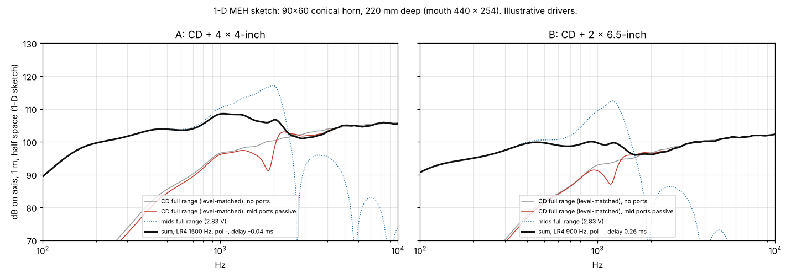

# Mini multiple-entry horn (MEH): research dossier and plan seeds

2026-10-29. Owner request (dictated): an internal + external research pass toward designing and optimising a **mini
multiple-entry horn** (Synergy / Unity class), smaller than JW Sound's Solana, one compression driver plus cone mids
on ports (2 x 6-inch or 4 x 4-inch), very small box, solid bass extension for EDM. **Research and plan seeds only: no
code in `hornlab_search/`, no configs, no GPU.** The goal is the parameter set, the measures and the typologies a later
plan will implement, and how the search (CMA-ES over GPU BEM) and a Boundary Lab refinement step fit around them.

Protocol: `hornlab-typology-research` skill (inventory first, then outside research, corrections table, checkable
properties). MEH was **deferred by the owner on 2026-10-24** (senior_pass 02 s6, row G17); this pass reopens it for
research only.

Labels: **[verified]** read in source or primary; **[measured]** computed here by a script in this folder;
**[inferred]** our reasoning; **[practitioner]** builder/forum report; **[unverified]** needs a check.
Raw web survey (Sonnet lane, verbatim): `mini_meh_2026-10-29/appendix_A_web_survey_raw.md`; read it through s8.
Scripts and outputs: `mini_meh_2026-10-29/calc/` (pure numpy/scipy, CPU, research only, not imported anywhere).

## 0. The short version

1. **Bass for EDM cannot come from the mid cones of a mini MEH.** Excursion-limited output of 4 x 4-inch is about
   93 dB at 50 Hz (1 m, half space); 2 x 6.5-inch about 97-101 dB; EDM at small-club level wants 115+ dB at 50 Hz,
   which needs about 840 cm^3 of volume displacement (one 18-inch). [measured, s5] So the design is either a
   **2-way mini MEH top + a separate sub**, or a **compact 3-way MEH with woofers in the horn walls** (the SH-50
   pattern shrunk). Both are typology candidates below.
2. **A mini mouth holds a pattern only down to about 1 kHz.** A 300 mm mouth holds 90 deg to ~940 Hz and 60 deg
   to ~1.4 kHz (K-law). Below that the box widens like any small speaker. [measured, s5]
3. **Entry distance is the core MEH trade-off, and the 1-D sketch quantifies it.** Mid ports close to the throat
   sum cleanly with the compression driver (quarter-wave rule: path <= c / 4f, 57 mm at 1.5 kHz) but cut a deep
   notch in the compression driver's response (18 dB at 20 mm, 9 dB at 50 mm, 2 dB at 70 mm for 4 x 4-inch);
   further out the notch fades but the sum through the crossover gets rougher. [measured, 1-D sketch, s6]
4. **The notch sits just above the port's own corner** (front chamber + port neck, a Helmholtz low-pass):
   notch ~1.15-1.4 x f_h. Small front chambers push it above the crossover and give the smoothest sum. [measured, s6]
5. **Our solver can already do most of the hard part.** The Julia engine builds one Neumann column per channel and
   solves them on one factorization, and returns each channel's complex pressure separately; on the fused CUDA path
   all channel columns are built in one pass. Only the Python wrapper refuses more than one source tag, and nobody
   computes the cross-impedance between entries yet. [verified 2026-10-29, fork source, s3]
6. **That makes a two-level search natural:** the GA moves geometry (needs a BEM solve), and for each solved geometry
   a fast inner optimiser picks drivers, chamber volumes, crossover, delay and polarity from the stored per-entry
   transfer functions and impedance matrix (milliseconds, no new solve). s10.
7. **Boundary Lab is the right refinement target**: its project format already has electrodynamic transducers
   (T/S inputs), voltage ports, interior air regions + port interfaces (FEM-BEM coupling) and channel synthesis
   (gain, delay, polarity, HPF/LPF). [verified for v0.5.0, s3; current version: s7]
8. Corrections to our own docs: the frozen plan says "the MEH geometry path is already there" (mesher tags 8-11).
   The mesher has the **tag names only**, no MEH builder. [verified, s8]

## 1. Reading of the dictated request

| Heard | Read as | Changes the answer? |
|---|---|---|
| "not as large ... the Solana" | smaller than JW Sound's Solana | sets the size class (Solana dimensions: s7) |
| "your morning driver / I macher driver" | one compression driver (horn driver) | yes: 2-way MEH core |
| "too seccion drivers or maybe 4 in drivers on matsure" | two 6-inch (6.5") drivers, or four 4-inch, "I'm not sure" | two candidate mid complements, both studied |
| "really small, solid good bass extension for EDM" | very small box, strong low end for dance music | yes: forces the s5 reality check and the 3-way / sub split |
| "boundary lab" | JW Sound's Boundary Lab (BEM app; we inventoried v0.5.0) | the refinement / cross-check tool |
| "use the genetic algorithm" | our CMA-ES search (`search/cma.py`) | the parameter-vector design in s10 |

## 2. Source table

| Source | What it gives us | Status |
|---|---|---|
| `docs/research/senior_pass_2026-10-24/02_TYPOLOGIES_AND_MULTICELL.md` s6, row G17 | MEH deferred by owner; Julia driver loops channels on one factorization; ports via CAD -> STEP | internal, verified 2026-10-24 |
| `docs/plan/12_RESEARCH_BASIS.md` s3, s9 (frozen) | mesher tags 8-11 named MEH; "CD notch universal, documented, unsolved"; port-neighbourhood topology optimisation as a phase-3 bet; quarter-wave entry rule kept as a design check | internal (frozen); "geometry path is there" corrected in s8 |
| `hornlab_search/constants.py:18-19` | `MEH_ENTRY_FRACTION = 0.25` (d <= c / 4 f) | internal, verified |
| `docs/BOUNDARY_LAB_0.5_RESEARCH.md`, `docs/research/boundary_lab_0.5/bl_inventory.md` | BL 0.5.0: electrodynamic_transducer, voltage port, bounded_air + interface, vented-enclosure provider, channel synthesis, named assemblies (symmetry Off) | internal, verified 2026-10-21 |
| `docs/IMPLEMENTATION_PLAN_2026-10-27.md` s9 | Solana (JW Sound): multi-entry, ~8 radial flutes, GA-searched, polar notes from owner screenshots | internal, owner screenshots |
| `docs/DRIVER_MODEL.md`, `hornlab_search/driver/compression.py` | lumped compression-driver circuit over the BEM throat impedance; Mmd vs Mms (BL issue #78) | internal, verified |
| `docs/research/HANDOFF_CONE_DRIVER_MODEL_2026-10-28.md`, `typologies/CONE_MIDHORN_AXEHEAD_2026-10-28.md` | cone-driver modelling plan, Keele/Hornresp 1-D chain (WP-M0), measurement recipe | internal |
| `docs/research/campaign_2026-10-26/LANE_E_WEB_DRIVERS_BRIEFS.md` | Danley SH50 row (50x50, 711x711x648, 1"+4x4"+2x12") | internal web lane, 2026-10-26 |
| hornlab-beat-bem fork `llevaachingada/hornlab-beat-bem` main (cloned 2026-10-29) | `config.py:462-464` one tag only; `capabilities.py:236-242, 380-390`; `BeatEngineDriver.jl:452-536` channel DSP, `:767-800` one Neumann column per channel, `:1030-1055` per-radiator impedance from the mixed field, `:1660-1680` per-channel pressure rows on the wire | verified (source read) |
| hornlab-waveguide-mesher `m3gnus/hornlab-waveguide-mesher` @ a833a7e (2026-10-26) | `tags.py`: MID_CHAMBER 8 ... MID_PORT_EXIT_RIGHT 11, `SOURCE_TAGS` = {2, 10, 11}; test "bigmeh extension tags"; no MEH builder | verified (source read) |
| `calc/meh_first_principles.py` -> `calc/first_principles.md` | excursion SPL, iron law, K-law, quarter-wave, port corner, conical sizes | measured (textbook formulas) |
| `calc/meh_1d_sketch.py`, `calc/meh_1d_study.py` -> `calc/study_out.md`, `calc/meh_1d_cases.png` | 1-D spherical-wave MEH: summation, CD notch, excursion | measured (1-D, illustrative drivers) |
| `calc/meh_zmatrix_check.py` -> `calc/zmatrix_check.md` | the s10.1 decomposition (per-source solve + Z matrix + lumped coupling) equals the direct solve; Z reciprocity | measured (1-D) |
| External sources (Danley, JW Sound, Boundary Lab current, DIY builds, drivers) | see s7 and the appendix source table | per appendix A |

## 3. What the repo and our forks already know (inventory)

| Topic | Established | Gap |
|---|---|---|
| Owner decision | MEH deferred 2026-10-24 (G17); reopened for research 2026-10-29 | implementation still needs an owner go |
| Solver, engine | multiple radiators per channel; per-channel level / polarity / delay / HPF / LPF (`channel_drive`, LR-type crossovers); one Neumann column per channel, one factorization; fused CUDA builds all columns in one pass; per-channel complex H / V / sphere pressure rows returned [verified] | none at engine level for the far field |
| Solver, Python package | `SolveConfig.velocity_sources` must have exactly one tag (`config.py:462`); capabilities: "engine has multiple source channels; the package request compiler drives exactly one tag" [verified] | opt-in fork change: several tags, one unit-drive channel each, no synthesis |
| Entry coupling | `impedance_for_radiators` integrates the MIXED boundary pressure over each radiator (self + mutual already summed) [verified] | per-channel boundary pressure averaged over each tag = the impedance matrix Z_ij; small fork change (the per-channel boundary pressures already exist in memory, `channel_boundary_pressures`) |
| Mesh, parametric | horn families build one source (tag 2) | no ports |
| Mesh, CAD route | `mesh/step_build.py` maps STEP labels `driver` -> tag 2, `wall` -> tag 1, refuses anything but exactly one `driver` face (`:274-279, 364`) [verified] | multiple labelled driven faces (one per entry group) |
| Mesher tags | 8 `mid_chamber`, 9 `mid_port_interior`, 10/11 `mid_port_exit_left/right`, 12 `mouth_aperture`; 10 and 11 are in `SOURCE_TAGS` [verified] | no builder uses them; names are left/right-specific |
| Driver model | compression-driver circuit with front + rear chamber, conj(z) convention, Mmd rule | no cone + port + front-chamber entry network; no multi-port coupling |
| Boundary Lab 0.5.0 | electrodynamic transducer (Re, Le, Bl, Mmd, Cms, Rms; rigid_translation), voltage port (2.83 V basis), bounded_air interior + interface boundaries, vented-enclosure provider, channel synthesis, headless `blab project solve`; exterior-only rejects electrodynamic transducers; named assemblies require symmetry Off [verified 2026-10-21] | current version and any MEH example: s7 |
| Design checks | K-law constant, f11, MEH quarter-wave fraction in `constants.py` | none |

## 4. How a multiple-entry horn works (designer terms)

To be cross-checked against the Danley primaries in s7; until then [inferred] + [practitioner].

1. **One horn, one apex.** A straight-walled (conical / pyramidal) horn has a spherical wavefront whose centre is
   the apex. Everything that enters near the apex leaves the mouth as one wavefront from one point: no
   front-to-back offset between drivers, no lobing between sources spaced apart on a baffle.
2. **Entries close to the apex.** Each cone driver enters through a port in the horn wall at a path length from the
   throat that is small against its highest frequency (rule of thumb d <= c / 4 f_top). Then its sound and the
   compression driver's sound arrive at the mouth together and sum like one source through the crossover.
3. **Front chamber + port = an acoustic low-pass.** The air between the cone and the port is a compliance, the port
   neck is a mass: a 2nd-order low-pass at f_h = c / 2 pi * sqrt(S / (V L_eff)). It adds acoustic slope to the
   electrical crossover and compresses the cone (Sd / S_port > 1), which raises efficiency.
4. **The ports are holes in the HF horn.** Seen from the compression driver, each port + chamber + cone is a side
   branch (a resonator hanging on the horn wall). Near its resonance it absorbs/reflects the HF wave: the "CD notch".
   It is the classic unsolved-in-general MEH defect (12_RESEARCH_BASIS s9).
5. **Delay and polarity.** The mids enter downstream of the throat, so their sound leads the compression driver's by
   about (path) / c, plus the filter group delays. A small delay / polarity choice makes the sum flat.
6. **Woofers near the mouth (3-way).** Below a few hundred Hz the wavelength is long against the whole horn, so
   woofers can enter far out (d <= c / 4 f at 300 Hz = 286 mm) and use the horn walls as a baffle / partial horn.

## 5. Size and bass: the honest numbers [measured, `calc/first_principles.md`]

Formulas: excursion-limited p = rho w^2 Vd Q / (4 pi r) (Q = 2, half space); Small's efficiency
eta0 = (4 pi^2 / c^3) fs^3 Vas / Qes; Keele's K-law (`constants.KEELE_K`); quarter-wave d = c / 4f;
Helmholtz port corner. Cone values are class-typical illustrations, not products (real drivers: s7 driver table).

**Excursion-limited SPL, 1 m, half space (dB):**

| Complement | Vd (cm^3) | 40 Hz | 50 Hz | 63 Hz | 80 Hz | 100 Hz | 125 Hz |
|---|---|---|---|---|---|---|---|
| 4 x 4-inch mid (Xmax 3) | 66 | 89 | 93 | 97 | 101 | 105 | 109 |
| 2 x 6.5-inch mid (Xmax 4) | 108 | 93 | 97 | 101 | 105 | 109 | 113 |
| 2 x 6.5-inch midbass (Xmax 6) | 162 | 97 | 101 | 105 | 109 | 113 | 117 |
| 2 x 8-inch woofer | 264 | 101 | 105 | 109 | 113 | 117 | 121 |
| 2 x 10-inch woofer | 490 | 106 | 110 | 114 | 118 | 122 | 126 |
| 1 x 15-inch | 704 | 110 | 113 | 117 | 122 | 125 | 129 |
| 1 x 18-inch sub | 1200 | 114 | 118 | 122 | 126 | 130 | 134 |

Volume displacement needed for **115 dB at 50 Hz**: 841 cm^3; for 120 dB: 1,496 cm^3. A vented box gains some
output near tuning; the order of magnitude does not change.

**Iron law (half-space sensitivity at 1 W, ideal vented B4):** 20 L tuned for f3 50 Hz -> 90 dB; 30 L -> 92 dB;
50 L -> 94 dB. Small boxes can reach 50 Hz; they cannot do it loudly. Thermal power then decides level, and
excursion decides it first below ~60 Hz.

**Pattern control vs mouth (K-law floor, Hz):**

| mouth dimension | 60 deg | 90 deg |
|---|---|---|
| 250 mm | 1,693 | 1,129 |
| 300 mm | 1,411 | 941 |
| 400 mm | 1,058 | 706 |
| 500 mm | 847 | 564 |

**Entry distance limits (quarter-wave, from the acoustic apex):** 1.5 kHz -> 57 mm; 1 kHz -> 86 mm; 600 Hz ->
143 mm; 300 Hz -> 286 mm. **Port corners:** a 4-inch with 15-30 cm^3 front chamber and 10-15 cm^2 port sits at
~1.5-2.3 kHz; a 6.5-inch with 100-160 cm^3 and 20-30 cm^2 sits at ~0.8-1.2 kHz. So the 4-inch complement naturally
crosses higher (1.2-2 kHz, easier on a 1-inch compression driver), the 6.5-inch lower (0.7-1 kHz, which asks for a
1.4-inch driver or a 1-inch rated that low).

**Consequence for typologies:** "really small + EDM bass" is two boxes (mini MEH top + sub) or one bigger box
(3-way MEH with 8-10-inch woofers: ~105-110 dB at 50 Hz half space in roughly 50-80 L). The owner picks; s13 Q1.

## 6. 1-D sketch: what entry geometry does [measured, 1-D, illustrative drivers]

Model (`calc/meh_1d_sketch.py`): flat-wall conical horn as an exact spherical-wave duct (checked against the
analytic infinite-cone throat impedance to 4e-16); compression driver = mass-controlled source with a 700 Hz
2nd-order resonance; each entry = N cone drivers (T/S Thevenin + sealed rear box) -> front chamber -> port neck ->
horn wall; mouth = baffled piston. Horn 90 x 60 deg, 220 mm from apex, mouth 440 x 254 mm, 1-inch throat.
**Limits:** 1-D keeps only the spherical mode; it ignores where the port sits around the wall, port-excited
higher-order modes, mouth directivity. Its job is to show sensitivities and ranges, not final numbers.



| case | entry path from throat | f_h | XO (LR4) | best delay / polarity | ripple through XO | CD notch |
|---|---|---|---|---|---|---|
| A: CD + 4 x 4-inch, 30 cm^3, 12 cm^2 | 50 mm | 1,624 Hz | 1.5 kHz | -0.04 ms, inverted | 2.3 dB rms | 1,865 Hz, -8.9 dB |
| B: CD + 2 x 6.5-inch, 120 cm^3, 25 cm^2 | 75 mm | 1,018 Hz | 900 Hz | 0.26 ms, normal | 1.2 dB rms | 1,189 Hz, -6.5 dB |

**Entry position sweep (case A):** path 20 mm: notch -18.2 dB, sum ripple 5.2 dB; 35 mm: -13.8 / 2.6; 50 mm:
-8.9 / 2.3; 70 mm: -2.4 / 2.5; 95 mm: -3.1 / 3.0; 125 mm: -3.5 / 4.5; 165 mm: -0.7 / 5.2. The sweet spot is
near the quarter-wave limit (57 mm at 1.5 kHz), not as close as possible.

**Front chamber / port sweep (case A position):** the notch tracks the port corner (notch / f_h = 1.15-1.4);
15 cm^3 chambers give the shallowest notches (-1.8 to -6.3 dB) and the smoothest sum (1.9 dB); 60 cm^3 chambers
give -7.8 to -13.8 dB and 2.8-4.9 dB ripple. Small chambers mean high compression and fast port air: the limit
moves to port velocity (chuffing) and cone clearance, which the 1-D model does not see.

**Excursion:** with no high-pass, 20 V (66 W into 6 ohm) drives the illustrative 4-inch past its 3 mm Xmax below
~200 Hz, the 6.5-inch past 4 mm below ~120 Hz. Mids need a high-pass at 150-250 Hz at high level; bass belongs to
woofers or a sub (agrees with s5).

**What this tells the search (ranges for knobs, s10):** entry path 0.6-1.3 x the quarter-wave limit of its upper
crossover; port corner 0.9-1.6 x the crossover; front chamber 10-60 cm^3 (4-inch), 60-200 cm^3 (6.5-inch); port
area 5-25 cm^2 (4-inch), 15-45 cm^2 (6.5-inch); delay -0.5..+1.2 ms and polarity as free network knobs. [inferred
from the sweeps; the BEM stage replaces these numbers]

## 7. External findings (web lane, Sonnet, 2026-10-29)

PENDING: filled from `mini_meh_2026-10-29/appendix_A_web_survey_raw.md` when the lane returns.

## 8. Corrections

| Claim | Where | Correction | Evidence |
|---|---|---|---|
| "Tags 8 through 11 are multiple-entry-horn structures. The mesher already has MEH scaffolding ... the geometry path is already there" | `docs/plan/12_RESEARCH_BASIS.md` s3, s9; `docs/plan/04_TASK_DESIGN_MESH.md:289` (frozen) | The mesher defines the tag NAMES (8-12) and lists 10/11 as source tags; no builder, config key or example produces them. MEH geometry must come from our CAD -> STEP route (or a new builder) | `hornlab_mesher/tags.py` @ a833a7e; repo-wide grep: only `tags.py` and one test |
| "Julia driver already loops several channels on one factorization" | senior_pass 02 s6 | Confirmed and sharpened: one Neumann column per channel; fused CUDA builds all columns per frequency in one pass; per-channel pressure rows are returned; impedance is computed from the mixed field only | fork `BeatEngineDriver.jl:767-800, 1030-1055, 1590-1680` |

External corrections: PENDING (s7).

## 9. Typology candidates (hypotheses; names neutral until a published reference validates them)

Each is a labelled experiment, not an attributed construction (R9 rename-gate pattern): no "Synergy" in a name
until a published Danley geometry is matched.

| ID | Name (working) | Drivers | Horn | Entries | Band / crossovers | Box | EDM bass |
|---|---|---|---|---|---|---|---|
| T1 | `meh2_4x4` | 1-inch CD + 4 x 4-inch | flat-wall conical, 90x60 / 80x80 / 90x90, 160-250 mm deep | 4 ports, one per wall or 2 per side wall, path 35-80 mm | mids HP 150-250 Hz, XO 1.2-2 kHz | ~12-30 L [inferred] | separate sub, XO 80-120 Hz |
| T2 | `meh2_2x65` | 1.4-inch (or low-XO 1-inch) CD + 2 x 6.5-inch | conical 90x60 / 80x50, 200-300 mm deep | 2 ports on the side (or top/bottom) walls, path 60-110 mm | mids HP 100-150 Hz, XO 0.7-1 kHz | ~25-45 L [inferred] | separate sub, XO 80-100 Hz |
| T3 | `meh3_compact` | T1 or T2 core + 2 x 8-inch or 2 x 10-inch woofers | conical, 250-350 mm deep | mids as T1/T2; woofers through large openings near the mouth, path <= c / 4 f_w | woofers to ~300-400 Hz, mids above | ~50-80 L [inferred] | ~105-110 dB at 50 Hz half space in-box; sub optional |
| T4 | `meh_fluted` (later) | as T1/T2 | lobed / fluted walls (Solana lineage) | entries between flutes | as T1/T2 | as T1/T2 | as T1/T2 |

T4 depends on the harmonic FREEFORM station or a CAD wall law (IMPLEMENTATION_PLAN_2026-10-27 s9b) and on T1/T2
working first.

**Checkable properties (before any typology code ships):**
- geometry: apex, wall angles and mouth W x H match the knobs within 0.2 mm; every port lies wholly on its wall;
  port path from the acoustic apex reported and checked against `MEH_ENTRY_FRACTION`;
- topology: quarter symmetry holds (ports mirror-paired), each entry group is one labelled tag, the CD throat is
  round at the exit (owner throat rule);
- solver bookkeeping: superposition (solve channels separately vs together, identical field), reciprocity
  (Z_ij = Z_ji within solver noise), symmetry copy factor on Z (the 6.02 dB trap in `impedance_for_radiators`),
  port-patch sign (a positive drive pushes air into the horn, in phase with the CD at low frequency);
- network: with all entries passive and blocked (Y = 0) the CD-only response equals the single-source solve;
  1-D sketch vs BEM agree below the first cross-mode at the entry.

## 10. Mapping onto hornlab-search

### 10.1 Solve strategy: one geometry solve, many systems

```
geometry knobs --CAD/STEP--> mesh with tags: CD throat (2), entry group A (e.g. 10), entry group B (e.g. 11)
     |
     v  BEM, one factorization per frequency, one unit-drive channel per group (quarter model)
per-channel complex H / V / diagonal / sphere pressures  +  Z matrix (mean pressure on tag i per unit drive of j)
     |
     v  post-solve network (no BEM): driver T/S + rear box + front chamber + port neck per group (Norton U_sc, Y),
        CD model, crossover / gain / delay / polarity / EQ per channel
U = (I + Y Z)^-1 U_sc   ->   p(theta, f) = sum_j H_j(theta, f) U_j   ->   metrics -> J
```

The coupled step `U = (I + Y Z)^-1 U_sc` is what puts the CD notch, the port loading of the mids and the
mid-to-mid interaction into the result without meshing the chambers (level L1 below). It is the standard
BEM + lumped-network method (AKABAK / Boundary Lab pattern) [inferred; external confirmation in s7].

**Checked on the 1-D model [measured]:** solving the bare horn once per source (unit injection, other sources
rigid), then coupling the lumped networks with the formula above, reproduces the direct solve to 5.6e-16 (one and
two entry groups, 100 Hz-8 kHz), and the bare-horn Z is reciprocal to the same level
(`calc/meh_zmatrix_check.py` -> `calc/zmatrix_check.md`). The decomposition is exact for lumped entries; what
L1 approximates is only "uniform velocity across each port patch".

### 10.2 Fidelity ladder

| Level | What is modelled | Cost per design | Use |
|---|---|---|---|
| L0 | analytic + 1-D sketch (this folder) | ms | screen ranges, sanity-check BEM, inner-loop warm start |
| L1 | exterior BEM: horn + box + flush port apertures as driven patches; chambers, necks, drivers lumped; Z matrix | one screen solve (minutes) | the GA's outer loop |
| L2 | exterior BEM with front chambers and port necks meshed, cone faces as driven surfaces inside the cavities | 1.5-3x L1 dofs, thin-gap care | finalists: neck shape, chamber modes, the real notch |
| L3 | Boundary Lab coupled FEM-BEM, electrodynamic transducers, voltage ports, channel synthesis | hours, full model (assemblies need symmetry Off) | refinement + independent cross-check before printing |
| L4 | prototype measurement | days | truth (s11) |

### 10.3 Parameter vector

Geometry knobs need a BEM solve (outer CMA-ES); network knobs do not (inner optimiser per stored solve).

| Group | Knob | Range (first guess) | Level | Note |
|---|---|---|---|---|
| horn | `cov_h_deg`, `cov_v_deg` (wall half-angles) | 40-60, 25-45 | geometry | Synergy horns are straight-walled [practitioner; s7] |
| horn | `depth_mm` (apex to mouth) | 150-350 | geometry | size vs pattern floor (s5) |
| horn | `throat_exit_mm`, `throat_len_mm`, `throat_blend` | 25.4 / 36; 0-20; 0-1 | geometry | round coupling plane (owner rule) |
| horn | `mouth_roll_mm`, `mouth_corner_mm` | 0-40, 0-30 | geometry | diffraction at a small mouth |
| box | `box_margin_mm`, `baffle_edge_mm` | 10-40, 0-30 | geometry | freestanding vs enclosure mounting (WP12) |
| entry (per group) | `wall` | {side, top/bottom, corner} | geometry, categorical | one CMA run per choice |
| entry | `count` | {2, 4} | geometry, categorical | 2 = one per opposite wall |
| entry | `path_mm` (port centre from apex, along the wall) | 0.6-1.3 x c / 4 f_x | geometry | s6 |
| entry | `port_shape`, `port_area_cm2`, `port_aspect` | {round, slot, multi-hole}; 5-45; 1-6 | geometry | slot along the wall = shorter path spread |
| entry | `port_offset` (across the wall) | -0.3..0.3 of wall width | geometry | breaks the left/right pairing if non-zero |
| woofer (T3) | `w_path_mm`, `w_open_area_cm2` | <= c / 4 f_w; 80-400 | geometry | |
| network | driver per group | from `examples/drivers/` | inner | categorical; enumerate |
| network | `v_front_cm3`, `l_neck_mm` | 10-200, 5-25 | inner (L1) / geometry (L2) | moves to geometry at L2 |
| network | `v_rear_l`, rear vent (T3) | 0.5-6 / box | inner | sealed per driver, or shared |
| network | crossover type / fc per channel | LR2/LR4/BW3; ranges s6 | inner | |
| network | gain, delay, polarity, PEQ (2-4 biquads) per channel | +-12 dB, -1..+2 ms, +-1 | inner | DSP is free; geometry is not |
| network | drive limits (V_max, P_AES per driver) | datasheet | inner | for max-SPL terms |

### 10.4 Objective terms

Existing v4 terms keep their meaning but are computed on the **summed system** response after the network, not on
one source: coverage (beamwidth vs target), ripple, DI and DI slope, flatness of normalised polars, loading.

New candidate terms (each encodes a new priority, so each needs owner approval before it enters J):

| Term | Measures | Why |
|---|---|---|
| `xo_lobing` | H and V polar consistency through each crossover octave (beamwidth jump, off-axis notch depth) | entries at different positions lobe off axis |
| `notch` | depth and width of narrow dips in the listening window that EQ cannot fix (CD notch) | the MEH signature defect |
| `max_spl` | excursion-, thermal- and port-velocity-limited SPL per band, at a drive budget | small boxes run out of excursion first |
| `lf_ext` | frequency where max SPL falls below a target (e.g. 110 dB) | the "EDM bass" knob, honest in dB |
| `coherence` | group-delay spread across the band and across angles | the claimed point-source benefit (the cone_plughorn coherence term proposal applies here too) |
| `size` | box volume and outer W x H x D vs the brief envelope | "really small" as a hard constraint |

### 10.5 Software changes a later plan will need (seeds, not tasks)

- Fork (opt-in, default byte-identical): several `velocity_sources` tags, one unit-drive channel each, no synthesis;
  per-channel per-tag mean pressure -> Z matrix in the result; capability flags updated. Tests: superposition,
  reciprocity, symmetry factor.
- Mesh: STEP route accepts `driver` plus `entry_<group>` labels, each to its own tag; a tag namespace decision
  (reuse mesher 10/11 or new ids); `mesh_meta.json` echoes per-tag area and centroid.
- CAD tool: `tools/cad/meh.py` (build123d, like `multicell.py` / `plughorn.py`): conical horn + box + flush port
  apertures (L1); later chambers and necks (L2).
- Network module: generalise `driver/compression.py` into a multi-port network (cone + rear box + front chamber +
  neck Norton entries; CD; Z coupling; DSP), with the energy-balance test pattern already used there.
- Search: nested optimisation (outer CMA-ES on geometry, inner fast optimiser on network); stored per-channel data
  makes re-scoring with new drivers or DSP free (dataset records must keep per-channel pressures and Z).
- Brief: drivers per group, crossover constraints, drive budget, size envelope, sub crossover.
- Boundary Lab exporter for MEH projects (named assembly with electrodynamic transducers + channels), headless solve,
  compare per-channel results with ours.

### 10.6 Mesh budget (rough)

A 90 x 60 conical horn 220 mm deep in a freestanding box has ~0.6 m^2 of surface; a quarter model at lambda/6 for
10 kHz (5.7 mm elements) is ~11k triangles, ~5-6k dofs [inferred], under the 12k cap with room for port refinement.
Extra channels are nearly free per frequency (s3). L2 chambers add small cavities and thin gaps (near-correction is
CPU-only today: `_refuse_unsupported_solver_knobs`).

### 10.7 Hand-off to Boundary Lab

What we pass: the finalist's full (un-reduced) mesh in metres, tags per entry, one electrodynamic transducer per
driver with datasheet T/S (Mmd, not Mms), voltage ports, channel DSP from our inner optimiser, interior air regions
for chambers if L2/L3. What BL adds: coupled interior FEM for chambers and necks, its own BEAT build as an
independent solver, GUI inspection. Rules from our BL research still apply: phasor conjugation, `scale_to_m = 1.0`,
its Julia host is not shut down by its CLI (GPU hygiene rules 1, 2, 6).

## 11. Measurement plan (when a prototype exists)

1. T/S of every driver (impedance sweep, added mass), Mmd from Mms minus front air load.
2. Per-channel acoustic transfer: gated far-field (or ground-plane) on axis and polars every 10 deg H and V,
   **one channel at a time with the others connected but silent** (that is the model's Z coupling), then summed.
3. CD notch check: CD alone with mid ports open (cones in place) vs ports taped shut. The difference is the
   side-branch effect the L1 model predicts.
4. Electrical impedance per channel in the box (shows port and chamber resonances).
5. Excursion at the band bottom and max SPL / compression sweep; port air noise at high level.
6. Group delay on axis; sum vs prediction through each crossover.

## 12. Plan seeds (not a plan)

Order and gates a later plan can adopt:

| Seed | Content | Gate |
|---|---|---|
| MEH-0 | owner decisions (s13) | none |
| MEH-1 | promote the 1-D sketch to a validated calculator (vs a published Hornresp/AKABAK/BL case) | match within 1 dB below the first cross-mode |
| MEH-2 | driver library: 4-inch / 6.5-inch mids, 1 / 1.4-inch CDs with Sd + Mmd (s7 table) | every number has a datasheet URL |
| MEH-3 | fork change: multi-tag, per-channel outputs, Z matrix | superposition + reciprocity + symmetry tests pass on CPU and CUDA |
| MEH-4 | CAD tool + multi-label STEP route (L1 geometry) | shape checks + quarter-symmetry pairing |
| MEH-5 | network module + inner optimiser | energy balance; 1-D vs network-on-BEM agreement |
| MEH-6 | objective terms + brief (owner approval per term) | T0-style gate on known cases |
| MEH-7 | first GPU screen (owner go): T1 and T2 seeds | L0 vs L1 agree in trend |
| MEH-8 | Boundary Lab export + cross-check of one finalist | per-channel results within agreed tolerance |
| MEH-9 | print + measure (s11) | model vs measurement report |

## 13. Open questions for the owner

1. **Bass:** separate sub (2-way mini top), or bass in the same box (3-way, bigger)? Target: f3 and SPL at 50 Hz?
2. **Size:** a number for "really small" (outer W x H x D or litres) and weight.
3. **Use:** DJ booth monitor, small club tops, mobile rig, home? Sets coverage (90x60 vs 80x80 vs 60x40) and level.
4. **Mids:** 4 x 4-inch (higher crossover, gentler on a 1-inch CD) or 2 x 6.5-inch (lower crossover, more output
   down low, wants a 1.4-inch CD)? The search can carry both; the brief needs one target at a time.
5. **Processing:** active DSP per channel assumed (it is what makes the inner optimiser free). OK?
6. **New J terms (s10.4):** which ones to add, and their weights.
