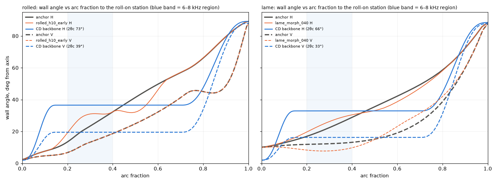

# CD wall-angle backbone under a retained returned lip (rolled and Klangfilm–Lamé): research dossier

2026-11-25. Status: **research and CPU feasibility only; no code, no solve.** UPDATE 2026-11-25: the kernel and adapters are built (`_cd_backbone_v1.py`, `cd_backbone_family.py`; knobs `g_bb_h`/`g_bb_v`/`g_bb_throat_frac`/`g_bb_rollin_frac`) and five fixed-candidate verifies were run; rolled `bb_h` 0.5 passes the predeclared rules (H 65.7 deg at 8 kHz, J 8.121 → 5.407, epw-9 confirmed), while rolled 1.0 and both Lamé doses fail on the 2–4 kHz band and throat loading. See [the evidence readout](../../evidence/cd_backbone_2026-11-25/README.md). The construction proposed here is
**[original-hypothesis]**, labelled hypothesis, no published name (rename gate / R9 pattern). It grows out of the
matched BEM attribution in [directivity_attribution_2026-11-24](../../evidence/directivity_attribution_2026-11-24/README.md)
and reuses the existing rolled and Lamé contracts
([rolled](../../knowledge/contracts/rolled_section_pucker.md), [Lamé](../../knowledge/contracts/klangfilm_lame_hv.md))
and [ROLLED_CD_WALL_ANGLE_RESEARCH_2026-11-20.md](ROLLED_CD_WALL_ANGLE_RESEARCH_2026-11-20.md).

## Sources

Outside literature was collected by a research subagent; its full report is kept verbatim in
[RETURNED_LIP_CD_BACKBONE_WEB_REPORT_2026-11-25.md](RETURNED_LIP_CD_BACKBONE_WEB_REPORT_2026-11-25.md). Items marked
*re-read* were checked again in this session against the source.

| Source | What it gives us | Status |
|---|---|---|
| Batík, [R-OSSE Acoustic Waveguide rev7](https://www.at-horns.eu/release/R-OSSE%20Waveguide%20rev7.pdf), Dec 2022 | Closed-form returned-lip waveguide (R, a, r0, a0, k, r, m, b, q); reference case R 130 mm, a 39°, r0 12.7 mm, a0 7.5°, k 1.8, r 0.3, b 0.3, m 0.8, q 3.7 → 260 mm wide, < 80 mm long (p. 7); ABEC BEM with a pulsating spherical cap at a0 (p. 8); a0 0° vs 15°: shape and throat impedance change, 0/30/60° polars and DI nearly identical (pp. 10–11); R 130 → 260 mm extends LF control, HF unchanged (pp. 12–13); k trades rising DI for smoothness and throat impedance (p. 16) | primary (author), *re-read* pp. 1–18 |
| Batík, [OS-SE Waveguide](https://www.at-horns.eu/release/OS-SE%20Waveguide.pdf), 2020 | OS forms r = √(r0² + 2 r0 z tan a0 + z² tan² a) and the generalized k form; superellipse termination; morph to a non-round mouth | primary (author), agent-read |
| Keele, [AES preprint 1038](https://audioroundtable.com/misc/Keele_Horn_Design_AES_1038.pdf), 1975 | Conical walls give a constant solid angle; exponential-horn directivity depends on flare rate; CE horn = exponential throat + straight conical body at the coverage angle + secondary mouth flare against mid-band narrowing; mouth size X = K/(θ f), K = 2.5×10⁴ m·deg·Hz, scoped to that horn class | primary (author), agent-read |
| Kolbrek, [Horn Theory: An Introduction, parts 1–2](https://audioxpress.com/assets/upload/files/kolbrek2884.pdf), audioXpress 2008 | OS and CE synthesis formulas; waistbanding (mid-band narrowing) and its fixes; spherical-wave and reversed-flare horns | secondary, agent-read |
| Kasolis, Wadbro & Berggren, [Struct. Multidisc. Optim. 46](https://people.cs.umu.se/martinb/downloads/Papers/KaWaBe12M.pdf), 2012 | Angle-between-segments (discrete curvature) design variables give smooth horns; a handful of control points under-uses BEM optimization | secondary, peer-reviewed, agent-read |
| Hipperson, Hargreaves & Cox, [Forum Acusticum 2026](https://dael.euracoustics.org/confs/fa2026/data/articles/000191.pdf) | Differentiable BEM, spline axial profile, 70 × 50° target 4–18 kHz; core width set largely by the starting profile, smooth edge termination gave most of the directivity-plot cleanup | secondary, peer-reviewed, agent-read |
| Bängtsson, Noreland & Berggren 2003; Udawalpola & Berggren 2008; Morgans et al. 2008 | Smooth (Bernstein/spline) parameterizations beat vertex displacement; directivity vs efficiency trade-off; EGO surrogate for frequency-independent beamwidth | secondary, peer-reviewed, abstract/snippet only |
| Geddes (JAES 1989; diyAudio "Geddes on Waveguides") | OS theory; match waveguide entrance to driver exit to limit higher-order modes | JAES not read (paywalled); forum snippet only |
| Repo: [ROLLED_CD_WALL_ANGLE_RESEARCH_2026-11-20.md](ROLLED_CD_WALL_ANGLE_RESEARCH_2026-11-20.md), [Lamé contract](../../knowledge/contracts/klangfilm_lame_hv.md), [rolled contract](../../knowledge/contracts/rolled_section_pucker.md), [senior pass 02 G6](../senior_pass_2026-10-24/02_TYPOLOGIES_AND_MULTICELL.md) | Existing additive wall-angle law and its limits; Phase B is a direct slope law but drops the return; G6 proposes θ(s) = θ_OS(s) + Σ c_k cos(kπs/L) | repo research |
| Repo: [sculpted home-900 V11 readout](../../evidence/sculpted_xo900_v11_2026-11-21/README.md) | R-OSSE backbone with a returned lip meets this brief well: R3 J 2.694, H/V RMS error 4.47° / 4.10° (51-frequency tier, not the 29-frequency grid used here), 575.5 × 443.0 × 408.5 mm | repo evidence [measured, simulated] |


## 1. Why the current geometry limits the optimizer (repo evidence)

**Measured on the matched verify grid [measured, BEM, simulated]:**

- 6–8 kHz H width tracks the wall angle at about 20–40 % of the pre-roll arc (≈ 55–110 mm of H wall from the throat)
  on both bodies. Raising the rolled H wall there (existing CD law, window 0.12/0.40/0.65, +10°) widened 6–8 kHz H
  by +7.6…+8.4° and put 8 kHz H in the corridor; the same law placed later, or acting on the return, had no HF
  authority. Lamé: earlier round→Lamé transition and a negative H interior gain both widen 6–8 kHz H, and both raise
  the H wall in that band. All effects held within 0.3° at epw 9.
- A station-map heuristic (width ≈ 2 × wall angle at a frequency-dependent station, half an octave toward the
  throat, fitted gain 0.6–0.7) predicted the 6–8 kHz H change of eight unseen candidates within 2° on average.

**What the parents do with the wall [measured, CPU geometry, `backbone_feasibility.json`]:**

| Meridian | Roll-on (max-z) station z, r mm | Straight chord angle (2×) | Parent wall at 10 / 20 / 30 / 45 % arc |
|---|---|---:|---|
| Rolled H | 187.4, 183.8 | 41.5° (83°) | 7.6 / 13.5 / 23.4 / 36.9° |
| Rolled V | 214.3, 129.6 | 27.5° (55°) | 4.7 / 6.8 / 13.3 / 21.7° |
| Lamé H | 207.3, 182.8 | 38.5° (77°) | 12.9 / 17.0 / 22.4 / 32.2° |
| Lamé V | 169.7, 96.5 | 24.8° (50°) | 11.3 / 11.9 / 12.3 / 14.0° |

Both mouths are already placed where a straight wall would give roughly the 80 × 50 target. The parents spend the
HF-critical first 30–45 % of the wall at 5–23° and make up the angle late, near the roll. That is the flare law of an
exponential-like spiral and of a spherical-wave (Kolbrek/Ahlswede) horn — neither is a CD law. The existing
additive laws are small, zero-mean perturbations (rolled CD kernel: one shared H/V window, ≤ 20°, net normal
offset zero; Lamé Phase A: entrance tangent plus a mid bump inside the forward branch). They cannot produce a
sustained conical body; the best they did was a short ~31° plateau (`rolled_h10_early`), which already gave a nearly
flat 69–75° H from 2.3 to 8 kHz.

**What a CD backbone could reach under the same roll-on station [inferred, CPU geometry]:** a wall-angle schedule
with a C2 throat transition (2° → θc over 15 % of the arc), a conical body at θc and a C2 terminal roll-in to the
parent's own tangent at the roll-on station (≈ 88–89°) over the last 30 %, solved to land exactly on that station,
gives θc = 36.5° H / 19.5° V on the rolled anchor (≈ 73° × 39° if width ≈ 2θ) and 32.9° / 16.3° on the Lamé
(≈ 66° × 33°). Shorter roll-ins raise θc (rolled 37.1° / 20.9° at 10 % / 25 %). All four solve with monotone radius.
So: **H is limited by the parameterization; V at high frequency is also limited by where each mouth begins to
roll**, because a smooth turn into an ~89° return consumes angle. Holding the visible lip while moving the roll-on
station outward in V, or tightening the roll-in, are the two V levers; both trade against the look and must be shown.



**CPU prototype of the construction [measured, geometry only; `backbone_homotopy_proto.py/.json`]:** per azimuth row,
the pre-roll wall angle is blended from the parent toward that row's own solved backbone,
θ(u) = (1 − λ) θ_parent(u) + λ θ_bb(u) + c·W(u), with λ(ψ) = λ_H cos²ψ + λ_V sin²ψ and (c, arc length) solved so
the row lands exactly on its own roll-on station (|c| ≤ 0.11°). λ = 0 rows are returned untouched. All four
settings tried per anchor ((λ_H, λ_V) = (0.5, 0), (1, 0), (0.5, 0.5), (1, 1)) resolve on both anchors with rim and return deltas of exactly
0.000 mm, unchanged extents (581.1 × 365.9 × 214.4 and 489.7 × 281.0 × 207.8 mm), monotone pre-roll z and radius,
and the 3 mm shell passing `check_self_approach`. Interior displacement reaches 31–36 mm (rolled) and 21 mm (Lamé)
at λ = 1: the inside of the horn changes visibly, the outline and return do not.

**Heuristic acoustic estimate [inferred, extrapolated far beyond the small-change calibration]:** rolled λ_H = 1:
H ≈ 85 / 77 / 74 / 71° at 2 / 4 / 6 / 8 kHz (anchor 90 / 70 / 63 / 55); Lamé λ_H = 1: H ≈ 73 / 69 / 66 / 64° (anchor
75 / 63 / 53 / 46). A V blend narrows V at 6–8 kHz on both (roll-on budget, above). Only a solve can confirm any of
this.

## 2. What the literature adds (and where it disagrees)

- **HF width follows the body wall angle, not the mouth.** Conical/OS bodies hold a constant solid angle and their
  HF width tracks the wall angle; exponential and spherical-wave flares beam as frequency rises (Keele 1975;
  Kolbrek 2008; Batík). R-OSSE's own BEM shows a 39° nominal half-angle giving a −6 dB width of about 96° at 2 kHz easing
  to about 80° at 10 kHz (rev7 Fig. 6, read off the polar map, *re-read*). This matches the station-map finding here.
- **The returned lip is a diffraction and smoothness tool.** Batík builds R-OSSE for free-standing termination;
  size R changes low-frequency control and leaves HF alone (*re-read*). The 2026 differentiable-BEM study reports
  that edge smoothing produced most of its directivity-plot cleanup while the starting profile set the core width.
  Consistent with the late-window and C-return null results here.
- **Throat angle changes loading, not coverage.** R-OSSE a0 0° vs 15° leaves the polars nearly identical while
  the throat impedance changes (*re-read*), matching `lame_src10` (≤ 0.05°). Geddes' forum advice to match the
  waveguide entrance to the driver exit is about higher-order modes and smoothness, not width. So a wider-exit
  driver is a loading and smoothness choice; coverage comes from the body.
- **Mid-band narrowing (waistbanding) is a known CD-horn failure** where the body angle and mouth size disagree;
  Keele's fix is a secondary mouth flare (Keele; Kolbrek). Watch the 2–4 kHz H band of any backbone candidate.
- **Parameterize angle or curvature, smoothly.** Vertex or offset displacements give ragged shapes; angle-space
  variables are smooth by construction (Kasolis et al. 2012; Bängtsson et al. 2003). The repo's G6 proposal is the
  same idea. Kasolis argues for many DOF with gradients; for CMA-ES here a low-dimensional backbone plus a few
  smooth residual modes is the practical compromise [inferred].
- **Keele's mouth rule is scoped.** It applies to sphere-segment CD horns and estimates where pattern control is
  lost at the low end (≈ 25,400 / (θ·f) mm: 80° at 900 Hz → ≈ 350 mm; 50° at 1 kHz → ≈ 510 mm). It is not a limit
  on HF width (KH-001). Read as a sanity check, it says V control near 1 kHz is out of reach for 281–366 mm-tall
  mouths whatever the body does [inferred].

**Correction to the agent report (dated 2026-11-25):** its "Implications" section proposes ~25° V for a 50° target
and puts the HF zone at "~20–90 mm". Here the roll-on budget limits the V backbone to about 16–21° at the current
roll-on stations (section 1), and the HF zone measured on these bodies is about 55–110 mm of wall. Use this
dossier's numbers.


## 3. Proposed construction (labelled hypothesis): CD wall-angle backbone under the retained return

**(a) Construction math.** For each azimuth row of the existing family surface (rolled `rolled_family_rect_cd_v1`
neutral, or Lamé `klangfilm_lame_hv_cd` blend 0), with pre-roll arc fraction u in [0, 1] up to that row's forward
(max-z) station:

```
theta_bb(u) = t0 + (theta_c - t0) S(u/lt), then + (tf - theta_c) S((u - (1 - lr))/lr)
theta(u)    = (1 - lam) theta_parent(u) + lam theta_bb(u) + c W(u)
lam(psi)    = lam_H cos^2 psi + lam_V sin^2 psi      (psi = normalized section angle at the forward station)
```

S is the C2 quintic, t0 the row's own throat angle (the driver tangent for the rolled family), tf the row's own
tangent at the forward station, W a C2 body bump that is zero at the throat and in the roll-in. theta_c and the arc
length are solved so the lam = 1 backbone lands on the forward station; then (c, arc length) close the endpoint
for the blend. lam = 0 returns the row unchanged; the forward station, the return and the rim are not moved for
any lam.

**Reference case** (rolled anchor `fa5b207bca6d`, lt 0.15, lr 0.30, `backbone_homotopy_proto.json`): H row
theta_c = 36.51°, V row 19.49°; Lamé `0782945027ae`: 32.23° / 15.49°. Checkable properties: rim and return delta
0.000 mm; extents unchanged; |c| ≤ 0.11°; pre-roll z and radius monotone; shell passes `check_self_approach`;
lam = 0 bit-identical to the parent.

**(b) Strengths.** Puts the optimizer's degrees of freedom where the HF width is decided; keeps the owner's mouth
outline and return by construction; exact zero-control identity, so it is additive and digest-bindable like the
existing CD kernel; low-dimensional and smooth (angle space).

**(c) Weaknesses and design issues.** V is capped by the roll-on budget (about 16–21° body angle at the current V
roll-on stations), so a V blend narrows 6–8 kHz V on both anchors; raising V needs the V roll-on station moved
outward or a tighter roll-in, which changes the look and needs an owner decision. A conical body plus a fixed
return can waistband at 2–4 kHz. Interior displacement reaches 21–36 mm, so the inside of the horn will look
different. Low-band V (≤ 4 kHz) stays mouth-limited. Real driver wavefronts and higher-order modes are not modelled.

**(d) Knobs and ranges (first pass).** `lam_H` 0–1, `lam_V` 0–0.5, `lt` 0.10–0.20, `lr` 0.25–0.35; theta_c is
solved, not searched. Later: 2–4 G6-style smooth residual modes per plane on the body, and the Lamé `morph_frac`
(0.40 widened V at 6–8 kHz by +3.7…+5.1°) as the V lever for that family.

**(e) Honest objectives.** H and V −6 dB widths per bin against the corridor, diagonal cut, DI slope and roughness,
a 2–4 kHz waistband check, on-axis and listening-window smoothness, throat Re(z), and v11 J as a summary only (never
ranked across grids or identities).

**(f) Practitioner experience.** CD horns with straight-wall bodies hold coverage and DI; their known failure is
mid-band narrowing where the mouth stops controlling; rollbacks are valued for smoothness (Keele, Kolbrek, Batík;
diyAudio snippets, unverified).

## 4. Validation ladder before any solve

1. Versioned kernel and adapter (new kind, own schema and digest; parents untouched); neutral lam = 0 bit-identical
   to the anchor arrays and design hash.
2. Rim, return and extents parity; monotone pre-roll; constriction and self-approach guards; |c| reported.
3. `tools/shape_check.py --mode verify` for each fixed candidate.
4. Fixed-candidate BEM matched to the anchors: rolled lam_H in {0.5, 1}, lam_V 0; Lamé lam_H in {0.5, 1} on
   `morph_frac` 0.40; then the best of each at epw 9. Pass: H ≥ 62° at all five 6–8 kHz bins, H 65–85° from 2 to
   4 kHz (no waistband), V not narrower than its control at 6–8 kHz, no multilobe bins, min Re(z) not worse by more
   than 0.1, J not worse.
5. Only then a small CMA over (lam_H, lam_V, lt, lr), with sigma and bounds set through `tools/search_preflight.py`.

Status (updated 2026-11-25 16:15Z): rolled keeper `bb_h` 0.65 / throat 0.25 passes all six rules and the epw-9 gate on two different rolled bodies; the Lamé does not pass (waistband and loading, batch 6); other families surveyed (applies to rolled designs only under the CD brief). Earlier: steps 1–4 done (kernel tests, geometry parity, `shape_check --mode verify`, fixed-candidate solves with the refined-mesh gate); step 5 (CMA over the backbone knobs) not started. Results: [cd_backbone_2026-11-25](../../evidence/cd_backbone_2026-11-25/README.md). Ownership: `hornlab_search/design/generators/**` changes need the integrator's
go-ahead; parents and existing digests stay frozen.

