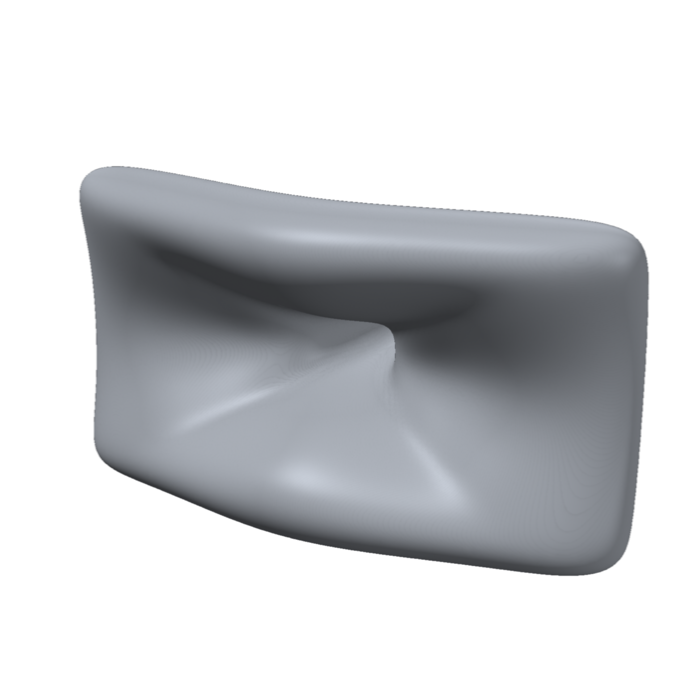
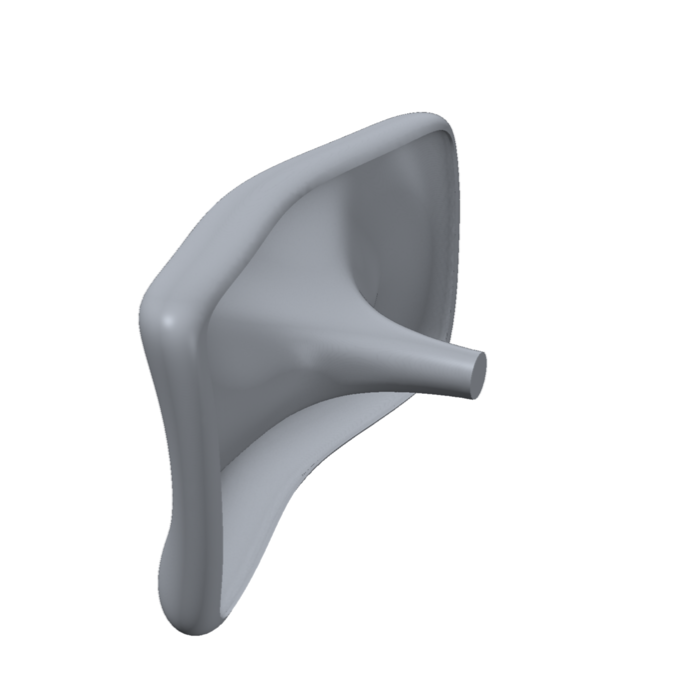
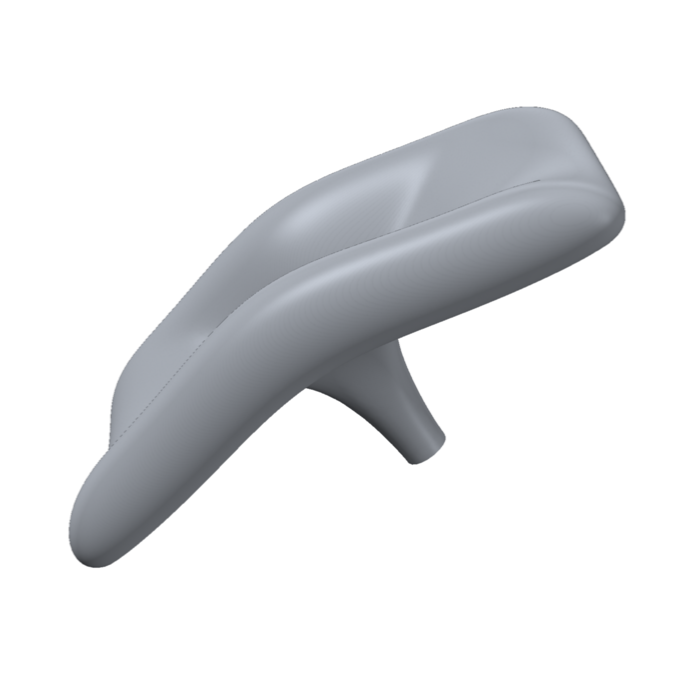

# Real spiral diagnostics — two calls only

Exact numeric provenance and raw paths: [SPIRAL_ACOUSTICS.json](SPIRAL_ACOUSTICS.json). Same physical design and solve hash, fixed surface sampling/frequencies/angular observations; spatial EPW6→8 only.4500→5277 DOFs, J29.915059→29.913599. Full search readiness and asymptotic convergence are not claimed.

Baseline before first job921MiB and before finer job is saved in spiral_acoustic_epw8_baseline.txt (desktop usage varied). WDDM process-tree monitors reported dedicated peaks330/348MiB and shared80/80MiB, no spill by the tool's threshold; these process-tree figures are not whole-GPU usage and should not be substituted for it. No general speed/VRAM-ceiling claim. Runtime wall54.016/50.125s includes cold start. Cleanup removed this pass's worker trees.

Fresh generated views from the EPW6 solved mesh:

[H/V sections of the matching seed](../img_biradial_crowe_2026-11-15/packet/sections_es_spiral.png). The sections show the original seed geometry; newly generated views above use this pass's actual solved mesh. All model/source limitations in READINESS.md apply.
