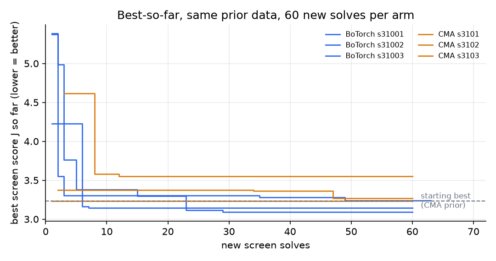
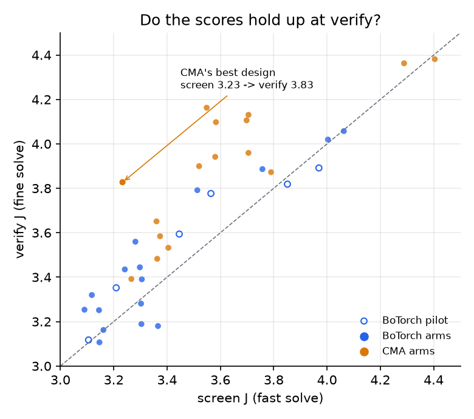
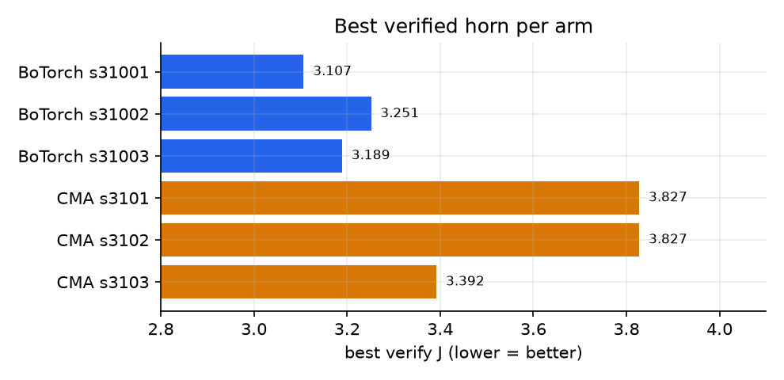
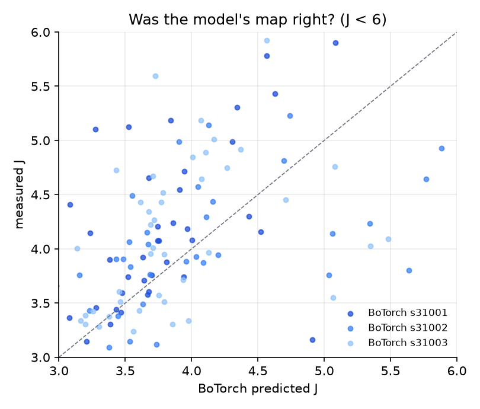
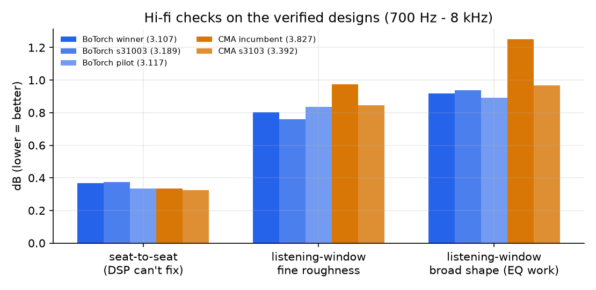
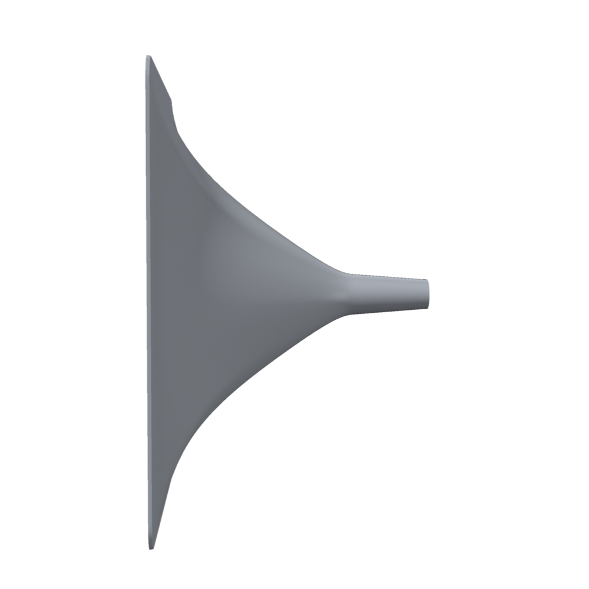
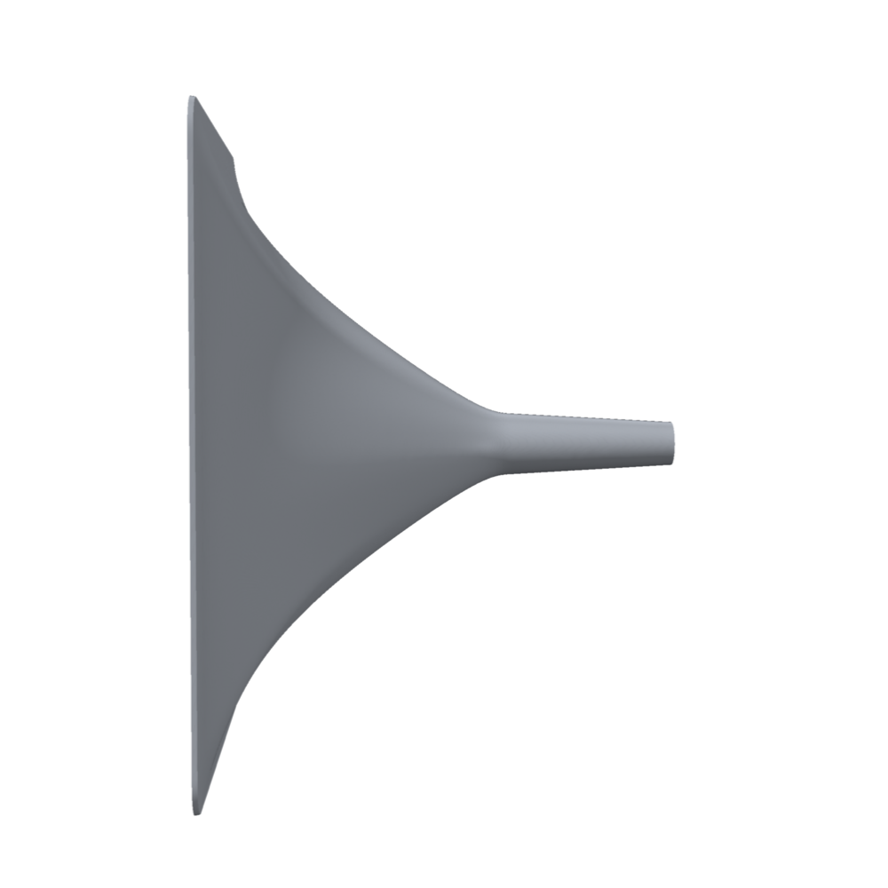

# BoTorch vs CMA-ES on the home horn — 15 Nov 2026

**Live page (interactive charts, light/dark):** https://llevaachingada.github.io/Hornfab/status/2026-11-15-bo-vs-cma/

Task: OSSE extended-throat home horn, brief `room_80x60_700_hf1440_v7` (objective v7; **lower J is better**).

## Verdict

**BoTorch wins under the pre-declared rule.** Median **verify** J 3.189 vs 3.827: a gap of 0.638, larger than both seed spreads (BoTorch 0.145, CMA 0.435).

| | |
|---|---|
| **3.107** | best verified horn (BoTorch s31001) |
| **0 / 3** | CMA arms that improved on their starting design in 60 solves |
| **+18 %** | how much worse CMA's best design scored when re-solved finer (screen 3.233 → verify 3.827) |
| **14–29 vs 0–3** | solves lost to "too large" refusals, CMA vs BoTorch |

## Setup

- **Same starting knowledge for both:** 185 solved designs from an earlier CMA run (best J 3.2328). BoTorch learns from all of them; CMA starts from the best one.
- **Equal budget:** 60 new screen solves + 6 verify solves per arm, 3 seeds per method, same GPU, solver pin and brief.
- **Methods:** BoTorch uses a Gaussian process (Matérn 5/2, per-knob length scales) + qLogNoisyExpectedImprovement over a 4096-design candidate pool that is pre-checked for size. CMA-ES uses σ₀ 0.15 from the prior best.

| Arm | best screen J | best verify J | solved / refused | solves to beat start | run |
|---|---:|---:|---:|---:|---|
| BoTorch s31001 | 3.146 | **3.107** | 60 / 0 | 6 | `study-f269f257b24e00f2` |
| BoTorch s31002 | 3.090 | **3.251** | 60 / 0 | 23 | `study-24b6cdf8614ff2bc` |
| BoTorch s31003 | 3.242 | **3.189** | 60 / 3 | never | `study-82b9e51a51d7325c` |
| CMA s3101 | 3.233 | **3.827** | 31 / 29 | never | `20261115T052416Z-screen-cdbc27` |
| CMA s3102 | 3.233 | **3.827** | 44 / 16 | never | `20261115T085601Z-screen-0c9c90` |
| CMA s3103 | 3.233 | **3.392** | 46 / 14 | never | `20261115T105220Z-screen-e0be04` |

## What BoTorch found

- **A shorter, steeper throat extension:** all three BoTorch arms converged on about 110–127 mm at 4.3–4.8°, against the incumbent's 172 mm at 3.2°.
- **Independent confirmation:** CMA arm 3's best verified design went to the same region (120 mm).
- **Coverage is similar:** about 66 × 68–71° (1–8 kHz).

## Deeper analysis (offline, no new solves)

**1. Do the scores hold up?** For every verified design, verify J against screen J:

| | designs | median drift at verify | worst drift | rank agreement screen↔verify |
|---|---:|---:|---:|---:|
| BoTorch | 24 | +3.4 % | +13.8 % | 0.86 |
| CMA | 18 | +9.4 % | +18.4 % | 0.76 |

BoTorch's picks survive the finer solve better: smaller drift, and the ranking holds.

**2. Was BoTorch's model right?**
- BoTorch's per-pick predictions were not logged, so I reconstructed them exactly: refit the same locked, deterministic model on the data it had before each pick, then predict that design.
- **Ranking: good.** Predicted and measured order agree at rank correlation 0.68–0.83 per arm, which is what drives its picks.
- **Accuracy near the best designs: decent.** For designs measuring J < 4.5, the typical error was 0.2–0.4.
- **Confidence intervals: not useful.** They are very wide (median 95 % width ≈ 4.6 J units), so 157/180 landing inside them tells us little. The model is honest but vague about absolute values.

**3. Hi-fi checks on the finer verify data** (CTA-2034-style listening window, 29 frequencies):

| design | verify J | seat-to-seat spread | listening-window roughness | broad shape (EQ work) |
|---|---:|---:|---:|---:|
| BoTorch winner `2ac988a2` | 3.107 | 0.37 dB | 0.80 dB | 0.92 dB |
| CMA incumbent `f6315ce4` | 3.827 | 0.33 dB | 0.97 dB | 1.25 dB |

- **Seat-to-seat consistency** (what DSP can't fix) is a tie: a 0.04 dB difference is far below audibility.
- **Listening window:** BoTorch's horn has the smoother response, with less fine roughness and less broad shape to EQ.
- So its J win doesn't come at the cost of hi-fi behaviour.

**4. The two horns** (side view; the throat is on the right):

| BoTorch winner (J 3.107 verify) | CMA incumbent (J 3.827 verify) |
|---|---|
|  |  |
| throat extension 114 mm at 4.3°, length 297 mm | throat extension 172 mm at 3.2°, length 310 mm |

Logging fix noted for the code: store each adaptive pick's prediction in the study journal, so this check doesn't need a replay next time.

## Caveats

- **Warm start from an already-optimized horn.** The shared prior was a finished 200-design CMA run, and its best design (J 3.2328) is where two independent CMA seeds had already converged. CMA restarted from that converged point with a small step (σ₀ 0.15), so it had little room left in that basin; BoTorch's global model could jump to a different basin. This test answers "which method improves an already-optimized design?", not "which searches better from scratch". A cold-start comparison is still to do.
- **Narrow test:** one task, objective v7 and 3 seeds per method, warm-started from CMA data. A cold start was not tested.
- **Speed:** a BoTorch step takes about 73 s against about 55 s for CMA, because of the model refit. The comparison counts solves, not wall time.
- **Next:** the TuRBO (trust-region) and Pareto (coverage × ripple) BoTorch modes, tested the same way.

Data: [`data.json`](data.json).
