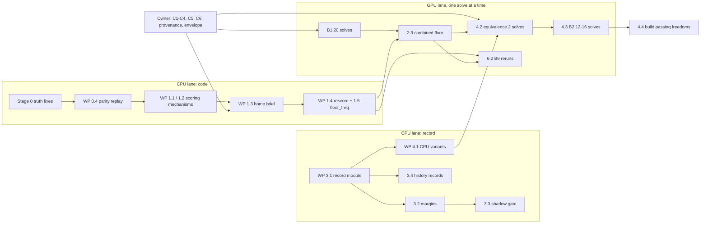

# ARCHITECTURE_AND_STAGED_PLAN_2026-11-17 - target architecture and the gate-driven plan

> **AUTHOR AND STATUS.** Senior (high-thinking) reviewer pass, picking up for Fable. Not the owner.
> HEAD at writing: `1d6ebc8`. This is the **architecture and staged plan** that handoff §7 reserved
> for a high-thinking model, built on the decisions in `FABLE_SENIOR_REVIEW_2026-11-17.md` (read
> that first for the reasons). It is **not yet the implementation plan**: §8 says exactly how each
> work package becomes a task file, and which ones are ready to be written now. Nothing here
> approves a solve, changes a brief, or edits code. Every GPU item is a proposal for the owner.

---

## 0. The architecture in one picture

```
  OWNER INTENT ──► BRIEF (versioned; declares envelope, source, band, intent: CD or profile,
                         corridor / target, constancy yes/no, dead bands)
                     │
  ┌──────────────────┴─────────────────────────────────────────────────────────┐
  │ GENERATORS (plural, unchanged in kind)                                     │
  │ OSSE · R-OSSE · ICW · FREEFORM · grid/rows · Crowe · Klangfilm · Le Cléac'h · CAD │
  │ recipe schema v2: termination kind, wall, resolved source cap, digests     │
  └──────────────────┬─────────────────────────────────────────────────────────┘
                     │ materialize (no mesh)
  ┌──────────────────▼──────────────────────┐   typed refusal for MEH / CAD / septa
  │ CANONICAL SURFACE RECORD (one, contract v2) │──────────────────────────────┐
  │ 65 stations x 61 azimuths, exact metadata   │                              │
  │  • validity + envelope gate (signed margins)│                              │
  │  • history rebuild check (record digest)    │                              │
  │  • freedom test bench (record edits)        │                              │
  └──────────────────┬──────────────────────┘                              │
                     │ mesh (existing routes; point-grid for record edits)        │
  ┌──────────────────▼──────────────────────┐                              │
  │ SOLVER  BEAT GPU / bempp CPU (unchanged)    │◄─────────────────────────────┘
  │ fidelity ladder: screen → verify → finalist │
  └──────────────────┬──────────────────────┘
                     │ physical_solve_id
  ┌──────────────────▼──────────────────────┐
  │ RESPONSE STORE (immutable; the real asset)  │
  └──────────────────┬──────────────────────┘
                     │ score (free, re-runnable, many identities)
  ┌──────────────────▼──────────────────────┐
  │ SCORING  v7 history · v9 corridor/target    │
  │ + opt-in constancy · dense-grid identity    │
  │ + noise floor published per identity        │
  └──────────────────┬──────────────────────┘
                     │
  ┌──────────────────▼──────────────────────┐
  │ SEARCH  inside one lane: CMA-ES builds rows,│
  │ BoTorch once ≥100 rows, seeds from history  │
  └──────────────────┬──────────────────────┘
                     │
  ┌──────────────────▼──────────────────────┐
  │ CAMPAIGN  queue · watchdog (safety net) ·   │
  │ protected list · humans approve changes     │
  └──────────────────┬──────────────────────┘
                     ▼
              DELIVERABLE  winner or menu (owner C4), verified, ties marked
```

**In plain words.** Many specialist horn makers; one common way to describe what they made; one
solver; responses kept forever; scores computed from responses as often as the intent changes;
search done family by family; people approve anything that changes the rules.

---

## 1. Design principles

| # | Principle | Evidence |
|---|---|---|
| P1 | **Plural generators, one description.** Families make horns; the record describes them | U1 (compact carrier fails), X1B/X4 (dense record passes 6/6, 55/55) |
| P2 | **Responses are the asset; scores are views.** Changing intent costs CPU, not GPU | `dataset/identity_v2.py` already separates solve, analysis, score; S1/N3 rescored 3,414 rows for free |
| P3 | **Intent is declared in the brief, never inferred from a family name** | Owner lock, v9 RFC Amendment A; knowledge hub (no silent CD scoring of non-CD horns) |
| P4 | **Compare only within one score identity, and only above its noise floor** | N3 (floor differs by identity), R4 (seed spread 0.57 of config gaps) |
| P5 | **A freedom earns code by measured authority** | Klangfilm Stage A (≤ 2.74°) vs Phase B (25-40°); U3 rule |
| P6 | **Provenance is checked on the geometry, not on code identity** | ROSSE validator-only lockout; lecleach and Klangfilm silent geometry drift |
| P7 | **Automation proposes; people decide** brief, envelope, objective, fidelity, bounds, policy | ADR D6, D9, D10; watchdog replay |
| P8 | **New behaviour is opt-in and additive**; historical J, rows, `config_sha` and score identity are never rewritten | v9 RFC; CLAUDE.md; `record.py:179-188` |

---

## 2. Layer by layer: today, target, and the change

| Layer | Today [verified at `1d6ebc8`] | Target | Change type | Main paths |
|---|---|---|---|---|
| **Brief and intent** | v7 point 80×50 home brief; v9 registered opt-in (corridor and target modes); smooth brief for non-CD lanes | Owner-chosen v9 home brief(s); constancy declared or absent; envelope convention named | New brief files only | `examples/briefs/**` |
| **Generators** | ~35 lanes over six engines; recipes lack termination kind, wall thickness, resolved source cap, and most lack any digest | Same generators; recipe schema v2; new freedoms only after stage 4 authority | Additive fields; new knobs behind new config versions | `hornlab_search/design/**`, `tools/geometry/**` |
| **Provenance** | `implementation_sha256` on some rows recipes, a code hash that a validator edit can break | Record digest (gate) + kernel digest (info); legacy bridges named per recipe era | New fields, new check | `design/generated.py`, `design/generators/registry.py`, recipe writers |
| **Canonical record** | Scratch samplers in `.x1/`, `.n1b/`, `.x4/` (validated, not packaged) | Packaged module, contract v2, per-route samplers, typed refusals, descriptors, signed margins | New module | proposed `hornlab_search/geometry/` (needs ownership assignment) |
| **Validity and envelope gate** | Per-route estimates; GRID max-radius estimate conservative on both axes; post-mesh envelope coded as geometry | One gate from record margins for every non-CAD route; outcome taxonomy fixed | Fix, then shadow, then switch | `search/evaluate.py`, `search/outcomes.py`, `design/generators/grid.py:2989` |
| **Mesh and solve** | Unchanged; screen 18 frequencies, verify 29 on the same mesh | Unchanged solver; explicit three-tier fidelity ladder with a finalist tier at 2× DOF | Config tiers | `solve/**`, budget profiles |
| **Response store** | Immutable, identity-gated | Unchanged | none | `dataset/**` |
| **Scoring** | v7 production; v9 registered; `objective/replay.py` dispatches ≤ v7 and regenerates DI with plain `compute_metrics` | Parity-exact replay for v7 and v9; opt-in constancy; dense-grid score identity; noise floor file per identity | Fix + additive | `objective/**`, `targets/**` |
| **Search** | CMA-ES, TuRBO, scalar BO, Pareto, QD; `bo/cohort.py` v4-only gate vs `bo/data.py` v7; `search.links` refuses generator blocks | Same optimizers; cohort gated by score identity; links for generator knobs; σ0/bound preflight | Fixes | `bo/**`, `search/links.py`, `search/cma.py` (untouched) |
| **Campaign** | Live-reload queue, watchdog with conflated bad-outcome flag, `best_J: null` on stops, restart can double-run done jobs | Same tools, fixed; protected list as data; noise-aware advisory rules after stage 2 | Fixes + data file | `tools/run_campaign_night.py`, `tools/night_queue/**` |
| **Deliverable** | Best-J per run; render skill layouts | Winner card or menu per C4, with verify tier and ties marked | Report | `hornlab_search/report/**`, render tools |
| **Excluded topologies** | MEH, CAD multicell/plughorn on their own routes | Record refuses with a typed reason; they share solver, store, scoring and reports | Typed refusal | record module |

---

## 3. Contracts between layers

| Contract | Content | Status |
|---|---|---|
| **Canonical record v2** | `CANONICAL_SURFACE_CONTRACT.md` §2-§9 as amended by §12: arc-length stations ≥ 65, azimuth step ≤ 1.5°, exact metadata, refinement / mesh-agreement (relative to native floor) / envelope-with-stated-cause / metadata / determinism tests | Validated geometrically; metadata blocked on recipe schema v2 |
| **Recipe schema v2** | Adds: termination kind; wall thickness; resolved source-cap radius, curvature, angle; `kernel_sha256`; `record_digest` (record at 65×61, float64, fixed byte order); bridge name for legacy recipes | To write (WP 0.9) |
| **Outcome taxonomy** | `invalid_envelope` with `stage: pre_mesh | post_mesh`; `invalid_geometry` only for true geometry faults; existing `mesh_too_large`, `solve_failed`, `metrics_failed` unchanged | To fix (WP 0.1) |
| **Score identity** | objective version + objective block (including constancy and score grid) + target hash + frequency support; rows from different identities never pooled or ranked together | Exists for version and blocks; score grid and constancy are new members |
| **Noise floor record** | Per score identity: frequency part (solved-grid residual at the top), mesh part (B1), combined floor; the report layer reads it and marks ties | New (WP 1.5, 2.3) |
| **Protected list** | Data file of lane IDs with the owner evidence line; queue tools refuse to drop or auto-stop them | New (WP 7.1) |

---

## 4. The staged plan

### 4.0 Overview

| Stage | Goal | GPU | Owner input needed | Depends on | Can start |
|---|---|---|---|---|---|
| **0 Truth fixes** | Make the numbers we already have mean what they say | 0 | provenance rule and envelope convention for WP 0.9 only | nothing | **now** |
| **1 Scoring and intent** | Score what the owner wants, on a grid that does not move the answer | 0 | C1-C3 values (C2 for WP 1.1) | WP 0.4 | mechanisms now; brief after C1-C3 |
| **2 Fidelity ladder** | Know how big a real difference is | B1: 20 | C6 approval | WP 1.2 for scoring (solves themselves do not wait) | B1 any time the GPU is free |
| **3 Record as a service** | One description for comparison, gating, history and experiments | 0 (CPU meshing for tests) | ownership of the new module | WP 0.9 for digests | **now** |
| **4 Structural freedoms** | Find which new freedoms move the beam, then build only those | 2 + 12-16 | host pick; C6 | WP 3.1, stage 2 floor | CPU part after WP 3.1 |
| **5 Parameter spaces** | Fewer refusals, no dead or rounded knobs | 0 | `--strict` σ0 gate for nights | WP 0.2, WP 3.3 | partly now |
| **6 Search within lanes** | Fair family comparison under the new scoring | B6: owner's choice | B6 budget | stages 1, 2, WP 0.3 | after stage 1 |
| **7 Campaign and deliverable** | The owner gets what C4 asks for, safely | 0 | C4, C5 | stage 2 | protected list now |
| **8 Excluded topologies** | Share data and reports, not search | 0 | none | WP 3.1 | with stage 3 |

**Production keeps running throughout.** Stages 0-3 change no running config, queue or default.
New identities are opt-in. Nights continue under v7 until the owner switches a brief.

### 4.1 Stage 0: truth fixes (no GPU)

| WP | What | Paths | Done when |
|---|---|---|---|
| 0.1 | **Outcome taxonomy.** Post-mesh envelope violations become `invalid_envelope` (`stage: post_mesh`), not `invalid_geometry`; a family error text `GeneratorError: invalid_envelope…` maps to `invalid_envelope` (today `evaluate.py:1562` tests `startswith("invalid_envelope")` on the prefixed string). New rows only; `infeasible_penalty: graded` becomes reachable for native families, so record that behaviour change per config | `search/evaluate.py`, `search/outcomes.py` | Offline tests for both paths; a CPU reclassification of the 2026-11-16/17 window from stored reason text, published as evidence |
| 0.2 | **`search.links` for generator blocks** (`search/links.py:36-37` raises today) | `search/links.py`, generator knob spaces | Offline test: a generator config with links searches the reduced dimension and reproduces the seed |
| 0.3 | **Cohort gate by score identity**, replacing `bo/cohort.py:96` (`objective_version != 4`) and reconciling with `bo/data.py` | `bo/cohort.py`, `bo/data.py` | Tests: same identity pools; different identity refuses with a named reason; existing v4 and v7 cohorts unchanged |
| 0.4 | **Parity-exact replay.** `objective/replay.py` dispatches v9 and uses the stored-DI (sin θ balloon) rule, not plain `compute_metrics` (`replay.py:694`); fold in `.tmp/fable_replay_harness.py` | `objective/replay.py`, tests | Stored J reproduced exactly on a fixture set (v7: the harness's 116-row check; v9: S1's verified rows) |
| 0.5 | **GRID extent false refusals (T4).** CPU-mesh N asymmetric knob vectors near the box; count `pre_mesh_refused AND post_mesh_admitted`. If > 0, make the estimate per plane (W from φ = 0, H from φ = 90°, plus wall) like the other routes | `design/generators/grid.py:2989`, `design/generated.py:210-221` | Evidence doc with the count; estimator fix with a regression test if the count is non-zero |
| 0.6 | **Night-runner restart idempotency.** Read `queue_state.json` `done` back on start | `tools/run_campaign_night.py:1246-1420` | Test: restart after a finished job does not rerun it |
| 0.7 | **Watchdog truth.** Recompute `best_J` from `search.ndjson` at stop; report outcome classes separately (use `search/outcomes.py` kinds); document or expose `pin_min_valid` / `pin_frac` / `pin_count` | `tools/run_campaign_night.py` | Replay of the 38 historical stops shows non-null `best_J` |
| 0.8 | **Documentation truths.** `tools/night_queue/queue.ps1:21-22` comment; `budget_counts` doc; `flat` ddof=2 vs `flat_cv` ddof=0 documented, not changed (historical J immutable); the `mode` enclosure-overwrite hazard (`EVIDENCE_LEDGER.md` E-012) guarded or documented | as listed | Doc diffs; a guard test if a guard is added |
| 0.9 | **Recipe schema v2 and provenance** (needs the owner's provenance and envelope decisions; the metadata fields do not). Add the fields in §3; write `record_digest` once WP 3.1 exists; name legacy bridges (`tools/geometry/klangfilm_lame.py` for the Klangfilm era, the pre-`a10e784` ROSSE validator) | recipe writers, `design/**` | T4 of contract v2 passes on the six contract lanes for new designs; legacy recipes classified rebuildable / bridge / unverified |

**Exit gate 0:** all WPs merged with offline tests green; T4 verdict published; refusal rates for
the current window recomputed under the corrected taxonomy.

### 4.2 Stage 1: scoring and intent (no GPU)

| WP | What | Paths | Done when |
|---|---|---|---|
| 1.1 | **Opt-in constancy term** in v9, following the `hf_floor` precedent: `objective.constancy: {mode: strict \| slope, slope_max_deg_per_decade, weight, tolerance}`, absent by default. Part of the score identity. No family-name path can switch it on. Entry: C2 is strict or slope-limited; `hornlab-typology-research` gate satisfied by citing `SCORING_RANGE_PROPOSAL.md`, `S1_RANGE_SCORING.md` and the v9 RFC | `objective/scalar_v9.py`, `config.py` validator, tests | Absent ⇒ J identical to 1e-12 on fixtures (G11-style); declared ⇒ its own reported term reproducing S1's strict/slope numbers on S1's verified rows |
| 1.2 | **Dense-grid score identity**: `objective.score_grid: {kind: dense_log, points: 58 \| 116, interp: pchip_logf}` opt-in; 116 when constancy is declared (N3) | `objective/**`, `metrics/**` | Reproduces N3's 58→116 and A4's v7 numbers on the 58 study pairs |
| 1.3 | **New home brief file(s)** with the owner's C1, C2, C3 (and ripple-window) values; existing briefs untouched | `examples/briefs/**` | Brief validates; scoring-view and GUI corridor display match the scorer (existing G13 test) |
| 1.4 | **Rescore history** under the new identity (free) and publish per-lane bests | uses WP 0.4; evidence doc | Every stored home-brief response scored; exclusions counted |
| 1.5 | **Frequency part of the noise floor** for the new identity (N3 method: 18 vs 29 solved residual at the top) | evidence doc | Floor value written to the noise-floor record |

**Exit gate 1:** the identity is registered and tested; history is rescored; the frequency part of
the floor is published. Production default is still v7 until the owner switches.

### 4.3 Stage 2: fidelity ladder (B1, 20 solves)

| WP | What | Done when |
|---|---|---|
| 2.1 | **Three tiers in config**: screen (18 frequencies, screen DOF cap), verify (≥ 29 frequencies, same mesh), finalist (≥ 29 frequencies, 2× DOF cap). Reuse budget profiles; add the finalist tier if absent | Tier names resolve in config; offline test |
| 2.2 | **B1**: ten designs chosen per SD-7 (union of v7 top five and v9-placeholder top five), each at screen cap and 2× cap, ≥ 29 frequencies. Run with `hornlab-gpu-job`; write with `hornlab-evidence` | 20 solves, evidence doc with baseline and peak VRAM |
| 2.3 | **Publish the combined floor** per identity, `sqrt(freq² + mesh²)`; the report layer marks rank gaps below it as ties | Noise-floor record complete; report shows ties |

**Exit gate 2 and tripwire:** floor published. If the mesh part is comparable to the gaps between
leading designs, every ranking is re-examined and finalists default to the 2× tier (handoff §8).

### 4.4 Stage 3: the canonical record as a service (CPU)

| WP | What | Done when |
|---|---|---|
| 3.1 | **Package the sampler**: contract v2 record from each non-CAD route without meshing; typed refusals for MEH, CAD, septa, self-intersection; ported from the validated `.n1b/` and `.x4/` code | Determinism and refinement tests offline; mesh-agreement test marked (mesher); six contract lanes pass |
| 3.2 | **Descriptors and signed margins** (contract §7): size, along-wall curves, section area/aspect/shape index, termination, envelope/throat/gap/curvature margins | Offline tests on fixtures |
| 3.3 | **Gate in shadow mode**: compute record margins next to the current per-route gate for every new design; log disagreements; switch only after ≥ 200 designs with zero record-admitted designs that the mesh then refuses | Shadow report; switch is an owner-visible change |
| 3.4 | **History records** for all ~3,414 home-brief designs (A12, about 1 h CPU) with rebuild status from WP 0.9 | Dataset of records; counts per status |
| 3.5 | *Optional research:* section-aware H-plane transfer retest (A12 second half). Informs only the SD-5 reopen condition | Evidence doc; no code consequence unless it passes |

**Exit gate 3:** module tested and owned; history classified; shadow gate report available.

### 4.5 Stage 4: structural freedoms (test, then build)

| WP | What | GPU | Done when |
|---|---|---|---|
| 4.1 | **CPU variants** as record edits on two candidate hosts (best `ext_throat_hvlaw_v7`, best `biradial_es_style_v7`): vertical timing ×2, termination split ×2, section steering ×2, diagonal pull ×1. U2 validity checks; meshability through the point-grid route; ≥ 5 mm RMS change outside the last 5 % of wall | 0 | Validity tables and overlays for both hosts; owner picks one host |
| 4.2 | **Record-route equivalence**: the unmodified record of the chosen host, meshed via point grid, solved, compared with the stored response. Predeclared pass: mean beamwidth within 1° per band in both planes and ΔJ within the stage-2 floor | 2 | Pass, or B2 stops (senior review §7) |
| 4.3 | **B2**: control, repeat, seven variants, dense-grid identity. Authority rule unchanged from U3 (≥ 3° intended plane, other plane < half) | 12-16 | Authority table per freedom |
| 4.4 | **Build only what passed**, inside the specialist whose construction carries it (template: Klangfilm H/V core). `hornlab-typology-research` first, `hornlab-shape-check` before any GPU, new config version, never retrofitted | 0 here | One implementation proposal per passing freedom, or a written "inert in this envelope" finding |

**Exit gate 4:** authority table published. If every freedom is inert, effort moves to the owner's
envelope and intent decisions; if two or more pass across constructions, SD-3 is evaluated.

### 4.6 Stage 5: parameter spaces (CPU, ongoing)

| WP | What | Done when |
|---|---|---|
| 5.1 | **Space card per active lane** from X4/A8 labels and `tools/analysis/walls.py`: fix, link (WP 0.2), re-bound | Card per lane in the lane's config folder |
| 5.2 | **Categoricals become lanes**: `morph_target`, ICW `termination` and similar are split into configs, not rounded inside a continuous box (`design/families.py:73`, `design/space.py:148-152`) | No categorical in any searched continuous box |
| 5.3 | **σ0 and bound preflight** as standard (already in `hornlab-search-economy`); `--strict` for nights if the owner agrees | Preflight output attached to every queued job |
| 5.4 | **Bounds as record constraints** once WP 3.3 has switched: refusal margins become signed values, so graded penalties and margin-aware boxes are possible | Refusal rate per lane tracked against the stage-0 baseline |

### 4.7 Stage 6: search within lanes

| WP | What | GPU | Done when |
|---|---|---|---|
| 6.1 | **Rescored history as BoTorch rows** inside each lane under the new identity (needs WP 0.3, WP 1.4; frequency support must match) | 0 | Cohort probe shows ≥ 100 rows for each lane meant for BoTorch |
| 6.2 | **B6 matched-budget reruns** of the leading constructions under the new identity: equal valid-row budgets, 2-3 seeds each (R4: seed spread is 0.57 of config gaps) | owner's choice | Lane comparison with ties marked by the stage-2 floor |
| 6.3 | **Finalists** to the verify or finalist tier | small | Finalist table |

### 4.8 Stage 7: campaign and deliverable

| WP | What | Done when |
|---|---|---|
| 7.1 | **Protected list as data** (owner-confirmed C5), read by queue and night tools; they refuse to drop or auto-stop a protected lane | Test: a queue edit removing a protected lane is refused with the evidence line |
| 7.2 | **Noise-aware watchdog rules** as advisory output only, after stage 2 | Advisory lines in night reports; no automatic action |
| 7.3 | **Lane-ordering proposals** in night reports (read-only, from rescored history) | Present in report |
| 7.4 | **Deliverable per C4**: winner card, or a menu spread across the corridor and size, each verified, ties marked | Owner sign-off |

### 4.9 Stage 8: excluded topologies

MEH, CAD multicell and plughorn, septa and phase plugs: the record returns a typed refusal; they
keep their own generation routes and share the solver, response store, scoring, noise floor and
reports. No search-space or model sharing.

---

## 5. Order of work and parallel lanes



- **Ready now with no owner input:** all of stage 0 except WP 0.9's digest rule; WP 1.2; WP 3.1-3.2.
- **Critical path to the first trustworthy campaign under new scoring:** WP 0.4 → WP 1.1/1.2 →
  owner C1-C3 → WP 1.3 → WP 1.4 → B1 → WP 2.3 → B6.
- **Critical path for geometry:** WP 3.1 → WP 4.1 → owner host pick → WP 4.2 → WP 4.3 → WP 4.4.

---

## 6. GPU budget

| Item | Solves | Decides |
|---|---|---|
| B1 mesh fidelity at the top | 20 | Mesh part of the noise floor; trust in top rankings |
| Record-route equivalence | 2 | Whether record edits are a valid acoustic test bench |
| B2 structural freedoms | 12-16 | Which freedoms get built |
| B6 matched reruns | owner's choice | Fair family comparison under the new scoring |
| **Total before B6** | **34-38** | Less than one overnight optimizer arm |

Withdrawn: B3 (22), B5 (4). Not now: B4 (40).

---

## 7. Invariants for every work package

1. Historical J, stored rows, `config_sha`, score identity and record bytes are never rewritten.
2. New behaviour is opt-in; production defaults change only by an owner decision.
3. No scorer, loader or gate selects behaviour from a family or geometry name.
4. Every horn number is a YAML default in `examples/`, never hardcoded.
5. The three silent killers hold: `mesh_scale=1.0`; quadrants and symmetry from one source;
   `MetricSet.di_source == "balloon"` for any checkpoint.
6. GPU hygiene per CLAUDE.md and `hornlab-gpu-job`: one CUDA solve at a time, clean state before
   any measurement, baseline with every peak.
7. J is never compared across score identities; rank gaps below the published floor are ties.
8. Protected families are never cut or stopped by automation.
9. Any solver or mesher change goes through the pinned forks (`docs/FORKS.md`); none is expected,
   because the point-grid route already exists.
10. Every push updates `docs/CONTINUITY.md` and `docs/ISSUES.md`; a new doc or module gets a line
    in `docs/INDEX.md` / `docs/CODE_MAP.md` in the same commit.

---

## 8. Turning this into the implementation plan

### 8.1 Task-file template (one per WP)

```
ID / stage / title
Goal (one sentence, the user-visible effect)
Owned paths (CLAUDE.md ownership table; paths not listed there need orchestrator assignment)
Inputs (evidence files, fixtures, stored runs)
Behaviour change (what changes for new rows; what is guaranteed unchanged)
Invariants touched (§7 numbers)
Acceptance (named offline tests; marked GPU/mesher tests; evidence doc if any)
GPU budget (0 or the approved count)
Skills (gpu-job, evidence, shape-check, typology-research, search-economy as applicable)
Docs to update (CONTINUITY, ISSUES, INDEX/CODE_MAP)
Rollback (how to turn it off: opt-in key absent, config version not used)
```

### 8.2 Readiness

| WP | Ready to write as a task file? | Blocked by |
|---|---|---|
| 0.1-0.8 | **Yes** | nothing |
| 0.9 | Metadata fields yes; digest rule after owner | provenance and envelope decisions |
| 1.1 | Mechanism yes; enable after owner | C2 |
| 1.2 | **Yes** | nothing |
| 1.3-1.5 | No | C1, C2, C3 (+ ripple window); WP 0.4 |
| 2.1 | **Yes** | nothing |
| 2.2 | Yes, as a GPU proposal | C6 approval |
| 2.3 | After B1 | B1 |
| 3.1-3.2 | **Yes** | ownership of the new module path |
| 3.3-3.4 | After 3.1 | WP 3.1, WP 0.9 for digests |
| 4.1 | After 3.1 | WP 3.1 |
| 4.2-4.3 | Yes, as GPU proposals | host pick, C6, stage-2 floor |
| 4.4 | Per passing freedom | B2 result |
| 5.1-5.3 | **Yes** | WP 0.2 for links |
| 5.4 | After 3.3 | shadow gate switch |
| 6.x | After stage 1 | stage 1, B6 budget |
| 7.1 | After C5 | C5 |
| 7.2-7.4 | After stage 2 / C4 | floor, C4 |

### 8.3 Who should write which part

The stage 0 and 2.1 task files are mechanical and can be written by a lower-cost agent from this
document. WP 1.1, 3.1 and 4.1 involve contract and research judgement and should be written or
reviewed by a high-thinking pass. Stage 4.4 needs the typology-research protocol per freedom.

---

## 9. Parked items and their reopen conditions

| Item | Reopen when |
|---|---|
| Unified backbone (U1-bis) | B2 finds ≥ 2 freedoms with authority across constructions and per-family cost exceeds a shared carrier; parameter cap ≤ 14 predeclared |
| Cross-family predictor / response model | An unbiased pool exists (B4 or an atlas-cohort check) and a section-aware descriptor passes H ≥ 0.6 held-out |
| Supervisor acting on J | Stage 2 floor published and an equal-information, predeclared experiment is affordable |
| Quality-diversity-first | A goal-distance descriptor exists and archived elites survive verify |
| Oversize exploration | Owner approves a versioned exploratory brief; T4 shows the refusals are real; re-optimise at the HF1440 throat |
| Frequency staging | A better abandon rule shown on stored data first |
| Constrained freeform / adjoint | An adjoint exists for the solver fork (ADR D8) |

---

## 10. Implementation status (2026-11-17, senior pass + two Sonnet helper lanes)

All on branch `ccr-260b4b76-fi6b8j` (PR #67). Every item is opt-in or additive; no stored row,
identity or production default changed. "Needs Windows" = needs `runs/`, the GPU, or both.

| WP | Status | Where | Needs Windows / owner |
|---|---|---|---|
| 0.1 refusal taxonomy | **done** | `search/evaluate.py` | real-run reclassification report |
| 0.2 generator links | **done** | `search/links.py`, `design/generated.py` | none |
| 0.3 cohort by identity | **done** (helper) | `bo/cohort.py` | none |
| 0.4 parity replay + v9 | **done** | `objective/replay.py` | parity check on stored v9 rows |
| 0.5 GRID extent | **done**: 3/3 → 1/64 false refusals, 0 misses | `design/generators/grid.py`, `.t4/` | none (no home lane uses the route) |
| 0.6 restart idempotency | **done** (helper) | `tools/run_campaign_night.py` | none |
| 0.7 watchdog truth | **done** (helper); pin_* exposure open | same | replay of 38 stops |
| 0.8 doc truths + E-012 guard | **done** (helper) | `queue.ps1`, `docs/reference/`, `design/families.py` | none |
| 0.9 recipe metadata | **partly**: termination/wall/source-cap block (helper); digests wait for owner | `design/recipe_meta.py` | provenance rule (owner) |
| 1.1 constancy term | **done** (mechanism, off by default) | `objective/scalar_v9.py` | C2 decides use |
| 1.2 dense-grid identity | **done** | `metrics/dense_grid.py` | none |
| 1.3 home brief | open | - | C1-C3 |
| 1.4/1.5 rescore + floor | **tool done** | `tools/analysis/rescore_identity.py` | run on `runs/` |
| 2.1 fidelity tiers | helper lane in progress | - | - |
| 2.2 B1 | open | - | 20 solves (C6) |
| 3.1/3.2 record module | **done** | `geometry/record.py` | module ownership |
| 3.3/3.4 shadow gate + history records | **tool done** | `tools/analysis/record_shadow.py` | run on `runs/` |
| 4.1 U3 CPU stage | **done** on a biradial seed (8/8 mesh; 3/7 reach ≥ 5 mm) | `geometry/edits.py` | best stored designs |
| 4.2/4.3 | **runnable**: record body, job writer, predeclared rules | `record_body.py`, `u3_jobs.py`, `u3_authority.py` | 2 + 12-16 solves (C6) |
| 5.2 categoricals | **warning done**; 5 shipped configs flagged | `config.py` | split configs (owner) |
| 6.1 BoTorch on rescored history | open: `offline_scores` is ATH/v4-specific | `tools/analysis/offline_scores.py` | after 1.3 |
| 7.1 protected lanes | **done**; list `status: proposed` | `examples/protected_lanes.yaml`, runner | C5 |
| Driver | **done** | `tools/analysis/senior_plan_evidence.py` | one command on Windows |

Environment note: the container lacked `libGLU`, so gmsh could not load; installing it made the
real mesher tests runnable here. Pre-existing failures confirmed at `1d6ebc8`, not caused by this
work: `test_grid_self_approach_classifies_invalid_geometry_and_is_memoized` and two
`test_gui_preview_shape` tests.

### 10.1 Plan amendments (2026-11-18, orchestrator per senior direction evening 2026-11-17 — proposals, nothing auto-applies)

Owner context: the §4 owner answers arrived 2026-11-17 evening (see
`OWNER_DECISIONS_PACKET_2026-11-17.md` §D4-marking and below); the GPU-scheduling answer changed:
**B1 goes into the live night as a job** (senior D7 supersedes the first review's "wait for drain").

- **D5 — merge the two plans into one table (proposal).** Fable's staged plan vs the owner's
  acoustic-truth master plan (`docs/research/HORNFAB_ACOUSTIC_TRUTH_MASTER_PLAN_2026-11-17.md`):
  adopt the master plan as the owner's source document (outranks where they conflict; nothing in
  it contradicts this plan's stage order). One mapping table so no agent re-does WP3/N3 work:
  Fable 0.4 parity replay + 1.4 rescore = master-plan WP3 use 1 (one tool, `replay_run_dir`);
  1.5 frequency floor = WP3 use 3 (measured twice: N3 + WP3 — cite, never re-measure); 1.3 home
  brief = WP5 menu (the WP3 offline briefing candidates); 0.9 recipe schema/provenance + Q5
  envelope = WP4 (do once, with D9); 3.1 record / X1 mesh agreement = WP1 template, next on a
  cornered family (X1/X4 corner mismatch is open: superellipse route clean at p99 0.11-0.13 mm,
  cornered families 1.1-1.6 mm); 2.2 B1 + 4.2/4.3 = WP6 pilot (owner-gated GPU, B1 first).
- **D6 — "Stage 2b: physical anchor" (owner-approved 2026-11-17 answer 4; upgrade from
  proposal to scheduled):** two steps, owner-gated per step. Step 1 (now, no build): one
  published horn (Geddes OSSE or ATH waveguide with published geometry AND measured polars)
  through the full pipeline; pass = beamwidth ± 5° (± 3° in the presence band), DI ± 1 dB;
  cost 1-2 solves + research. Step 2 (after B1): print and measure 1-2 finalists —
  ext-throat `3a1038da45d0` if B1 confirms its lead, plus the top v9-score design if a different
  construction, else fold-warm OSSE (v9 3.62); measuring two horns ~0.5 J apart ties J
  differences to a real horn and settles the scoring question with data. Sits before B6.
- **D7 — B1 scheduling (as directed, now owner-specified):** B1 is a live-night job AFTER the
  BO arms. **Owner encoding decision 2026-11-18:** B1 must test MESH convergence — same ten
  designs, same brief/objective/source/mounting, SAME frequency grid as each design's reference
  solve; refinement = higher epw and/or tighter throat/mouth/rear resolution; report realized
  triangle/DOF counts for both meshes; pass/fail per design is |ΔJ| + per-term deltas (H/V
  beamwidth, DI, ripple) against the numerical floor, designs whose shift exceeds the
  finalists' claimed gains flagged "mesh-sensitive"; before queuing, estimate refined DOF per
  design (quarter/half where symmetry is genuine); designs that do not fit 8 GB are marked
  "mesh check infeasible on this card" with the estimated DOF and left out of the conclusion;
  memwatch + VRAM baseline/peak + sysmem Shared-Usage check mandatory; a spilled run is invalid,
  not a result. The frequency-grid pair encoding is renamed **B1f** ("frequency-fidelity check")
  and never read as mesh convergence. Order: encoder + CPU dry-run (build both meshes, ten
  designs, no solves) → feasibility table → owner approves GPU slots → queue after the BO arms.
- **D8 — continuation rule (advisory, for WP 7.2/7.3):** propose a continuation only when the
  lane's last-100-evaluation improvement exceeds that identity's published frequency floor
  (≈ 0.13 J for v7 at 12/25 frequencies; restate once B1 lands). Worked example = tonight's
  numbers [measured 2026-11-17]: three lanes beat the floor (ath_core14 +0.38-0.45, hvlaw_cov,
  lecleach_ar), biradial +0.16 gained but under floor, corelaw and warm-c221aa found nothing.
- **D9 — provenance in one package (proposal):** WP 0.9 metadata + the C3 `surfaceFit` echo
  into `mesh_meta.json` (`hornlab_search/mesh/build.py:440-458` currently echoes only midPorts;
  the mesher's interpolating→approximating fit fallback at `config_builder.py:2304-2320` is
  unrecorded — one run can mix two wall surfaces with no row-level flag) + the Q5
  "record both boxes" rule + master-plan WP4 = ONE work item. `record_digest` only after the
  owner's provenance decision.
- **D10 — governance (proposal):** nights should run `main` (owner amendment 2026-11-12). After
  the drain: full offline suite (thread caps, `-n 6`), then ask the owner to merge PR #67.
  One integrator per branch: `f5db35e` AND `3682173` were second-writer commits — record in
  `NOTES_FOR_SENIOR.md` and ask the owner who integrates master-plan work from now on
  (owner 2026-11-18: an independent throat-H/V patch set, 4 patches rebased onto `3682173`,
  waits for integration AFTER this branch's commit/push + post-drain suite; the GPU throat
  steps queue after B1 + the BO arms as a separate budget line; not to be applied by the
  orchestrator beyond the isolated-clone CPU test run).

Status deltas to the table above (2026-11-18): 2.1 finalist tier — wired in CLI/GUI
(`--mode finalist`); **B1-encoding finding: `dof_cap_finalist` does not densify the mesh for
these configs (epw/f_max unchanged, cap not binding) — the tier changes frequency grids only**;
2.2 B1 — in D7 above; 1.3 — owner answered: keep v7 for nights, add v9 as a free second CPU
score (H 60-90° from 700 Hz, V 40-60° from 1000 Hz, loading on, slope-limited constancy with
its noise floor measured on stored data before it counts); 3.3/3.4 — data-agreement gate now
"unknown"/`unconfirmed (n=…)` for n < 10 (C2, tools/analysis/space_card.py, uncommitted);
0.6/0.7/3.2 — night-truth fields landed in tools (C1, uncommitted); D4 evidence: shape check
9/14 (the 5 bridge-type `_w1` lanes fail the STOCK `DesignSpace`/`shape_check` path — the night
jobs now run their bridge CLIs, see `runs/nights/cd_rrect_2026-11-17/held_and_edited_2026-11-18.md`);
search_preflight `--from-runs` still refuses history on every loadable lane (raw brief_file
string identity — C5 remains the owner-gated fix), `hl__klangfilm_lame_curved_v1_c200_w1` adds
`no_headroom`.
